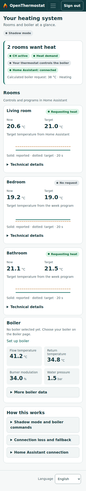
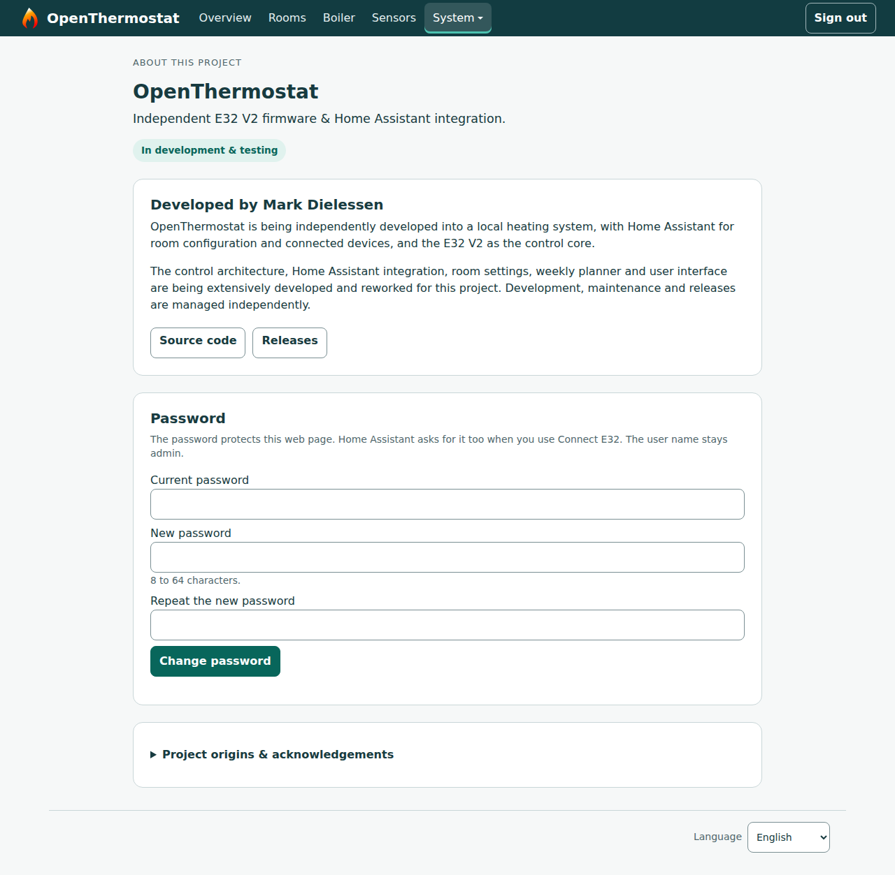

# OpenThermostat

Local, open source heating software for **rooms, week programs, Bluetooth
thermometers and EMS boiler diagnostics** on a BBQKees E32 V2 gateway, with an
optional Home Assistant integration. Developed independently by **Mark
Dielessen**.

The room plan lives on the E32 and runs without Home Assistant. Every 10
seconds the E32 reads each room's temperature sources (Bluetooth sensors it
receives itself, or Home Assistant entities such as a thermostat), follows the
room's target or week program in its own time zone, and calculates a boiler
request. Without Home Assistant everything is set up on the E32 itself.

**E32 beta.20 runs this in shadow mode.** The E32 calculates its boiler
request, learns how each room warms up and, where a thermostat controls the
boiler over EMS, compares its decisions with it. It does not send that
request.
Active boiler control is built into beta.20 but stays switched off in the
firmware until an attended switch-over with failure tests.

## Requirements

**Always needed**

- A **BBQKees E32 V2** gateway (ESP32, 16 MB flash, PSRAM). Releases are built
  for this board only.
- An **EMS Classic (EMS 1.0) boiler** on the E32's EMS connection, directly or
  through an adapter such as the Bosch EasyControl Adapter. EMS+ (EMS 2.0)
  boilers are not supported yet; EMS+ is planned for version 1.1.
- A local network: **2.4 GHz Wi-Fi** or Ethernet.
- A phone or computer with a browser for the first setup (the E32 opens its
  own setup Wi-Fi network `OpenThermostat-xxxxxx`).
- At least one **temperature source per room**: a supported Bluetooth
  thermometer, or a Home Assistant temperature entity.

**For the Home Assistant integration (optional)**

- **Home Assistant 2026.10.0 or newer** (tested with 2026.10.2 to 2026.10.4).
- An **MQTT broker**, for example the Mosquitto broker add-on, and Home
  Assistant's **MQTT integration**. MQTT carries all live values (rooms, heat
  request, boiler, Bluetooth sensors, advice) and the values of Home Assistant
  sources and energy inputs. Without MQTT these entities stay unavailable.
- A **broker user name and password for the E32**: the E32 does not connect
  to Home Assistant through a broker without a login.
- The integration is installed by hand from the release ZIP (copy
  `custom_components/open_thermostat`); it is not in HACS yet.
- No room in Home Assistant: rooms live on the E32 and are managed under
  Configure → Rooms after connecting.
- The E32's address and web password, entered once in the integration. Room
  editing and firmware updates use them over HTTP.
- Internet access for Home Assistant, to download firmware updates from
  GitHub. Updates appear under Settings → Updates and install with one click,
  as with ESPHome devices; the ESPHome integration itself is not needed.

**Optional**

- Supported Bluetooth thermometers: Shelly BLU H&T Display ZB, Xiaomi Monitor 3
  (MJWSD05MMC, with bindkey) or thermometers with pvvx firmware.
- In Home Assistant: a gas meter, a gas price, an outdoor temperature sensor or
  weather entity, and your boiler's power, for energy estimates and advice.
- A USB-C data cable, for the first installation and for a password reset.

**Not needed:** Home Assistant itself (rooms, week programs and Bluetooth
sensors work on the E32 alone), a P1 meter, a cloud account or a permanent
internet connection.

[Downloads](https://github.com/dielessen/open_thermostat/releases) ·
[Requirements](#requirements) · [Installation guide](docs/INSTALL.md) · [User guide](docs/USER-GUIDE.md) · [Features](#features) ·
[Roadmap](#roadmap) · [Screenshots](#screenshots) ·
[Installation](#installation) · [Documentation](#documentation)

<!-- openthermostat-readme-releases:start -->

## Latest published releases

| Component | Version | Channel |
| --- | --- | --- |
| E32 V2 firmware | [v0.1.0-e32v2-beta.21](https://github.com/dielessen/open_thermostat/releases/tag/v0.1.0-e32v2-beta.21) | Pre-release |
| Home Assistant integration | [0.4.0b13](https://github.com/dielessen/open_thermostat/releases/tag/ha-v0.4.0b13) | Pre-release |

Firmware and the HA integration are separate downloads. Read each release’s
changes, compatibility notes and installation instructions before updating.

To build the published E32 firmware, start from its exact tag:

```sh
git clone --branch v0.1.0-e32v2-beta.21 https://github.com/dielessen/open_thermostat.git
```

<!-- openthermostat-readme-releases:end -->

## What's new in E32 beta.19 + HA 0.4.0b11

Install both together if you use Home Assistant. The E32 now sends small MQTT
topics with a heartbeat, so HA 0.4.0b10 does not understand beta.19 and HA
0.4.0b11 does not understand beta.18. Update the integration first, then the
E32 from its Firmware entity in Home Assistant.

**New**

- **Comfort on top of the week program:** a temporary target or boost (until
  the next switch point or for a set time), away or holiday until a date, and
  a pause while a window or door is open. Each ends by itself, also after a
  restart. On the E32 Overview and in Home Assistant, where every E32 room
  now has its own thermostat (climate entity).
- **Visual week planner** per room, on the E32 Rooms page and as a view of
  the Home Assistant dashboard: comfort, night and away levels, templates,
  copy a day, drag the block edges.
- **24-hour charts on the E32**, also without Home Assistant: temperature and
  target per room, flow, return and burner.
- **Flow temperature options**, all off by default: a weather curve from an
  outdoor temperature, using the learned lowest flow, and gas calibration
  from a real gas meter.
- **Backup and restore** of the E32 settings (Settings → Backup and restore),
  with keys only included, encrypted, when you set a passphrase.
- **Boiler profile:** the E32 learns which values your boiler reports, so
  Home Assistant only creates those. The E32 also reads the boiler's own
  maximum heating temperature itself.
- **Home Assistant:** no starter room needed, one group per room, safe
  removal of the old Home Assistant room, a redesigned dashboard, gas for
  heating and hot water in the Energy dashboard, a weekly advice blueprint,
  a diagnostics download without secrets, and a complete Polish translation.
- **Updates through Home Assistant are the official route:** the Firmware
  entity checks GitHub's SHA-256, the size and the version marker before it
  uploads, and records the install.
- **Our own name:** OpenThermostat in Home Assistant and MQTT discovery.
- **Active control, prepared and locked:** the "thermostat disconnected"
  confirmation now survives a restart (never a firmware change), heat resumes
  only after 2 minutes of listening, and the supervisor holds back restarts
  while the E32 owns the boiler. A firmware gate keeps all of this switched
  off in beta.19.

**Fixed**

- A steady link to Home Assistant: the E32 queues and merges its messages and
  only drops the connection after 15 seconds without progress (beta.18
  dropped it several times an hour).
- More room in flash: the web interface is stored compressed only (93 % → 76 %).
- Duplicate boiler entities for the same value are merged; history is kept.

[User guide](docs/USER-GUIDE.md) ·
[Firmware release notes](docs/modern-thermostat/RELEASE-NOTES.md) ·
[HA release notes](docs/modern-thermostat/HA-RELEASE-NOTES.md)

## Features

**Available** means delivered for the stated use. **Shadow** means it runs on
the E32 and is reported, but nothing is sent to the boiler or valves.
**Prepared** means code exists but the user flow, device connection or physical
acceptance is still open. **Planned** means further implementation or
qualification is required.

### Rooms and heating

| Feature | Current status |
| --- | --- |
| Room plan on the E32 | **Shadow:** up to 8 rooms, each active, inactive or inactive until a date, with heating type (radiators or floor) and up to four temperature sources in order. The first fresh source leads, the others are fallback. With no usable source the room keeps its last value for 30 minutes, then stops asking for heat. Large week programs are stored in a compact form, so 8 rooms with four switch points a day fit. |
| Where rooms are edited | **Available:** without Home Assistant on the E32 Rooms page. With Home Assistant its room editor is the one place to edit; the E32 Rooms page is then read-only with "Edit here anyway" as a fallback. Both work on the same plan with a revision number, so neither side silently overwrites a newer change. |
| Target temperature and week program | **Shadow:** every room runs its own week program on the E32 (up to six switch points a day), starting from a "Workdays and weekend" template. An optional setting device per room (a radiator valve, a thermostat such as tado, or a number in Home Assistant) is set to the program's temperature at every switch point; turning it is an override until the next switch point. Without a valid clock a room keeps its temperature without Home Assistant. Night setback and morning warm-up continue when HA is away. |
| Time zone | **Available:** week programs and daily figures run in the E32's own time zone (any POSIX time zone with its summer-time rule). |
| Boiler request | **Shadow:** the flow temperature follows the largest room shortfall between the flow limits (default 30–60 °C; the maximum can be set up to 80 °C), with five-minute minimum burner on and off times. The limits are set in Home Assistant or on the E32; the boiler's own maximum heating temperature always stays the ceiling. |
| Comparison with your thermostat | **Available** where a thermostat controls the boiler over EMS: heating time, burner starts, flow range and start timing of the E32 decision next to the thermostat's actual request: today and the last seven days on the E32 Rooms page, today's figures as HA sensors. A home without such a thermostat gets no comparison entities. |
| Learning per room | **Shadow, advice only:** warm-up rate per flow temperature and the lowest flow that still warms the room 1 °C in an acceptable time, as HA sensors "Learning status" and "Recommended flow". Needs several stable heating periods before a result is shown. Not applied to the boiler request. |
| Optimum start | **Shadow, advice only:** HA sensor "Predicted heating start" for the next week-program rise. Not applied. |
| Night-setback estimate | **Shadow, estimate only:** holding the night temperature versus letting it drop, in kWh, m³ and €, as attributes of "Predicted heating start". Needs a valid clock and an outdoor temperature (from the boiler or Home Assistant). With a gas meter in Home Assistant the estimates are calibrated against measured gas use. |
| Heating advice | **Available in Home Assistant, advice only:** short cycling, a maximum heating temperature above what the house needs, a return too warm for condensing, the flow the rooms need, night setback, hot-water temperature and water pressure, each with what to change, where, and a confidence. Never changes a setting. |
| Active boiler control | **Prepared, locked in the firmware:** takeover after confirmation, stop on a foreign controller, frost protection (on below 8 °C, off at 9 °C), flow never above the plan maximum (up to 80 °C) or the boiler's own maximum heating temperature, hand back to the thermostat. Opened only at the attended switch-over. |
| Radiator valves (TRVs) | **Available as setting device:** a valve in Home Assistant can be a room's setting device, which Home Assistant sets to the week program's temperature (this acts on the valve, also in shadow mode). Valve control by the E32 itself is **planned**. |
| Comfort, away, holiday and boost | **Shadow:** a temporary target or boost (until the next switch point or for a set time) and away or holiday until a date, on the E32 Overview and in Home Assistant (a thermostat per E32 room with presets). Each ends by itself, also after a restart; only room targets change, never the flow limits or frost protection. |
| Window and door contacts | **Shadow:** Home Assistant contacts per room, with a delay; while one is open the room pauses (its frost limit stays). Bluetooth contacts on the E32 are **planned**. |

### Bluetooth sensors

| Feature | Current status |
| --- | --- |
| Supported sensors | **Available:** Shelly BLU H&T Display ZB; Xiaomi Monitor 3 / MJWSD05MMC with bindkey; thermometers with pvvx firmware (BTHome v2, plain or with a bindkey, and the older PVVX Custom format); Shelly BLU TRV as a diagnostic profile only. |
| Pairing on the E32 | **Available:** up to eight sensors on the Sensors page. Search lists the 32 strongest nearby devices. Private keys are stored on the E32 and never read back. Changes apply after an automatic restart 30 seconds after saving. |
| Use as room source | **Available:** received by the E32 itself, so they keep working without Home Assistant. Readings stay valid for 15 minutes. |
| Sensors in Home Assistant | **Available:** each sensor is its own HA device with temperature, humidity and battery, and can be chosen as a room source in the HA room editor. |
| Valve control over Bluetooth | **Planned.** GATT valve control is not available. |

### Boiler and EMS

| Feature | Current status |
| --- | --- |
| Supported boilers | **EMS Classic** (EMS 1.0) boilers, directly or through an adapter such as the Bosch EasyControl Adapter. **EMS+ (EMS 2.0) is planned for version 1.1.** |
| Boiler essentials | **Available** on the Boiler page and in HA: flow, return and hot-water temperatures, pressure where the boiler reports it, status, and burner starts in the last hour. |
| Short-cycling warning | **Available:** counted from the reported flame state, because some adapters (such as the Bosch EasyControl Adapter) report their own start and hour counters as 0. Burner starts for hot water count as well. |
| Hot-water statistics | **Available:** hot water today, split into tapping and keeping warm. Where the adapter reports no real flow, a tap is recognised by the hot-water temperature dropping. |
| Faults and uptime | **Available:** last locking and blocking fault and the boiler's own uptime, alongside maintenance messages, where reported. |
| One EMS entity table | **Available:** one table generates the firmware field list and the HA entities. Thermostat request values were checked against real tado (RC10-type) telegrams. HA creates an entity only once the boiler reports it. |
| Boiler brand/model selection | **Available:** catalogue with EMS-ESP product groups and official model references. Listing a model does not qualify a new driver. Product images are hosted outside the ESP. |
| Passive EMS reception | **Available:** Classic boiler messages, temperatures, targets, modulation and other supported fields. Coverage depends on the boiler and the messages actually received. EMS Plus decoder foundations exist; this is not full EMS-ESP parity. |
| Data quality | **Available:** measured, derived, stale, unreliable and unavailable values remain distinguishable. |
| Attended boiler test | **Available for commissioning**, with someone at the boiler: asks for heat at a chosen flow (default 50 °C, up to 10 minutes), then checks that heating stops. It is refused while the E32 owns the boiler. One trial passed on the owner's installation; that is not a general qualification. |
| Weather compensation | **Shadow, off by default:** an optional weather curve from an outdoor temperature as the base flow, never above the plan or boiler limit. Installation tests remain open. |
| Boiler settings writes | Writable-entity metadata is inventoried. **Persistent setting writes remain disabled.** |
| Domestic hot water control | **Planned**, model specific. Readout and statistics are available. |
| Underfloor heating and mixed emitters | Floor heating is a room heating type with its own flow limit. Valve, pump and mixer routes are **prepared** and require separate hardware acceptance. |

Reported modulation describes the boiler's response; calculated demand
describes the controller's intention. Neither proves that a command was sent or
accepted. Not every installation has a digital pressure sensor; no synthetic
pressure reading is substituted.

### Home Assistant and daily use

| Feature | Current status |
| --- | --- |
| Native HA integration | **Optional, available:** room editor with flow limits, a "Heating" dashboard, per-room devices, Bluetooth sensors, the boiler request, heating advice and shadow-comparison sensors, in °C or °F. Uses a local MQTT broker; the E32 address may be an IP address or a local name ending in `.local`, `.lan`, `.home`, `.internal`, `.localdomain`, `.fritz.box` or `.home.arpa`. |
| Energy inputs | **Optional, available:** gas meter (m³ or kWh), gas price sensor or fixed price, calorific value, outdoor temperature sensor or weather entity and boiler power, chosen in Home Assistant. Without them everything works, with rougher estimates. |
| Entity cleanup | **Available:** removes this integration's own duplicate or never-reported entities. Renamed or changed entities and other integrations' entities are never removed. |
| E32 web interface | **Available:** Overview, Rooms, Boiler, Sensors and System (network, firmware update, system log, about, restart), light and dark, usable from 320 px wide. The Overview shows the E32's own rooms, also without Home Assistant. Sign-in with your own password (stored as a salted hash). A new E32 is named `openthermostat-xxxxxx` after its MAC address. |
| English and Dutch | **Available:** English default and fallback; E32 language selection and native HA translations. |
| History and CSV | **Available:** read-only recorder views and exports for day/week/month periods up to 31 days. |
| ESP/EMS logs and syslog | **Available:** view, filter and download local logs; optionally forward to an RFC5424 UDP collector (off by default). |
| Energy, cost and comfort analysis | **Partly available:** the night-setback estimate and heating advice, calibrated with a gas meter where one is configured. Longer-term reports remain open. |
| External wall controls and further notifications | **Planned**, with additional device, ownership and failure acceptance. |

Core operation needs no thermostat cloud. Devices connected through HA still
depend on HA and MQTT; Bluetooth sensors and week programs on the E32 do not.

### Reliability and updates

| Feature | Current status |
| --- | --- |
| Watchdogs | **Available:** a supervisor restarts the E32 when its main loop hangs for 5 minutes; a hardware watchdog restarts a fully hung device within about two minutes, also during start-up. The system log shows what the device was doing before its last restart. |
| Network liveness | **Available:** the E32 checks that the router answers and restarts after 3 minutes of "Wi-Fi connected but network dead". It restarts after 15 minutes without Wi-Fi or the MQTT broker, backs off during long outages, and waits while an update runs (only an update stuck for 20 minutes is restarted). |
| Updates and rollback | **Available:** updates from the HA update entity or the local upload on the update page. A new firmware confirms itself after about a minute of normal running once the network has worked; restarts wait until then, and a firmware that fails to start or gets no working network connection within 10 minutes (router, MQTT broker or the web page answering) rolls back. Normal application updates keep settings. |
| Memory and input | **Available:** JSON and large buffers in PSRAM; a bounded Bluetooth status reply; deeply nested network JSON is rejected; boiler reception recovers by itself after a bus error. The parsers of outside input are fuzz-tested in CI. |
| Physical failure tests | **Open:** HA, MQTT, sensor and E32 failures during active control are tested at the attended switch-over. |

## Roadmap

1. **Shadow period** (at least 3, preferably about 5 days): no hang or restart
   for 72 hours, at least 10 compared heating periods including night setback
   and morning warm-up, decisions close to the thermostat's, and the Bluetooth
   fallback has taken over at least once.
2. **Attended switch-over** for the living room: disconnect the thermostat from
   the boiler, open the active-control gate, and test start, stop and
   modulation, hot water during heating, an E32 restart, loss of Wi-Fi, HA and
   measurements, the boiler adapter's behaviour when the E32 stops sending, and
   handing back to the thermostat.
3. **Active mode** with daily monitoring for one to two weeks, then the first
   non-beta release.
4. **Gas-meter calibration** checked against real gas use (the optional inputs
   and the calibration are in beta.19, off by default).
5. **Optimum start applied** in active mode, and the learned lowest flow used
   for the boiler request.
6. Then: radiator valves in the E32 room plan, Bluetooth window and door
   contacts, EMS+ boilers (version 1.1), outside sources, further devices and
   floor-heating functions.

No release dates are promised for these steps. The detailed requirements and
remaining acceptance are tracked in engineering notes in Dutch
([workboard](docs/modern-thermostat/WORKBOARD.nl.md),
[design plan](docs/modern-thermostat/PLAN.nl.md),
[current release work](docs/modern-thermostat/NEXT-RELEASE.nl.md)); the
project page, user guide and release descriptions are in English.

## Screenshots

<details>
<summary>E32 Overview</summary>


Demonstration with sample data, not a live capture.
Two rooms ask for heat; in shadow mode your thermostat keeps controlling the boiler.

</details>

<details>
<summary>E32 Overview on a phone</summary>



Demonstration with sample data, not a live capture.

</details>

<details>
<summary>E32 Rooms page (light)</summary>


Demonstration with sample data, not a live capture. Rooms are shown
read-only because they are managed in Home Assistant; "Edit here anyway" unlocks
editing on the E32. The flow limits show the maximum set on the boiler.

</details>

<details>
<summary>E32 Rooms page (dark)</summary>


Demonstration with sample data, not a live capture.

</details>

<details>
<summary>E32 Boiler page</summary>


Demonstration with sample data, not a live capture.

</details>

<details>
<summary>E32 Sensors page</summary>


Demonstration with sample data, not a live capture.

</details>

<details>
<summary>E32 About page</summary>



Demonstration with sample data, not a live capture.

</details>

## Installation

**New installation?** Follow the step-by-step
[installation guide](docs/INSTALL.md). It is written for anyone with Home
Assistant and an EMS Classic boiler and covers flashing a new E32 over USB,
the setup Wi-Fi, the admin password, the boiler connection, MQTT, installing
and connecting the Home Assistant integration, rooms with a week program and
an optional setting device, what shadow mode does, updates, backup and
restore, and troubleshooting.

Download the E32 firmware and, if you use Home Assistant, the HA integration
separately from the release links above. For the native HA connection,
configure Home Assistant's MQTT integration and a local MQTT broker. Follow the
release's compatibility notes.

- **E32 application update:** install it from Home Assistant (the firmware
  update entity) or upload `firmware.bin` on the E32 update page. The E32
  confirms the new firmware after about a minute of normal running; until then
  a failed start rolls back. A new partition layout or factory installation
  uses a different procedure.
- **Home Assistant (optional):** install the separate integration package,
  keep existing entries and restart HA; the E32 updater does not install it.
  Install E32 beta.19 and HA 0.4.0b11 together.
- **Optional Zigbee report companion:** source-only material for original
  receive reports; no automatic installation or valve-control enablement.

Back up first, then verify the new boot, version and retained settings. Then
set up your rooms as described in the [user guide](docs/USER-GUIDE.md); its
first-start section works without Home Assistant. See also [USB backup and recovery](docs/FLASHING.md).

## Hardware and development

The main target is **BBQKees E32 V2**: classic ESP32, 16 MB flash and physical
PSRAM. It differs from the original E32 and ESP32-S3. The `esp32dev` and
`esp32s3` builds remain supported as source targets; their output capabilities
do not automatically apply to E32 V2. Network and recovery acceptance is
installation specific.

Use the tagged clone command above, then build locally:

```sh
cd open_thermostat
python3 -m venv .venv
. .venv/bin/activate
pip install platformio==6.2.0 intelhex==2.3.0
pio run -e e32v2
pio run -e e32v2 -t buildfs
python3 scripts/verify_e32v2.py
pio test -e native
```

These commands build and verify files. Run PlatformIO operations sequentially
within a checkout. Other source targets use `pio run -e esp32dev` or
`pio run -e esp32s3`.

## Documentation

- [Installation guide: from a new E32 to a working setup](docs/INSTALL.md)
- [USB backup and recovery](docs/FLASHING.md)
- [User guide: first start, where to set what, rooms, shadow comparison](docs/USER-GUIDE.md)
- [Attended switch-over procedure (draft)](docs/SWITCHOVER.md)
- [Current release work (engineering notes, Dutch)](docs/modern-thermostat/NEXT-RELEASE.nl.md)
- [Firmware release history](docs/modern-thermostat/RELEASE-NOTES.md)
- [Home Assistant release history](docs/modern-thermostat/HA-RELEASE-NOTES.md)
- [E32 V2 hardware and pins](docs/BBQKEES_E32V2.md)
- [Hardware differences](docs/HARDWARE.md)
- [REST API](docs/RESTAPI.md)
- [Test infrastructure (engineering notes, Dutch)](docs/modern-thermostat/TEST-INFRA.nl.md)
- [Third-party sources and licences](docs/third-party/README.md)
- [Legacy project documentation](docs/README-LEGACY.md)

## Credits and licence

This project derives from [OpenThermostat by Pawel Filipczak / intuibase](https://github.com/intuibase/open_thermostat).
Original copyright notices and the [MIT licence](LICENSE) are preserved.
Further development, product decisions and releases are independently maintained
by Mark Dielessen; this is not an official intuibase release.

Reused libraries and SDK components retain their own licences. The
[third-party documentation](docs/third-party/README.md) describes source
availability, redistribution and relinking information.
