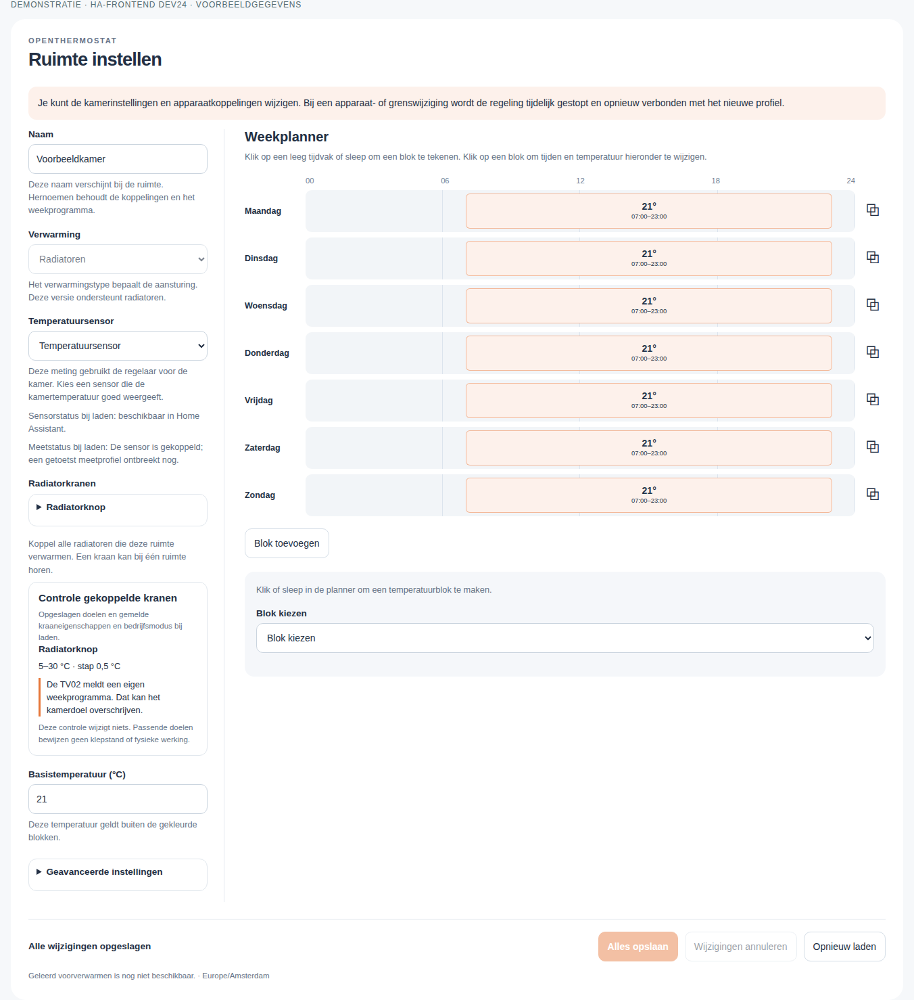
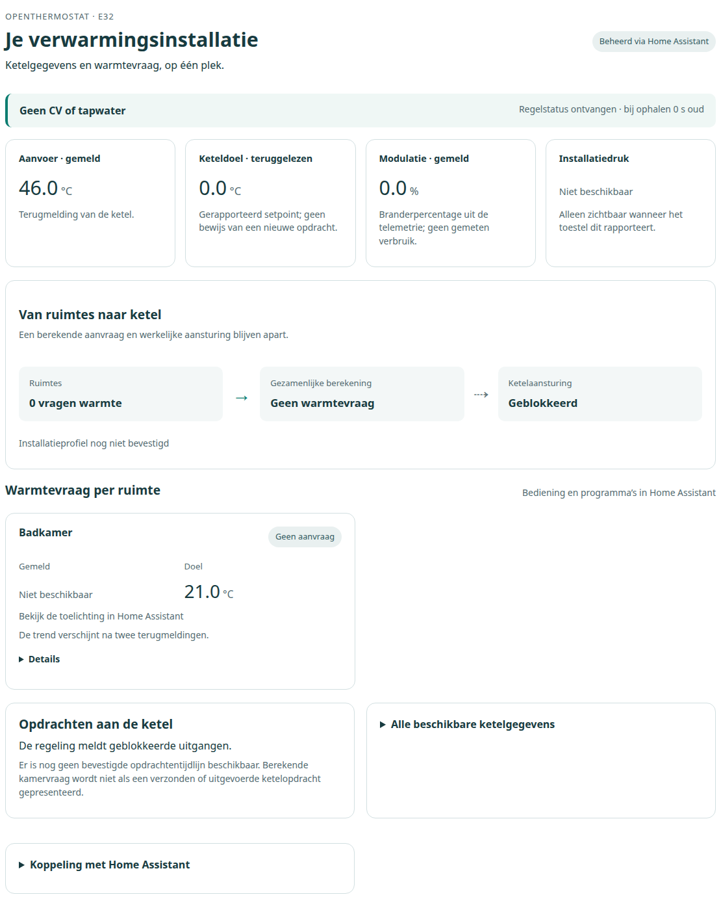
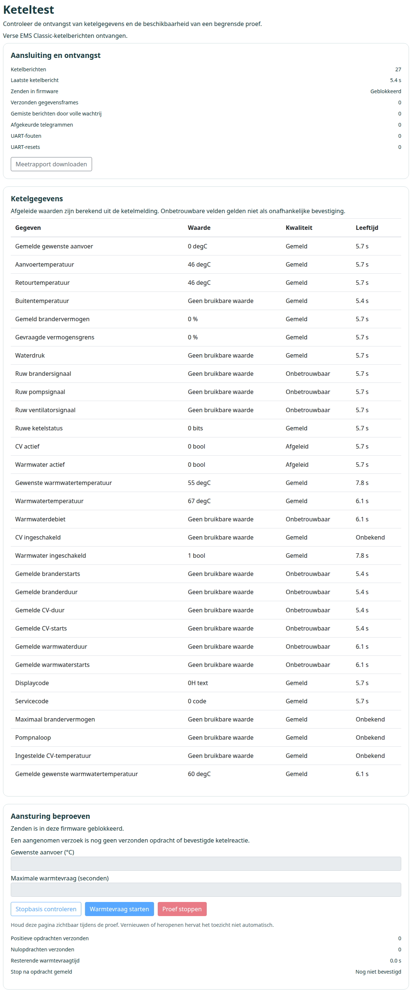

# OpenThermostat — slimme verwarming met Home Assistant

Een lokale, open thermostaat voor **regeling per kamer, slimme radiatorkranen en
centrale ketelregeling**, met Home Assistant als bedieningsomgeving en een
BBQKees E32 V2 bij de ketel. Ontwikkeld door **Mark Dielessen**.

Je stelt per kamer in wanneer het warm moet zijn. De regelsoftware bepaalt de
warmtevraag en het gewenste aanvoerwater; de E32 verzorgt de ketelkoppeling.
Hieronder staat welke onderdelen nu bruikbaar zijn, welke al zijn geprogrammeerd
en welke nog op de roadmap staan.

[Downloads](https://github.com/dielessen/open_thermostat/releases) ·
[Mogelijkheden](#alle-mogelijkheden) · [Roadmap](#wat-we-nog-gaan-bouwen) ·
[Screenshots](#screenshots) · [Documentatie](#documentatie)

**Gepubliceerd, geïnstalleerd en gecontroleerd:** [E32 alpha28](https://github.com/dielessen/open_thermostat/releases/tag/v0.1.0-e32v2-alpha.28) + [Home Assistant dev37](https://github.com/dielessen/open_thermostat/releases/tag/ha-v0.4.0.dev37).
Kamerinrichting, weekprogramma's, webinterfaces en passief uitlezen zijn beschikbaar.
De huidige native inrichting ondersteunt **1–2 kamers, één radiatorknop per kamer**;
acht zones blijft het uitbreidingsdoel. Tado blijft de actieve regelaar.

**Nieuw:** Settings → EMS-apparaten met ontvangen afzenders en entiteiten,
kwaliteit/ouderdom en stabiele EN/NL-weergave. Sessies en opdrachten behouden hun
oorspronkelijke geldigheid; vertraagde verzending of navigatie herstelt geen oude
opdracht/pagina. HA-opstart/cleanup en kraanmetadata zijn robuuster afgehandeld.

Vrij geheugen, CPU-temperatuur en uptime blijven beschikbaar. Instellingen,
programma's, SOURCE, koppelingen en identiteiten zijn met back-up/nacontrole behouden.
De E32 is via één bestaande app-only webupload bijgewerkt; de eerdere native
HTTPS-updaterafwijking is nog onverklaard.

**Nog open:** de oorspronkelijke TV02-ontvangstdiagnose geeft na deze HA-herstart
een bronbindingswaarschuwing; pins en producent zijn behouden. De geschikte
kamerbron, causale kraanbevestiging en fysieke ketel-/stopproeven blijven open.
Actieve kamer-/ketelsturing is nog niet vrijgegeven. [Installatie en grenzen](docs/modern-thermostat/INSTALLATIE-HA37-ALPHA28-20261024.nl.md).

**English:** E32 alpha28 and HA dev37 are installed and verified with preserved
configuration. New passive EMS device inventory, session/deadline fences and
reliable setup/navigation are included. Boiler/valve outputs stay disabled.
Original-TV02 startup diagnostics remain an explicit open issue; active heating
is not yet qualified.

## Alle mogelijkheden

**Beschikbaar** = geleverd in de huidige software voor de genoemde functie.
**Voorbereid** = code aanwezig; aansluiting, gebruikersbediening of praktijkproef
moet nog worden afgerond. **Gepland** = uitbreiding die nog moet worden gebouwd
of gekwalificeerd. Een voorbereide regeling is dus nog geen werkende fysieke
verwarmingsinstallatie.

### Kamers, zones en temperatuurregeling

| Mogelijkheid | Wat je ermee kunt | Status |
| --- | --- | --- |
| Kamerinrichting | Kamers benoemen en sensoren, radiatorkranen, afgiftetype en temperatuurgrenzen kiezen uit HA | **Beschikbaar** voor 1–2 kamers |
| Eigen temperatuur per zone | Per kamer een doeltemperatuur en warmtevraag berekenen; gezamenlijke vraag naar de ketel | **Voorbereid**; fysieke meet-/kraan-/ketelketen nog afronden |
| Hystereseregeling | Verwarmen met een instelbare temperatuurmarge rond het doel | **Voorbereid** in de regelkern |
| PI-regeling | Warmtevraag geleidelijk aanpassen aan temperatuurafwijking en de duur daarvan, met begrensde integraal | **Voorbereid**; dit is PI, zonder D-term van PID |
| Langzame tijdproportionele regeling | PI-vraag omzetten naar lange aan/uit-cycli met minimum aan- en uittijd voor geschikte kleppen | **Voorbereid** |
| Lokaal regelende radiatorkraan | De eigen regeling van de kraan respecteren en daarboven kamerdoel en ketelvraag coördineren | **Voorbereid**; geen tweede concurrerende PI op de kraan |
| Slimme radiatorkranen via HA | Bestaande HA-apparaten selecteren, mogelijkheden controleren en modusconflicten zichtbaar maken | Selectie/controle **beschikbaar**; fysieke doelopdracht en terugmelding **voorbereid** |
| Originele sensor- en kraanberichten | [WSDCGQ11LM-meetberichten](docs/modern-thermostat/ORIGINAL-ZIGBEE-REPORTS.nl.md) en [TV02-datapoints](docs/modern-thermostat/ORIGINAL-TV02-REPORTS.nl.md) onderscheiden van cachewaarden | **HA-ontvangst en diagnose geleverd**; Zigbee-extensions, bronpins en fysieke bronkwalificatie nog afronden |
| Meer zones en kranen | Acht gevalideerde zones, meerdere kranen per kamer en meer merken | **Gepland**; huidige inrichting heeft één kraan per kamer |

Een geselecteerde sensor is nog geen gekwalificeerde regelmeting. De actuele
productieroute voor originele kamermetingen en de fysieke kraanproeven staan nog
open. TV02-modusconflicten zijn al zichtbaar; dit is nog geen volledige
compatibiliteitsverklaring voor iedere TV02-variant.

### Ketel, modulatie en EMS

| Mogelijkheid | Wat je ermee kunt | Status |
| --- | --- | --- |
| Je eigen ketel op Home | Model kiezen onder Settings → Mijn ketel, met een lokale illustratie op de beginpagina | **Beschikbaar**, inclusief [Nefit Ecomline Classic HRC 22H](docs/modern-thermostat/boiler-profiles/nefit-ecomline-classic-hrc-22h.json); volledige modelnaam en familie-illustratie. Keuze blijft op de E32 bewaard |
| EMS-ketelgegevens uitlezen | Beschikbare temperaturen, doelen, modulatie en overige gedecodeerde ketelwaarden bekijken | **Beschikbaar**; verse Classic-berichten ontvangen op de E32 |
| EMS-apparaten onder Settings | Ontvangen apparaten, beschikbare entiteiten, bronkwaliteit en ouderdom per afzender bekijken; zoekfilter en open details blijven behouden | **Beschikbaar**, passief en EN/NL; geen actieve scan |
| Classic en EMS Plus | Decoderbasis voor beide protocolfamilies behouden | **Beschikbaar als basis**; velddekking en ondersteuning blijven ketelafhankelijk |
| Datakwaliteit | Zien of een waarde gemeten, afgeleid, verouderd, onbetrouwbaar of niet beschikbaar is | **Beschikbaar** |
| Centrale ketelvraag | Warmtevraag uit kamers samenbrengen en voorwaarden voor verwarmen beoordelen | **Voorbereid**; rekent mee zonder actieve uitvoer |
| Modulerende ketelregeling | Een gewenst aanvoerwaterdoel berekenen op basis van vraag, groepen en grenzen | **Voorbereid**; echte EMS-aansturing nog testen en vrijgeven |
| Weersafhankelijke regeling | Stooklijn en buitenbron gebruiken voor het gewenste aanvoerwater | **Voorbereid**; complete inrichting en uitvoerroute nog afronden |
| Eigen buitensensor / HA-weerbron | Buiteninformatie met expliciete bronkeuze, actualiteit en terugval gebruiken | Bronbasis **voorbereid**; volledige productroute nog afronden |
| Anti-pendelen en hydrauliek | Minimumtijden, minimumlast, groepsgrenzen en voorwaarden voor doorstroming meenemen | Policies **voorbereid**; installatieproeven nog nodig |
| Keteltest en diagnose | Ontvangst, protocol, veldkwaliteit en fouttellers bekijken en meetrapport downloaden | Passieve diagnose **beschikbaar**; actieve proefbediening **voorbereid en geblokkeerd** |
| Tapwater | Ondersteunde tapwatergegevens bekijken; later eventueel modelspecifiek bedienen | Uitlezing **beschikbaar waar ondersteund**; bediening **gepland** |

Een uitgelezen modulatiepercentage is wat de ketel meldt. Een berekend
waterdoel is wat de regelaar wil. **Actief versturen en de werkelijke ketelreactie
zijn nog niet vrijgegeven of bewezen.** De E32-zendfunctie en fysieke uitgangen
blijven in de huidige uitgave geblokkeerd. Het overzicht belooft geen volledige
EMS-ESP-velddekking of ondersteuning voor iedere ketel/converter.

### Programma’s, comfort en slimmer verwarmen

| Mogelijkheid | Wat je ermee kunt | Status |
| --- | --- | --- |
| Weekprogramma per kamer | Temperatuurblokken tekenen, verplaatsen en aanpassen, ook op een aanraakscherm | **Beschikbaar**, inclusief opslaan/toepassen en terugbevestiging |
| Tijdelijk temperatuurdoel en HEAT/OFF | Een kamerdoel of logische verwarmingsstand wijzigen via de native klimaatentiteit | **Beschikbaar als regelintentie**; fysieke uitvoering volgt de actieve regelketen |
| Comfort, eco, weg, vakantie en boost | Programma’s en tijdelijke keuzes met prioriteiten en eindtijden combineren | Logica **voorbereid**; complete huidige gebruikersroute nog afronden |
| Raam-open en aanwezigheid | Warmtevraag aanpassen of blokkeren op basis van HA-context | Logica **voorbereid**; bronkoppeling/inrichting nog afronden; geofencing later |
| Zelflerende kamerregeling | Opwarm- en afkoelgedrag modelleren en begrensde adviezen berekenen | Modellen/opslag **voorbereid**; actieve toepassing en comfortvoordeel nog aantonen |
| Optimum-start | Eerder beginnen zodat een kamer op het gewenste tijdstip warm is | **Voorbereid**; praktijkvergelijking nog nodig |
| Slim uitlopen en stooklijn leren | Restwarmte benutten en de curve gecontroleerd bijstellen | **Voorbereid**; nog niet actief vrijgegeven |
| Zomer- en vorstlogica | Seizoensstand en een begrensd vorstdoel meewegen | **Voorbereid**; fysieke vorstbescherming bij uitval nog niet bewezen |
| Vloerverwarming / gemengde afgifte | Radiatoren en vloergroepen met eigen watergrenzen, kleppen, pomp en menger combineren | Groeps-/regelbasis **voorbereid**; actieve vloerroute en hardwareproeven volgen |

### Home Assistant, inzicht en dagelijks beheer

| Mogelijkheid | Wat je ermee kunt | Status |
| --- | --- | --- |
| Eigen HA-integratie en dashboard | Kamerpagina’s, klimaatbediening, inrichting en weekplanner in één omgeving | **Beschikbaar** |
| Bestaande HA-apparaten gebruiken | Sensoren en klimaatapparaten uit HA selecteren, met controle op eenheden, grenzen en stapgrootte | **Beschikbaar**; regelkwalificatie per apparaat blijft nodig |
| Ketelvelden in HA | 69 huidige Classic-velddefinities met bronleeftijd, eenheden en kwaliteit via de bestaande verbinding; modelkeuze begrenst de ontvangst niet | **Beschikbaar** met eigen overzicht en drie historiekaarten. Waarde, eenheid en kwaliteit zijn met de E32 vergeleken; gerapporteerde en afgeleide velden staan apart. [Details](docs/modern-thermostat/BOILER-FIELDS-V1.md) |
| Externe wandbediening | Kamerdoelen vanuit andere bedieningen overnemen zonder terugkoppellussen | Basis **voorbereid**; complete route **gepland** |
| E32-webinterface | Installatie, kamernamen, doelen, berekende vraag en beschikbare ketelwaarden bekijken; open details blijven staan tijdens verversen | **Beschikbaar** |
| Nederlands en Engels / Dutch and English | E32: taalkeuze in menu en bij aanmelden/wifi-installatie. HA: profieltaal voor kamereditor en native vertalingen; vaste opgeslagen dashboardteksten vallen terug op Engels | **Beschikbaar**; Engels is standaard en terugval |
| Uitleg waarom er vraag is | Regelstatus en redenen voor warmtevraag of blokkering zien | **Beschikbaar als diagnosebasis**; echte opdracht-/reactietijdlijn volgt |
| Grafieken, historie en CSV | Temperatuur, vraag, brander/modulatie en tapwater over tijd analyseren | Metrics-/opslag-/exportcode **voorbereid**; volledige actuele productroute nog afronden |
| Verbruik, kosten en comfort | Metergegevens en duidelijk gelabelde schattingen combineren | **Deels voorbereid**; echte bronnen/kalibratie en presentatie volgen |
| Systeemlog en syslog | Recente E32-logregels bekijken/filteren/downloaden; langer bewaren op een eigen RFC5424 UDP-collector | **Beschikbaar**; externe syslog staat standaard uit. [Gebruik en grenzen](docs/modern-thermostat/LOGGING.nl.md) |
| Meldingen en onderhoud | Diagnose-, batterij- en foutinformatie benutten | Basis **aanwezig**; complete scenario’s en meldingen nog afronden |
| Lokaal en open | Eigen broncode, lokale E32 en koppeling via lokale MQTT-broker; geen verplichte thermostaatcloud | **Beschikbaar**; via HA gekoppelde apparaten blijven afhankelijk van HA/MQTT |
| Beheer en updates | Weblogin, About, uitloggen, herstarten onder Settings, HTTPS-updater en herstelroutes | **Beschikbaar**; normale update behoudt instellingen |
| Gedrag bij uitval | Oude/onbevestigde gegevens afwijzen en sessies, eigenaarschap en deadlines bewaken | Softwarecontroles **aanwezig**; volledige fysieke HA/MQTT/sensor/E32-uitvalproeven nog open |

## Wat we nog gaan bouwen

De volgorde blijft gericht op een werkende eerste ketelbèta. Bestaande
voorbereide functies blijven in de codebasis behouden.

1. **De actieve basis afronden:** originele kamermetingen aansluiten, radiatorkraan
   met verse terugmelding testen en de echte vraag-/afgifteketen verbinden.
2. **De eerste actieve ketelbèta:** de concrete EMS-interface en converterketen
   kwalificeren, daarna een begrensde start-/stopproef met ketelterugmelding.
3. **Het product compleet aansluiten:** centrale instellingen, comfortstanden,
   weersregeling, grafieken en historie via de normale gebruikersinterface afmaken.
4. **Uitbreiden:** meer gekwalificeerde sensoren/kranen, externe wandbediening,
   meerdere kranen per kamer en acht geteste zones; vloerfuncties apart beproeven.
5. **Slimmer optimaliseren:** zelfleren, optimum-start, uitlopen en curveaanpassing
   gecontroleerd activeren en met echte metingen beoordelen.

Meer ketelvelden uitlezen blijft onderdeel van de ontwikkeling; passieve
ontvangst levert alleen de berichten die de installatie daadwerkelijk verzendt.
Er zijn nog geen vaste datums voor deze vervolgstappen.

Het [actuele werkbord](docs/modern-thermostat/WORKBOARD.nl.md) bevat de volledige
31 producteisen en acceptatiechecks. Het [ontwerpplan](docs/modern-thermostat/PLAN.nl.md)
werkt de regeling uit. De [release-inventaris](docs/modern-thermostat/BETA1-RELEASE-INVENTARIS.json)
bewaakt de 23 voorbereide onderdelen. Deze detaildocumenten zijn de plek voor de
technische uitvoeringsstatus.

## Screenshots

<details>
<summary>Home Assistant — kamerbediening en weekprogramma</summary>



Demonstratie van de **uitgeleverde dev24-frontend** met voorbeeldgegevens.
Dit is geen live HA-opname; de afbeelding is ook als demonstratie gemarkeerd.

</details>

<details>
<summary>E32 — installatieoverzicht</summary>



Echte opname van alpha18. Berekende vraag, ketelmeldingen en vrijgave van
actieve aansturing worden afzonderlijk getoond.

</details>

<details>
<summary>E32 — passieve EMS-ontvangst en Keteltest</summary>



Echte opname van alpha18 met passief ontvangen Classic-berichten.
Zendfunctie en actieve proefknoppen zijn geblokkeerd.

</details>

## Releases en installeren

Voor de native koppeling zijn Home Assistant met de MQTT-integratie en een
lokale MQTT-broker nodig. Apparaten die via HA zijn gekoppeld blijven van die
diensten afhankelijk.

| Onderdeel | Huidige uitgave | Gebruik |
| --- | --- | --- |
| E32 V2 | [v0.1.0-e32v2-alpha.18](https://github.com/dielessen/open_thermostat/releases/tag/v0.1.0-e32v2-alpha.18) | Toepassingsupdate via de normale E32-updater |
| Home Assistant | [0.4.0.dev24](https://github.com/dielessen/open_thermostat/releases/tag/ha-v0.4.0.dev24) | Afzonderlijk HA-integratiepakket; de firmware installeert dit niet |

Dit softwarepaar komt uit [dezelfde broncommit](https://github.com/dielessen/open_thermostat/commit/6ef01d0e8468f2bb88310d165fb5d49d033b21d4).
De volledige CI slaagt, inclusief drie firmwareboards, native tests,
SDK-bronreproductie, browsers en **1.758 HA-checks**. Bij de gecontroleerde uitrol
zijn instellingen, weekprogramma, bindings en identiteiten behouden.

- [Normale updates, bron en pakketten](docs/modern-thermostat/GITHUB-UPDATES.nl.md)
- [Installeren, back-up en herstel](docs/FLASHING.md)
- [HA-inrichting en beheerde interface](docs/modern-thermostat/HA-MANAGED-GUI.md)

Een normale app-only OTA is iets anders dan een nieuwe partitie-indeling of
fabrieksinstallatie. Gebruik daarvoor de bijbehorende hardware-/installatiegids.

## Hardware en ontwikkelen

Hoofddoel is de **BBQKees E32 V2**, met classic ESP32, 16 MB flash en fysieke
PSRAM. Het is een andere target dan de oorspronkelijke E32 of ESP32-S3.
De oorspronkelijke `esp32dev`- en `esp32s3`-builds blijven behouden; hun
uitgangsmogelijkheden gelden niet automatisch voor E32 V2.
Ethernet-/WiFi- en setupcode zijn aanwezig; fysieke netwerk- en herstelacceptatie
blijft per installatie te beoordelen.

```sh
git clone https://github.com/dielessen/open_thermostat.git
cd open_thermostat
python3 -m venv .venv
. .venv/bin/activate
pip install platformio==6.2.0
pio run -e e32v2
pio run -e e32v2 -t buildfs
python scripts/verify_e32v2.py
pio test -e native
```

Deze opdrachten bouwen en controleren bestanden; ze flashen geen apparaat.
Bouwen voor de andere boards kan met `pio run -e esp32dev` of `pio run -e esp32s3`.
Voer PlatformIO-opdrachten binnen één checkout achter elkaar uit.

## Documentatie

- [Actueel werkbord en roadmap](docs/modern-thermostat/WORKBOARD.nl.md)
- [Ontwerp en alle producteisen](docs/modern-thermostat/PLAN.nl.md)
- [Firmware-releasenotes](docs/modern-thermostat/RELEASE-NOTES.md)
- [HA-releasenotes](docs/modern-thermostat/HA-RELEASE-NOTES.md)
- [E32 V2-hardware en pinnen](docs/BBQKEES_E32V2.md)
- [Hardwareverschillen](docs/HARDWARE.md)
- [REST-interface](docs/RESTAPI.md)
- [Testinfrastructuur](docs/modern-thermostat/TEST-INFRA.nl.md)
- [Historische functies en legacy-instructies](docs/README-LEGACY.md)

## Herkomst en licentie

Dit project is gestart vanuit [OpenThermostat van Pawel Filipczak / intuibase](https://github.com/intuibase/open_thermostat).
De oorspronkelijke auteursrechten en [MIT-licentie](LICENSE) blijven behouden.
De verdere ontwikkeling, productkeuzes en releases worden onafhankelijk beheerd
door Mark Dielessen; dit is geen officiële intuibase-uitgave.

Hergebruikte bibliotheken en SDK-onderdelen behouden hun eigen licenties.
Zie [de bron- en licentiedocumentatie](docs/third-party/README.md) voor de
bijbehorende distributie- en herlinkinformatie.
