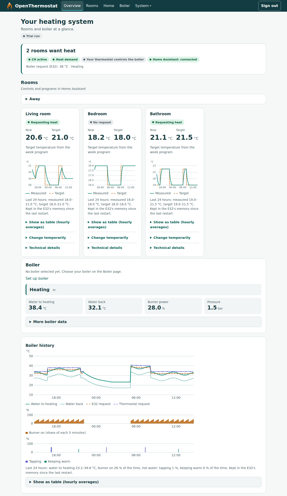
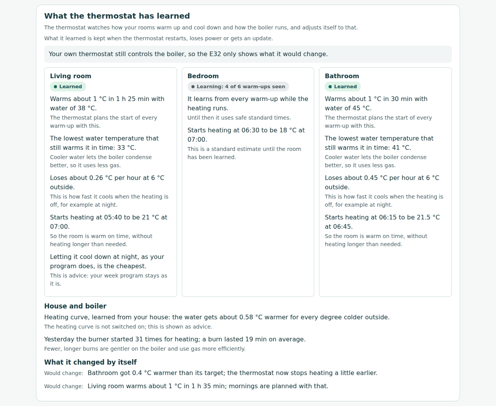
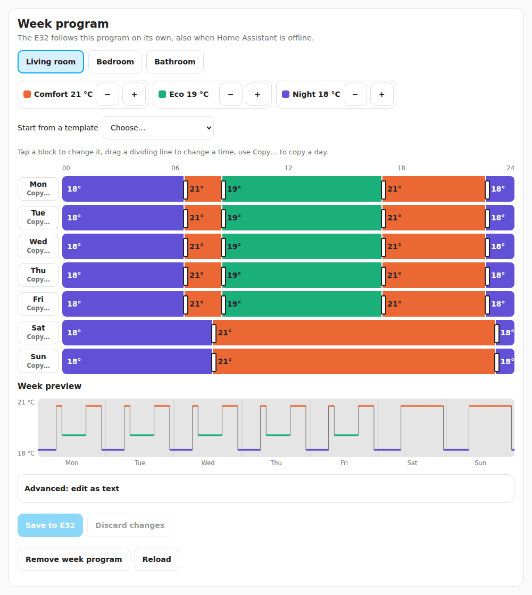
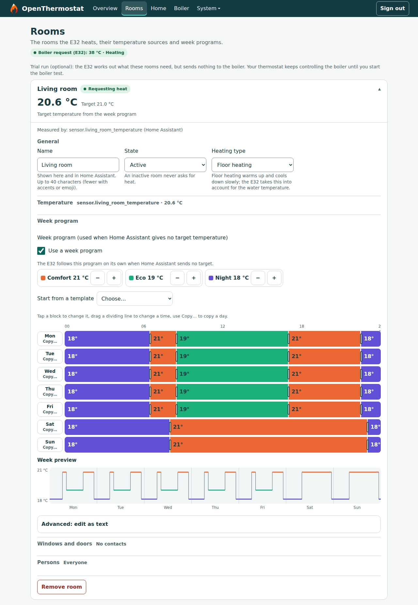
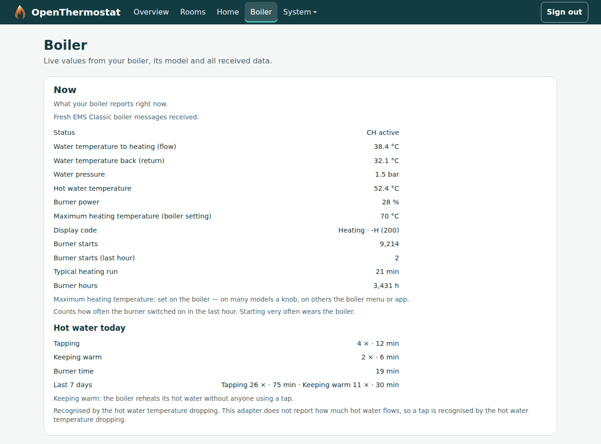
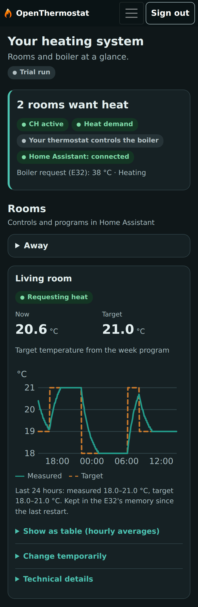

# OpenThermostat

A thermostat for your central heating that runs on a small box next to your
boiler: the BBQKees Gateway E32 V2. Every room gets its own week program. The
thermostat learns how fast each room warms up and cools down, so the room is
warm when you want it, and it tunes its own settings over time.

It runs in your own home. No cloud account and no internet connection are
needed. Home Assistant is optional: without it you set everything up on the
E32's own web pages. With it you get a thermostat per room, a week planner card,
energy figures and updates with one click.

**Status:** version 1.0 is in its last test phase (release candidate rc.2). It
runs every day in the developer's home. Version 1.0.0 follows once rc.2 has run
for 14 days without problems.



## What you need

- A **[BBQKees Gateway E32 V2](https://bbqkees-electronics.nl/product/gateway-e32-v2-ethernet-wifi-edition-v2/)**,
  connected to your boiler. Releases are made for this board only.
- A boiler that speaks **EMS Classic (EMS 1.0)**: most Nefit, Buderus, Bosch,
  Junkers and Worcester boilers, directly or through an adapter such as the
  Bosch EasyControl Adapter. Newer EMS+ (EMS 2.0) boilers are planned for
  version 1.1.
- A **thermometer in each room**: a Bluetooth thermometer that the E32 receives
  itself (Shelly BLU H&T Display ZB, Xiaomi Monitor 3 with its bindkey, or a
  thermometer with pvvx firmware), or any temperature sensor in Home Assistant.
- **Wi-Fi (2.4 GHz) or Ethernet.**
- For the first installation: a computer with Chrome or Edge and a **USB-C data
  cable**. After that, updates go over the network.

For Home Assistant you also need Home Assistant 2026.10.0 or newer, an MQTT
broker (for example the Mosquitto add-on) and the MQTT integration.

## What it does

- **A week program per room**, up to 8 rooms, with Comfort, Eco and Night
  temperatures. You change a time by dragging it.
- **Warm on time.** It learns how long each room takes to warm up and starts
  early enough. It also learns the lowest water temperature that still does
  the job, because cooler water uses less gas.
- **Tunes itself.** It adjusts its burner settings by itself, in small steps,
  and tells you in plain words what it changed and why.
- **Away and holiday.** It can follow who is at home, lower the temperature
  while everyone is out and be warm again when you come back.
- **Windows and doors.** A contact in Home Assistant pauses a room while a
  window is open.
- **Radiator valves** through Zigbee2MQTT or Home Assistant, set per room.
- **Your boiler at a glance:** water temperatures, pressure, burner starts,
  hot water use and the boiler's display code in words.
- **Backups.** Home Assistant keeps a daily backup of all E32 settings. A new or
  replaced E32 gets everything back in one step.
- **Updates from Home Assistant** with one click. A new firmware that does not
  start properly goes back to the previous version by itself.
- English and Dutch on the E32; English, Dutch and Polish in Home Assistant.

## Safety first

- **Nothing is sent to the boiler until you say so.** A new E32 first leads you
  through a short boiler test. Is your old thermostat still connected? Then
  the E32 can run beside it first in a trial run: it works out what it would
  do and compares, without touching the boiler.
- **Frost protection** always stays on: below 8 °C a room always gets heat.
- **The water temperature never goes above your limit** or the boiler's own
  maximum.
- **Giving control back** to your old thermostat is one button, and always
  works.

## Getting started

1. Put the OpenThermostat firmware on the E32 over USB
   ([installation guide, step 2](docs/INSTALL.md#2-install-the-firmware-on-the-e32-first-time-over-usb)).
   The gateway usually comes with EMS-ESP; this replaces it, so
   [make a backup first](docs/FLASHING.md#make-a-full-backup-first).
2. Connect the E32 to your Wi-Fi and choose your own password.
3. Add your rooms and their thermometers, on the E32 or in Home Assistant.
4. Optional: install the Home Assistant integration with
   [HACS](https://github.com/dielessen/openthermostat-ha).
5. Run the boiler test and let the E32 take over.

The [installation guide](docs/INSTALL.md) walks through every step. There is
also a [checklist](docs/INSTALL-CHECK.md) to do it together with someone else.

<!-- openthermostat-readme-releases:start -->

## Latest published releases

| Component | Version | Channel |
| --- | --- | --- |
| E32 V2 firmware | [v1.0.0-e32v2-rc.1](https://github.com/dielessen/open_thermostat/releases/tag/v1.0.0-e32v2-rc.1) | Pre-release |
| Home Assistant integration | [1.0.0rc1](https://github.com/dielessen/open_thermostat/releases/tag/ha-v1.0.0rc1) | Pre-release |

Firmware and the HA integration are separate downloads. Read each release’s
changes, compatibility notes and installation instructions before updating.

To build the published E32 firmware, start from its exact tag:

```sh
git clone --branch v1.0.0-e32v2-rc.1 https://github.com/dielessen/open_thermostat.git
```

<!-- openthermostat-readme-releases:end -->

## Screenshots

These use made-up example data, not a real home.



<details>
<summary>More screenshots</summary>

The week planner card in Home Assistant:



A room with its week program on the E32:



The boiler page:



On a phone, in the dark theme:



</details>

## Not yet possible

- EMS+ (EMS 2.0) boilers. Planned for version 1.1.
- Radiator valve control has not yet been tested on real valves in a home.
- Behind some adapters, such as the Bosch EasyControl Adapter, the position
  of the three-way valve (heating or hot water) cannot be read.
- Changing the boiler's own settings from the E32. That comes after 1.0.
- The charts start empty again after a restart.

## Documentation

- [Installation guide](docs/INSTALL.md): from a new E32 to a working setup
- [User guide](docs/USER-GUIDE.md): where to find what, rooms, away, learning, backups
- [Switching over from your old thermostat](docs/SWITCHOVER.md)
- [USB backup and recovery](docs/FLASHING.md), also for going back to EMS-ESP
- [Testing a release candidate at home](docs/FIELD-TESTER.md)
- [Firmware release notes](docs/modern-thermostat/RELEASE-NOTES.md) and
  [Home Assistant release notes](docs/modern-thermostat/HA-RELEASE-NOTES.md)
- [E32 V2 hardware and pins](docs/BBQKEES_E32V2.md), [hardware differences](docs/HARDWARE.md)
  and the [REST API](docs/RESTAPI.md)
- [Current release work](docs/modern-thermostat/NEXT-RELEASE.nl.md) and
  [test infrastructure](docs/modern-thermostat/TEST-INFRA.nl.md) (engineering notes, in Dutch)
- [Third-party sources and licences](docs/third-party/README.md) and the
  [older project documentation](docs/README-LEGACY.md)

Questions or problems? [Open an issue](https://github.com/dielessen/open_thermostat/issues).

## Building it yourself

Start from the tagged clone command above, then:

```sh
cd open_thermostat
python3 -m venv .venv
. .venv/bin/activate
pip install platformio==6.2.0 intelhex==2.3.0
pio run -e e32v2
pio run -e e32v2 -t buildfs
python3 scripts/verify_e32v2.py
pio test -e native
```

Run the PlatformIO commands one after another in a checkout. The `esp32dev`
and `esp32s3` builds still compile, but only the E32 V2 is tested and released.

## Credits and licence

OpenThermostat started as [OpenThermostat by Pawel Filipczak / intuibase](https://github.com/intuibase/open_thermostat).
The original copyright notices and the [MIT licence](LICENSE) are kept.
Further development and releases are by Mark Dielessen; this is not an
official intuibase release. OpenThermostat is not made or supported by BBQKees
Electronics.

Libraries and SDK parts keep their own licences; see the
[third-party documentation](docs/third-party/README.md).
