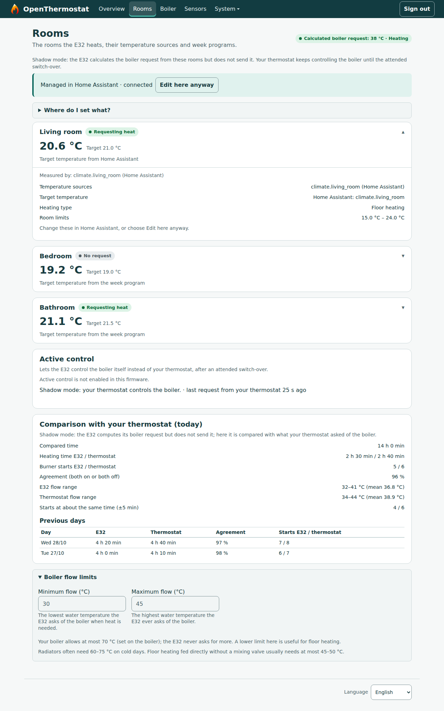
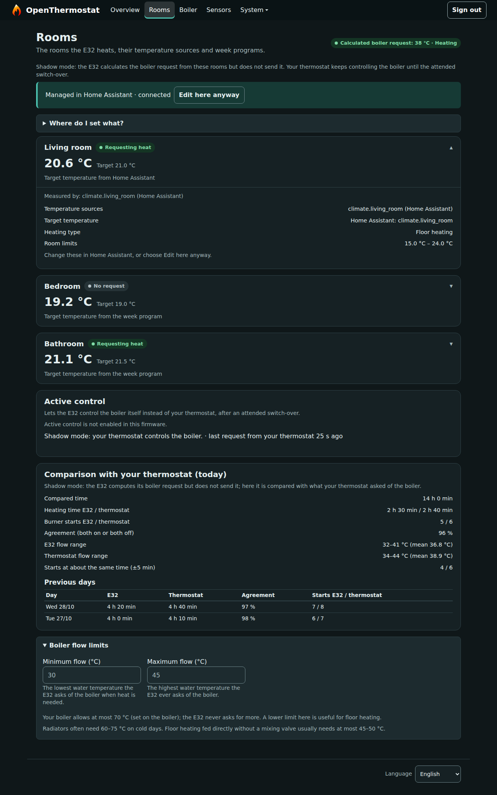
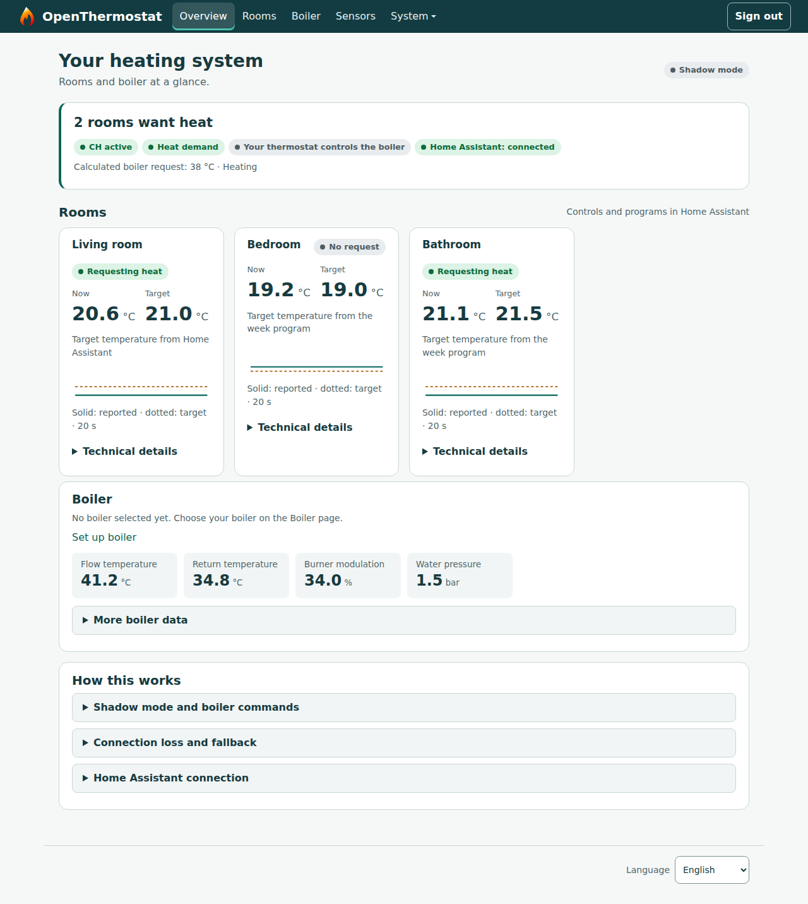
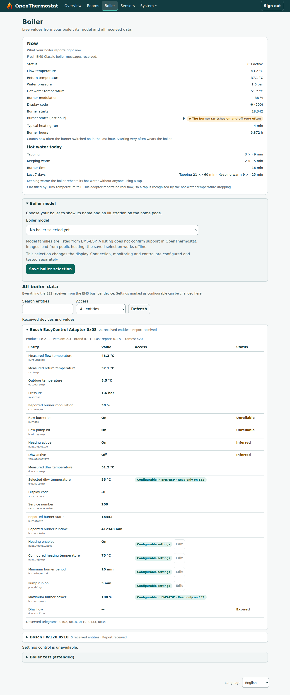
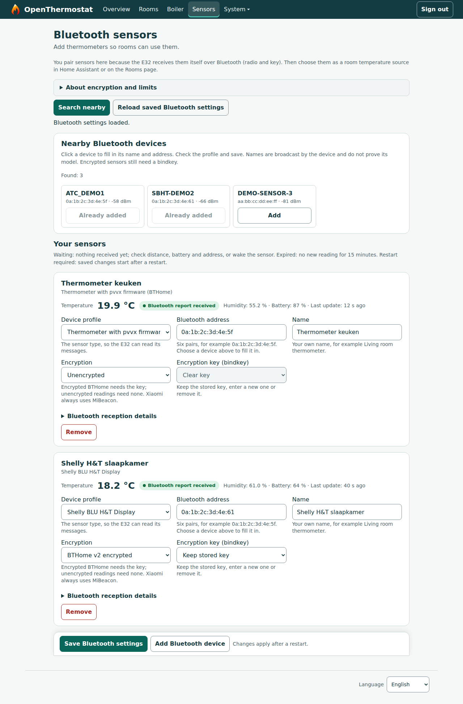

# OpenThermostat

Local, open source heating software for **rooms, week programs, Bluetooth
thermometers and EMS boiler diagnostics**, with Home Assistant and a BBQKees
E32 V2 gateway. Developed independently by **Mark Dielessen**.

The room plan lives on the E32 and keeps running without Home Assistant. Every
10 seconds the E32 reads each room's temperature sources (Home Assistant
entities such as a thermostat, or Bluetooth sensors it receives itself),
follows the room's target or week program, and calculates a boiler request.

**E32 beta.18 runs this in shadow mode.** The E32 calculates its boiler
request, learns how each room warms up and compares its decisions with the
thermostat that still controls the boiler. It does not send that request.
Active boiler control is built into beta.18 but stays switched off in the
firmware until an attended switch-over with failure tests.

[Downloads](https://github.com/dielessen/open_thermostat/releases) ·
[User guide](docs/USER-GUIDE.md) · [Features](#features) ·
[Roadmap](#roadmap) · [Screenshots](#screenshots) ·
[Installation](#installation) · [Documentation](#documentation)

<!-- openthermostat-readme-releases:start -->

## Latest published releases

| Component | Version | Channel |
| --- | --- | --- |
| E32 V2 firmware | [v0.1.0-e32v2-beta.17](https://github.com/dielessen/open_thermostat/releases/tag/v0.1.0-e32v2-beta.17) | Pre-release |
| Home Assistant integration | [0.4.0b9](https://github.com/dielessen/open_thermostat/releases/tag/ha-v0.4.0b9) | Pre-release |

Firmware and the HA integration are separate downloads. Read each release’s
changes, compatibility notes and installation instructions before updating.

To build the published E32 firmware, start from its exact tag:

```sh
git clone --branch v0.1.0-e32v2-beta.17 https://github.com/dielessen/open_thermostat.git
```

<!-- openthermostat-readme-releases:end -->

## What's new in E32 beta.18 + HA 0.4.0b10

Install both together. HA 0.4.0b9 keeps working with beta.18 for the fields it
knows.

**New**

- **Rooms are edited in Home Assistant**, in one place: Settings → Devices &
  services → OpenThermostat → Configure → Rooms. Sources (HA entities and the
  E32's Bluetooth sensors, °C only), target, limits and a week program per
  room. The plan is stored on the E32. The E32 Rooms page shows it read-only,
  explains where to set what, and offers "Edit here anyway" for when Home
  Assistant is not reachable.
- **Refreshed E32 interface** in English and Dutch, light and dark: five menu
  items (Overview, Rooms, Boiler, Sensors, System), pages that keep their
  address on refresh, larger touch targets and a short help line at each
  setting.
- **Learning per room, in shadow mode:** how fast a room warms up at which flow
  temperature, the lowest flow that still warms it in time, when to start
  before the next week-program switch, and whether holding the night
  temperature or letting it drop uses less gas (estimate in kWh, m³ and €).
  The results appear as HA sensors per room; they are advice only and are not
  applied.
- **Boiler page starts with the essentials:** temperatures, pressure where the
  boiler reports it, burner starts in the last hour with a short-cycling
  warning, and hot water today (tapping versus keeping warm). The last locking
  and blocking fault and the boiler's own uptime are added to the EMS table.
- **Home Assistant:** each E32 room and Bluetooth sensor is its own device with
  plain names and icons; a "Heating" dashboard; shadow-comparison sensors
  (heating time and burner starts today for the E32 and the thermostat, and
  their agreement); a short-cycling warning.
- **Active control, prepared and locked:** takeover only after you confirm the
  thermostat is disconnected from the boiler, a stop when another controller
  still sends boiler requests, frost protection below 8 °C and a "Hand back to
  the thermostat" button. A firmware gate keeps all of this switched off in
  beta.18.

**Fixed**

- Bluetooth thermometers deliver readings reliably: every report is heard,
  readings stay valid for 15 minutes, a sensor whose counter restarts (new
  battery) is accepted again, and one bad report no longer clears the values.
- A firmware update that fails to start rolls back to the previous firmware
  instead of restarting forever.
- The watchdog also covers start-up; a stalled download can no longer switch
  off the supervisor; the E32 restarts itself when Wi-Fi reports "connected"
  but the network no longer answers, and backs off during a long Wi-Fi outage
  instead of restarting every 15 minutes.
- Deeply nested JSON from the network can no longer crash the E32; JSON and
  larger buffers use PSRAM, leaving more memory for Wi-Fi.
- HA creates boiler entities only once the boiler reports them and removes its
  own old duplicate or never-reported entities (history is kept). In the
  owner's installation this went from 155 to about 74 entities.

[User guide](docs/USER-GUIDE.md) ·
[Firmware release notes](docs/modern-thermostat/RELEASE-NOTES.md) ·
[HA release notes](docs/modern-thermostat/HA-RELEASE-NOTES.md) ·
[Current release work](docs/modern-thermostat/NEXT-RELEASE.nl.md)

## Features

**Available** means delivered for the stated use. **Shadow** means it runs on
the E32 and is reported, but nothing is sent to the boiler or valves.
**Prepared** means code exists but the user flow, device connection or physical
acceptance is still open. **Planned** means further implementation or
qualification is required.

### Rooms and heating

| Feature | Current status |
| --- | --- |
| Room plan on the E32 | **Shadow:** up to 8 rooms, each active, inactive or inactive until a date, with heating type (radiators or floor) and up to four temperature sources in order. The first fresh source leads, the others are fallback. With no usable source the room keeps its last value for 30 minutes, then stops asking for heat. The whole plan must fit in 4 KB. |
| Where rooms are edited | **Available:** the Home Assistant room editor is the one place to edit. The E32 Rooms page is read-only with "Edit here anyway" as a fallback. Both work on the same plan with a revision number, so neither side silently overwrites a newer change. |
| Target temperature and week program | **Shadow:** per room the target comes from an HA entity, else from the E32 week program (up to six switch points a day), else from a fixed temperature without Home Assistant. Night setback and morning warm-up continue when HA is away. |
| Boiler request | **Shadow:** the flow temperature follows the largest room shortfall between the configured limits (default 30–60 °C, never above 60 °C), with five-minute minimum burner on and off times. |
| Comparison with your thermostat | **Available:** heating time, burner starts, flow range and start timing of the E32 decision next to the thermostat's actual request: today and the last seven days on the E32 Rooms page, today's figures as HA sensors. |
| Learning per room | **Shadow, advice only:** warm-up rate per flow temperature and the lowest flow that still warms the room 1 °C in an acceptable time, as HA sensors "Learning status" and "Recommended flow". Needs several stable heating periods before a result is shown. Not applied to the boiler request. |
| Optimum start | **Shadow, advice only:** HA sensor "Predicted heating start" for the next week-program rise. Not applied. |
| Night-setback estimate | **Shadow, estimate only:** holding the night temperature versus letting it drop, in kWh, m³ and €, as attributes of "Predicted heating start". Needs a valid clock and an outdoor temperature; gas-meter calibration is planned. |
| Active boiler control | **Prepared, locked in the firmware:** takeover after confirmation, stop on a foreign controller, frost protection (on below 8 °C, off at 9 °C), flow at most the lowest of plan, 60 °C and boiler limit, hand back to the thermostat. Opened only at the attended switch-over. |
| Radiator valves (TRVs) | **Planned** for the E32 room plan. The older HA room records with TRV valves still exist for existing installations but are not used by the E32 heating control. |
| Comfort, eco, away, holiday and boost | Priority and expiry logic **prepared**; everyday controls remain to be connected. |
| Window and door contacts | **Planned:** select contacts per room, pause demand while open and resume with valid readings. |

### Bluetooth sensors

| Feature | Current status |
| --- | --- |
| Supported sensors | **Available:** Shelly BLU H&T Display ZB; Xiaomi Monitor 3 / MJWSD05MMC with bindkey; thermometers with pvvx firmware (BTHome v2, plain or with a bindkey, and the older PVVX Custom format); Shelly BLU TRV as a diagnostic profile only. |
| Pairing on the E32 | **Available:** up to eight sensors on the Sensors page. Search lists the 32 strongest nearby devices. Private keys are stored on the E32 and never read back. Changes apply after a restart. |
| Use as room source | **Available:** received by the E32 itself, so they keep working without Home Assistant. Readings stay valid for 15 minutes. |
| Sensors in Home Assistant | **Available:** each sensor is its own HA device with temperature, humidity and battery, and can be chosen as a room source in the HA room editor. |
| Valve control over Bluetooth | **Planned.** GATT valve control is not available. |

### Boiler and EMS

| Feature | Current status |
| --- | --- |
| Boiler essentials | **Available** on the Boiler page and in HA: flow, return and hot-water temperatures, pressure where the boiler reports it, status, and burner starts in the last hour. |
| Short-cycling warning | **Available:** counted from the reported flame state, because some adapters (such as the Bosch EasyControl Adapter) report their own start and hour counters as 0. Burner starts for hot water count as well. |
| Hot-water statistics | **Available:** hot water today, split into tapping and keeping warm. Where the adapter reports no real flow, a tap is recognised by the hot-water temperature dropping. |
| Faults and uptime | **Available:** last locking and blocking fault and the boiler's own uptime, alongside maintenance messages, where reported. |
| One EMS entity table | **Available:** one table generates the firmware field list and the HA entities. Thermostat request values were checked against real tado (RC10-type) telegrams. HA creates an entity only once the boiler reports it. |
| Boiler brand/model selection | **Available:** catalogue with EMS-ESP product groups and official model references. Listing a model does not qualify a new driver. Product images are hosted outside the ESP. |
| Passive EMS reception | **Available:** Classic boiler messages, temperatures, targets, modulation and other supported fields. Coverage depends on the boiler and the messages actually received. EMS Plus decoder foundations exist; this is not full EMS-ESP parity. |
| Data quality | **Available:** measured, derived, stale, unreliable and unavailable values remain distinguishable. |
| Attended boiler test | **Available for commissioning**, with someone at the boiler: asks for heat at a chosen flow (default 50 °C, up to 10 minutes), then checks that heating stops. It is refused while the E32 owns the boiler. One trial passed on the owner's installation; that is not a general qualification. |
| Weather compensation | Calculations **prepared**; full outside-source setup and installation tests remain open. |
| Boiler settings writes | Writable-entity metadata is inventoried. **Persistent setting writes remain disabled.** |
| Domestic hot water control | **Planned**, model specific. Readout and statistics are available. |
| Underfloor heating and mixed emitters | Floor heating is a room heating type with its own flow limit. Valve, pump and mixer routes are **prepared** and require separate hardware acceptance. |

Reported modulation describes the boiler's response; calculated demand
describes the controller's intention. Neither proves that a command was sent or
accepted. Not every installation has a digital pressure sensor; no synthetic
pressure reading is substituted.

### Home Assistant and daily use

| Feature | Current status |
| --- | --- |
| Native HA integration | **Available:** room editor, a "Heating" dashboard, per-room devices, Bluetooth sensors, the boiler request and shadow-comparison sensors. Uses a local MQTT broker. |
| Entity cleanup | **Available:** removes this integration's own duplicate or never-reported entities. Renamed or changed entities and other integrations' entities are never removed. |
| E32 web interface | **Available:** Overview, Rooms, Boiler, Sensors and System (network, firmware update, system log, about, restart), light and dark, usable from 320 px wide. |
| English and Dutch | **Available:** English default and fallback; E32 language selection and native HA translations. |
| History and CSV | **Available:** read-only recorder views and exports for day/week/month periods up to 31 days. |
| ESP/EMS logs and syslog | **Available:** view, filter and download local logs; optionally forward to an RFC5424 UDP collector (off by default). |
| Energy, cost and comfort analysis | **Partly available:** the night-setback estimate in shadow mode. Gas-meter calibration and presentation remain open. |
| External wall controls and further notifications | **Planned**, with additional device, ownership and failure acceptance. |

Core operation needs no thermostat cloud. Devices connected through HA still
depend on HA and MQTT; Bluetooth sensors and week programs on the E32 do not.

### Reliability and updates

| Feature | Current status |
| --- | --- |
| Watchdogs | **Available:** a supervisor restarts the E32 when its main loop hangs for 5 minutes; a hardware watchdog restarts a fully hung device within about two minutes, also during start-up. The system log shows what the device was doing before its last restart. |
| Network liveness | **Available:** the E32 checks that the router answers and restarts after 3 minutes of "Wi-Fi connected but network dead". It restarts after 15 minutes without Wi-Fi or the MQTT broker, backs off during long outages, and never restarts during an update. |
| Updates and rollback | **Available:** updates from the HA update entity or the local upload on the update page. A new firmware confirms itself after about a minute of normal running; a firmware that fails to start rolls back. Normal application updates keep settings. |
| Memory and input | **Available:** JSON and large buffers in PSRAM; a bounded Bluetooth status reply; deeply nested network JSON is rejected; boiler reception recovers by itself after a bus error. |
| Physical failure tests | **Open:** HA, MQTT, sensor and E32 failures during active control are tested at the attended switch-over. |

## Roadmap

1. **Shadow period** (at least 3, preferably about 5 days): no hang or restart
   for 72 hours, at least 10 compared heating periods including night setback
   and morning warm-up, decisions close to the thermostat's, and the Bluetooth
   fallback has taken over at least once.
2. **Attended switch-over** for the living room: disconnect the thermostat from
   the boiler, open the active-control gate, and test start, stop and
   modulation, hot water during heating, an E32 restart, loss of Wi-Fi, HA and
   measurements, the boiler adapter's behaviour when the E32 stops sending, and
   handing back to the thermostat.
3. **Active mode** with daily monitoring for one to two weeks, then the first
   non-beta release.
4. **Gas-meter calibration** of the learned models and night-setback estimates.
5. **Optimum start applied** in active mode, and the learned lowest flow used
   for the boiler request.
6. Then: radiator valves in the E32 room plan, comfort modes, window and door
   contacts, outside sources, further devices and floor-heating functions.

No release dates are promised for these steps. The
[workboard](docs/modern-thermostat/WORKBOARD.nl.md),
[design plan](docs/modern-thermostat/PLAN.nl.md) and
[current release work](docs/modern-thermostat/NEXT-RELEASE.nl.md) track the
detailed requirements and remaining acceptance. Much of the engineering
documentation is in Dutch; GitHub-facing project and release descriptions are
maintained in English.

## Screenshots

<details>
<summary>E32 Rooms page (light)</summary>



Demonstration with sample data, not a live capture. Rooms are shown read-only
because they are managed in Home Assistant.

</details>

<details>
<summary>E32 Rooms page (dark)</summary>



Demonstration with sample data, not a live capture.

</details>

<details>
<summary>E32 Overview</summary>



Demonstration with sample data, not a live capture.

</details>

<details>
<summary>E32 Boiler page</summary>



Demonstration with sample data, not a live capture.

</details>

<details>
<summary>E32 Sensors page</summary>



Demonstration with sample data, not a live capture.

</details>

## Installation

Download the E32 firmware and the HA integration separately from the release
links above. For the native HA connection, configure Home Assistant's MQTT
integration and a local MQTT broker. Follow the release's compatibility notes.

- **E32 application update:** install it from Home Assistant (the firmware
  update entity) or upload `firmware.bin` on the E32 update page. The E32
  confirms the new firmware after about a minute of normal running; until then
  a failed start rolls back. A new partition layout or factory installation
  uses a different procedure.
- **Home Assistant:** install the separate integration package, keep existing
  entries and restart HA; the E32 updater does not install it. Install E32
  beta.18 and HA 0.4.0b10 together.
- **Optional Zigbee report companion:** source-only material for original
  receive reports; no automatic installation or valve-control enablement.

Back up first, then verify the new boot, version and retained settings. Then
set up your rooms as described in the [user guide](docs/USER-GUIDE.md).
See also [installation and recovery](docs/FLASHING.md) and
[update packages](docs/modern-thermostat/GITHUB-UPDATES.nl.md).

## Hardware and development

The main target is **BBQKees E32 V2**: classic ESP32, 16 MB flash and physical
PSRAM. It differs from the original E32 and ESP32-S3. The `esp32dev` and
`esp32s3` builds remain supported as source targets; their output capabilities
do not automatically apply to E32 V2. Network and recovery acceptance is
installation specific.

Use the tagged clone command above, then build locally:

```sh
cd open_thermostat
python3 -m venv .venv
. .venv/bin/activate
pip install platformio==6.2.0 intelhex==2.3.0
pio run -e e32v2
pio run -e e32v2 -t buildfs
python3 scripts/verify_e32v2.py
pio test -e native
```

These commands build and verify files. Run PlatformIO operations sequentially
within a checkout. Other source targets use `pio run -e esp32dev` or
`pio run -e esp32s3`.

## Documentation

- [User guide: where to set what, first room, shadow comparison](docs/USER-GUIDE.md)
- [Current release work](docs/modern-thermostat/NEXT-RELEASE.nl.md)
- [Firmware release history](docs/modern-thermostat/RELEASE-NOTES.md)
- [Home Assistant release history](docs/modern-thermostat/HA-RELEASE-NOTES.md)
- [E32 V2 hardware and pins](docs/BBQKEES_E32V2.md)
- [Hardware differences](docs/HARDWARE.md)
- [REST API](docs/RESTAPI.md)
- [Test infrastructure](docs/modern-thermostat/TEST-INFRA.nl.md)
- [Third-party sources and licences](docs/third-party/README.md)
- [Legacy project documentation](docs/README-LEGACY.md)

## Credits and licence

This project derives from [OpenThermostat by Pawel Filipczak / intuibase](https://github.com/intuibase/open_thermostat).
Original copyright notices and the [MIT licence](LICENSE) are preserved.
Further development, product decisions and releases are independently maintained
by Mark Dielessen; this is not an official intuibase release.

Reused libraries and SDK components retain their own licences. The
[third-party documentation](docs/third-party/README.md) describes source
availability, redistribution and relinking information.
