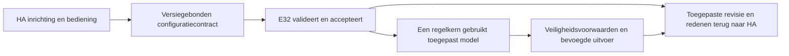

# Architectuuradvies — functioneel volledig en onderhoudbaar

**Aanleiding:** Mark11950, 21 oktober 2026. Mark staat zo nodig ook een andere
framework-/basisopzet toe en vraagt expliciet om kritisch, eerlijk advies.
**Status:** brongebonden uitvoeringsadvies bevestigd na onafhankelijke review van
specialistschets `999bae1` op bron `407f7097`; geen product-/bronvrijgave.
**Werkroute aanvaard:** Mark11956, 21 oktober 14:51. Gerichte herbouw binnen de
lopende integratie uitvoeren waar nodig; geen nieuwe goedkeuringswachtfase.
Geen bewezen implementatie, tijdwinst of releasebelofte.

**Aanvullend bronbewijs Mark11959:** Stage48 native caller onafhankelijk beoordeeld
en gericht getest (74 nativeHA;19zelfde nieuwe gevallen met ASan/UBSan/leaks).
Dit ondersteunt voortbouwen aan één bestaande eigenaar en gerichte koppellaag;
het bewijst geen volledige architectuur-/productvalidatie. Configureerbare
revisie-/pinlevenscyclus, echte producers/factory en bredere topologie blijven open.
De specialistarchitectuurtoets is hieronder verwerkt; de uitvoering blijft lopen.

**Specialisttoets en parentreview, 21 oktober 2026:** de
[uitgewerkte schets](ARCHITECTURE-DECISION.nl.md) bevestigt route B. Parent heeft
de concrete éénvloeropslag, DATA/controlfasekeuze en configuratiegebonden SOURCE-
pins in de bevroren bron gecontroleerd; alle 512 eerdere bestanden zijn bytegelijk
en de resterend-werktabel dekt R01–R31. Dit accepteert de uitvoeringsrichting, niet
Stage55-code of een werkende thermostaat. Bewijs/voorwaarden:
/home/dielessen/artifacts/open-thermostat-architecture-parent-11950-20261021/REVIEW.md.
Config/mapping, onafhankelijke installatiekwalificatie en vluchtige runtime-
bevoegdheid blijven strikt gescheiden. Het nieuwe versiecontract mag huidige pins
niet stilzwijgend versoepelen. Eerste oplevering: twee volledig opgeslagen kamers
via normale HA-apply tot exact C++-readback en herstel, zonder extra projectielaag.

## 1. Feitenbasis en grens

Eerste analyse: geaccepteerde bron `c2e8792`, documentatie `b937296`.
Actuele aanvulling: bevroren specialistbron `407f7097` en schets `999bae1`,
onafhankelijk gelezen voor dit advies. De kandidaatcode zelf blijft afzonderlijke
bronacceptatie; de ontwerpkeuze accepteert die implementatie niet automatisch.

- [Bestaande handoffanalyse](GRAPH-CONTROL-HANDOFF.md) beschrijft werkende
  deelcontracten, maar geen volledige normale HA-configuratie→regelaartransactie.
- De [HA-runtime](../../ha/config/custom_components/open_thermostat/v1_runtime.py)
  houdt configuratie-DATA en controlprofiel bewust gescheiden; DATA-only start
  geen metingslisteners of regelautoriteit. Die grens voorkomt onterechte vrijgave.
- [GraphControlStoreView](../../src/control/GraphControlStoreView.h) leest dezelfde
  begrensde opslag en projecteert alleen expliciet passend verklaarde kamerdoelen;
  het is geen algemene implementatie van alle centrale/groeps-/klepinstellingen.
- Productfactory/producers, volledige gebruikerscaller, bredere topologie en
  actuele E32-resource-/apparaatproeven zijn nog niet gezamenlijk bewezen.

Dit toont een productintegratiegat. Het bewijst niet dat Home Assistant, MQTT of
het gehele ESP32-framework vervangen moet worden, noch dat bestaande code altijd
de goedkoopste of beste oplossing is.

## 2. Vergelijking

| Route | Sterk punt | Risico / ontbrekend bewijs | Voorlopig oordeel |
| --- | --- | --- | --- |
| Alles behouden en caller afbouwen | Veel reeds getoetste componenten bruikbaar | Onvoltooide toestandoverdrachten kunnen onzichtbaar of versnipperd blijven; uitbreidbaarheid nog toetsen | Alleen voldoende als één normale gebruikersroute echt alle stappen beheerst |
| Eigen configuratie-/runtimekoppeling gericht herontwerpen | Eén duidelijke eigenaar van toepassen/herstel, minder losse overgangspaden; hergebruik begrensde opslag/regelmodules mogelijk | Migratie en bedoelde bevoegdheidsgrenzen moeten opnieuw integraal worden bewezen | **Voorkeursroute op huidig bewijs**, zo breed als de aantoonbare blokkade vereist |
| Hele basis/framework vervangen | Vrijheid om fundamentele beperkingen op te lossen | Herbouw platform/netwerk/OTA/protocol en nieuwe regressies; geen aangetoonde totale winst op huidige feiten | Toegestaan, maar pas aanbevelen bij concrete grens die de gerichte route onvoldoende oplost |

Er wordt geen duurvoordeel verzonnen. Extra regels, adapters of oude compatibiliteit
behouden is niet per definitie goedkoper dan vervangen. Volledige vervanging is
evenmin per definitie eenvoudiger.

## 3. Voorkeursarchitectuur en verantwoordelijkheid

Eén herkenbare toepassingsroute, met onderscheiden gewenst, geaccepteerd en
daadwerkelijk toegepast. Geen tweede regelbrein of verborgen concurrerende schrijver.

- **HA:** eigen configuratie-UI, apparaatbindingen, gebruikersbediening en heldere
  gewenst/toegepast/offline/foutstatus. Bestaande onderhouden apparaatdrivers benutten.
- **Koppellaag:** één expliciete lifecycle voor validatie, staging, toepassen,
  bevestigen en herstel. Opgeslagen DATA of een ontvangen ACK verleent op zichzelf
  geen regel- of fysieke bevoegdheid. Behoud eigenaar/revisie/actualiteitschecks.
- **E32:** lokale schema-/regel-/supervisoruitvoering op precies de geaccepteerde
  configuratie; status rapporteert wat werkelijk actief is, niet alleen ontvangen.
- **Herbouwvrijheid:** interne API's, klasse-indeling en zo nodig framework mogen
  vervangen worden. VeiligheidsGEDRAG en acceptatie behouden; specifieke oude
  veiligheidsbestanden zijn niet categorisch onvervangbaar.

Native HA, bestaande lokale MQTT en de ondersteunde ESP32-bouwbasis voorlopig
hergebruiken: geen extra runtime, database, brug of dienst zonder aantoonbare
noodzaak. Dit is een huidige afweging, geen permanent verbod op een betere basis.

## 4. Eerstvolgende concrete bewijsstap

De schets is geleverd en onafhankelijk als uitvoeringsrichting geaccepteerd.
Dezelfde specialist maakt nu de productkoppeling af in drie verticale increments:
contract/opslag, dezelfde owner tot controller, native GUI/productafwerking.

Twee volledige kamers (radiator/vloer) moeten via normale HA-review/apply duurzaam
in één accepted plan worden opgeslagen en exact door de echte C++-core worden
teruggelezen/gebruikt. Wijzig doel én schema zonder per-config SOURCE-code of
DATA/control-factorywissel; toets geïsoleerde doelen/stop, owner-/mappingraces,
lost ACK, onbekend schema, powerloss en reconnect/boot zonder oude grant te herstellen.
Geen vooraf geladen tweekamerreview of test-only tweede configuratiebron als
productvervanger. Payload/heap/NVS/queuegrenzen vóór capaciteitclaims meten;
uiteindelijk acht zones pas na afzonderlijk maxconfig/load/72u-bewijs.
Alle functies en profielen blijven; migratie/rollback is expliciet en behoudt data.

Een native HA/C++-proef is nog geen fysiek bord- of ketelbewijs. Nieuwe volledige
images, echte HA/E32/GUI-proeven, actuator/EMS-/uitval-/duur- en releasechecks blijven
afzonderlijke vereisten.

## 5. Wanneer breder vervangen?

Alleen concrete bevindingen kunnen de keuze ombuigen: het gewenste kamer-/profiel-
model past fundamenteel niet; meerdere actieve state-eigenaren blijven noodzakelijk;
gemeten geheugen/timing maakt de route onhoudbaar; afhankelijkheidsondersteuning
of aantoonbare migratie-/onderhoudslast maakt gericht herstel de slechtere basis.
Leg dan de alternatieve opzet en gevolgen naast de huidige route en wijzig het
advies eerlijk. Geen nieuwe toestemming nodig voor reeds geautoriseerd bronwerk.

Alle [31 eisen](PLAN.nl.md#4-eisen-en-aantoonbare-acceptatie), verzorgde GUI,
gegevensmigratie/identiteit, licenties en veiligheids-/fysieke grenzen blijven.
Geen functie schrappen, gate versoepelen of groen bewijs verzinnen om een keuze
goedkoper te laten lijken. Geen nieuwe overnames uit de oorspronkelijke upstream.
