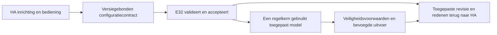

# Architectuuradvies — functioneel volledig en onderhoudbaar

**Aanleiding:** Mark11950, 21 oktober 2026. Mark staat zo nodig ook een andere
framework-/basisopzet toe en vraagt expliciet om kritisch, eerlijk advies.
**Status:** voorlopig onafhankelijk OpenClaw-advies; specialisttoets open.
**Werkroute aanvaard:** Mark11956, 21 oktober 14:51. Gerichte herbouw binnen de
lopende integratie uitvoeren waar nodig; geen nieuwe goedkeuringswachtfase.
Geen afgeronde architectuurvalidatie, bewezen tijdwinst of releasebelofte.

## 1. Feitenbasis en grens

Beoordeeld: geaccepteerde bron `c2e8792`, aangevuld met documentatie `b937296`.
De actieve specialistcandidate is niet dezelfde snapshot; zijn lopende werk kan
reeds delen oplossen en wordt vóór een definitieve route afzonderlijk beoordeeld.

- [Bestaande handoffanalyse](GRAPH-CONTROL-HANDOFF.md) beschrijft werkende
  deelcontracten, maar geen volledige normale HA-configuratie→regelaartransactie.
- De [HA-runtime](../../ha/config/custom_components/open_thermostat/v1_runtime.py)
  houdt configuratie-DATA en controlprofiel bewust gescheiden; DATA-only start
  geen metingslisteners of regelautoriteit. Die grens voorkomt onterechte vrijgave.
- [GraphControlStoreView](../../src/control/GraphControlStoreView.h) leest dezelfde
  begrensde opslag en projecteert alleen expliciet passend verklaarde kamerdoelen;
  het is geen algemene implementatie van alle centrale/groeps-/klepinstellingen.
- Productfactory/producers, volledige gebruikerscaller, bredere topologie en
  actuele E32-resource-/apparaatproeven zijn nog niet gezamenlijk bewezen.

Dit toont een productintegratiegat. Het bewijst niet dat Home Assistant, MQTT of
het gehele ESP32-framework vervangen moet worden, noch dat bestaande code altijd
de goedkoopste of beste oplossing is.

## 2. Vergelijking

| Route | Sterk punt | Risico / ontbrekend bewijs | Voorlopig oordeel |
| --- | --- | --- | --- |
| Alles behouden en caller afbouwen | Veel reeds getoetste componenten bruikbaar | Onvoltooide toestandoverdrachten kunnen onzichtbaar of versnipperd blijven; uitbreidbaarheid nog toetsen | Alleen voldoende als één normale gebruikersroute echt alle stappen beheerst |
| Eigen configuratie-/runtimekoppeling gericht herontwerpen | Eén duidelijke eigenaar van toepassen/herstel, minder losse overgangspaden; hergebruik begrensde opslag/regelmodules mogelijk | Migratie en bedoelde bevoegdheidsgrenzen moeten opnieuw integraal worden bewezen | **Voorkeursroute op huidig bewijs**, zo breed als de aantoonbare blokkade vereist |
| Hele basis/framework vervangen | Vrijheid om fundamentele beperkingen op te lossen | Herbouw platform/netwerk/OTA/protocol en nieuwe regressies; geen aangetoonde totale winst op huidige feiten | Toegestaan, maar pas aanbevelen bij concrete grens die de gerichte route onvoldoende oplost |

Er wordt geen duurvoordeel verzonnen. Extra regels, adapters of oude compatibiliteit
behouden is niet per definitie goedkoper dan vervangen. Volledige vervanging is
evenmin per definitie eenvoudiger.

## 3. Voorkeursarchitectuur en verantwoordelijkheid

Eén herkenbare toepassingsroute, met onderscheiden gewenst, geaccepteerd en
daadwerkelijk toegepast. Geen tweede regelbrein of verborgen concurrerende schrijver.

- **HA:** eigen configuratie-UI, apparaatbindingen, gebruikersbediening en heldere
  gewenst/toegepast/offline/foutstatus. Bestaande onderhouden apparaatdrivers benutten.
- **Koppellaag:** één expliciete lifecycle voor validatie, staging, toepassen,
  bevestigen en herstel. Opgeslagen DATA of een ontvangen ACK verleent op zichzelf
  geen regel- of fysieke bevoegdheid. Behoud eigenaar/revisie/actualiteitschecks.
- **E32:** lokale schema-/regel-/supervisoruitvoering op precies de geaccepteerde
  configuratie; status rapporteert wat werkelijk actief is, niet alleen ontvangen.
- **Herbouwvrijheid:** interne API's, klasse-indeling en zo nodig framework mogen
  vervangen worden. VeiligheidsGEDRAG en acceptatie behouden; specifieke oude
  veiligheidsbestanden zijn niet categorisch onvervangbaar.

Native HA, bestaande lokale MQTT en de ondersteunde ESP32-bouwbasis voorlopig
hergebruiken: geen extra runtime, database, brug of dienst zonder aantoonbare
noodzaak. Dit is een huidige afweging, geen permanent verbod op een betere basis.

## 4. Eerstvolgende concrete bewijsstap

Dezelfde specialist levert naast het lopende integratiewerk een korte schets met
exact behouden/vervangen modules en één aanbevolen route. Parent toetst die tegen
de werkelijke candidate en bovenstaande feiten, niet alleen tegen een samenvatting.

Voor één kamer moet de normale HA-inrichting via echte productiecodepaden leiden
tot een daadwerkelijk door de regelkern gebruikte configuratie, met onafhankelijke
teruglezing, herstart/herverbinding en afwijzing van ongeldige/verouderde opdrachten.
Dat is de eerste volledige softwaredoorsnede, **geen versmalling van het eindproduct**.
Daarna dezelfde identiteit/isoleringsgaranties voor twee en uiteindelijk de
bedoelde meerdere kamers, inclusief resourcegrenzen en alle afgesproken profielen.

Een native HA/C++-proef is nog geen fysiek bord- of ketelbewijs. Nieuwe volledige
images, echte HA/E32/GUI-proeven, actuator/EMS-/uitval-/duur- en releasechecks blijven
afzonderlijke vereisten.

## 5. Wanneer breder vervangen?

Alleen concrete bevindingen kunnen de keuze ombuigen: het gewenste kamer-/profiel-
model past fundamenteel niet; meerdere actieve state-eigenaren blijven noodzakelijk;
gemeten geheugen/timing maakt de route onhoudbaar; afhankelijkheidsondersteuning
of aantoonbare migratie-/onderhoudslast maakt gericht herstel de slechtere basis.
Leg dan de alternatieve opzet en gevolgen naast de huidige route en wijzig het
advies eerlijk. Geen nieuwe toestemming nodig voor reeds geautoriseerd bronwerk.

Alle [31 eisen](PLAN.nl.md#4-eisen-en-aantoonbare-acceptatie), verzorgde GUI,
gegevensmigratie/identiteit, licenties en veiligheids-/fysieke grenzen blijven.
Geen functie schrappen, gate versoepelen of groen bewijs verzinnen om een keuze
goedkoper te laten lijken. Geen nieuwe overnames uit de oorspronkelijke upstream.
