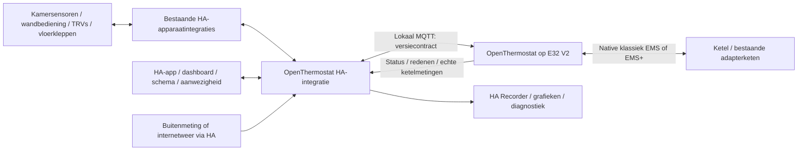

# OpenThermostat + Home Assistant — masterplan

**Geactualiseerd op 25 oktober 2026.** Alle 31 eisen R01–R31 en de oorspronkelijke
acceptatiepoorten F0–F10 hieronder blijven gelden. De actuele stand, voltooid
softwarewerk, open uitvoering en releasechecklist staan uitsluitend in
[WORKBOARD](WORKBOARD.nl.md). De eerdere statusinleiding is ongewijzigd bewaard
in `out/plan-audit-20261023/PLAN.nl.md.before`; oude versies/open punten uit die
inleiding zijn geen actuele planning meer.

## Actuele opdracht en releasegrens

Mark vraagt één complete samenhangende eerste bèta waarmee de ketel gekoppeld,
uitgelezen en onder concrete voorwaarden begrensd aangestuurd kan worden. Alles
wat eerder is voorbereid moet in de releasebasis behouden blijven. Daarom is
ieder voorbereid onderdeel opgenomen in de [release-inventaris](BETA1-RELEASE-INVENTARIS.json)
en in [WORKBOARD §3](WORKBOARD.nl.md#3-alles-wat-voorbereid-is-meenemen-in-de-bèta).

- **Geïnstalleerd:** HA dev48 (bron `70135db3`) en E32 alpha31 (bron `659879e`).
  Verse HA47-back-up van 96, één normale Core-herstart en 86 exacte componentbestanden.
  Instellingen, programma's, koppelingen en kaarten behouden. Tado-configuratie
  behouden; geen fysieke opdrachten. [Installatie en aparte nacontrole](INSTALLATIE-HA48-ALPHA35-20261025.nl.md).
- **Gepubliceerd:** HA dev48 en E32 alpha35 op bron `70135db3`. Deze opdracht voerde
  geen E32-upload uit. De oudere uploader-watchdogoorzaak/herstelroute blijven open;
  de actor/methode van de eerdere alpha31-installatie zijn onbekend.
  HA48 levert cleanup na callbackexception en de gedeelde klokfixture met vier
  regressies. Alpha35 bevat een pure Shelly-decoderbasis, nog zonder BLE-runtimekoppeling.
- **Geleverde softwarebasis:** EMS-apparatenpagina, sessie-/klokbewaking,
  opstartherstel, web-/editorcorrecties en HA-kraanberichtbedrading met standaard
  gesloten productfabriek, oorspronkelijke aanvraagcorrelatie, beschermd kanaalbeheer
  en deadlinegebonden nonblocking writes. HA46 voegt begrensde ontvangstdiagnostiek toe;
  alpha33-bron bewaakt ook herintrede bij de laatste socketcontrole en kanaaltoelating.
  HA47 bewaakt nu ook de opstart over async-configuratie/Store/MQTT-grenzen;
  alpha34-bron bevat gerichte updatercheckpoints met EN/NL-uitleg.
  Dit kwalificeert geen meetbron of fysieke kraanroute.
- **Voorbereide productbasis behouden:** regelaars/supervisor, water-/vloer-/
  mengerpolicies, metrics/grafieken/CSV, comfort/context en leermodellen. De
  ontbrekende aansluiting en praktijkkwalificatie staan per eis op het werkbord.
- **Nog nodig voor actieve bèta:** actuele meetbron en native kraantransactie,
  werkelijke veiligheidsfeiten, beoordeeld installatie-/TX-/stopprofiel en
  gecontroleerde fysieke proeven. Policy, Classic-encoder en laatste
  verzendcontrole zijn al gebouwd; ontbrekende kwalificatie blijft zichtbaar open.
- **Nu vóór fysieke proeven:** het gemelde pendelen onderzoeken. De passieve
  controle toont geen OpenThermostat-verzending; warmwatergerelateerde periodes
  zijn waargenomen, maar de oorzaak is nog onbekend. Zie het actuele werkbord.

Software aanwezig, software geleverd en fysieke werking bewezen zijn aparte
statussen. Bestaande onvolledige features gaan als begrensde bron mee, zonder
ze automatisch te activeren. Het productdoel blijft maximaal acht gevalideerde
zones; het huidige native plan ondersteunt één of twee kamers binnen zijn
bestaande byte-/transitiebudgetten. Leren, vloer- en onbeheerd verwarmingsbedrijf
krijgen geen vrijgave door deze planherijking. Geen nieuwe F9/F10/P2-stage vóór M2.

[De actuele 31-eisenmatrix](WORKBOARD.nl.md#4-alle-31-producteisen--actuele-softwarestand-en-resterend-werk)
benoemt per eis bestaande code én ontbrekend werk. De B01–B14-releasechecklist
in WORKBOARD §6 is de uitvoervolgorde; na ieder pakket status en bewijs bijwerken.
De overige paragrafen hieronder beschrijven het blijvende ontwerp en de
acceptatiecriteria, geen tweede concurrerende afvinklijst.

## Aanvulling Mark 24 oktober: directe Bluetooth-kranen en zelfstandig bedrijf

Naast alle bestaande functionaliteit komt een optionele rechtstreekse
Shelly BLU TRV-koppeling en een expliciete lokale E32-regelmodus zonder
Home Assistant in de regelketen. Ontwerp en fasering:
[uitbreiding X01](SHELLY-BLU-TRV-STANDALONE.nl.md). De 31 oorspronkelijke eisen,
voorbereide code en bestaande HA-route blijven behouden. Zelfstandig bedrijf
vereist lokale bronnen, planning/tijd, opslag, één eigenaar en dezelfde fysieke
veiligheidsacceptatie. Het verruimen van de HA-lease verleent die functie niet.

## Aanvulling Mark 23 oktober: GitHub-releases en E32-upgrades

Mark geeft opdracht om de geteste wijzigingen netjes als GitHub-releases uit te
brengen en machtigt E32-upgrades wanneer die nodig zijn voor de uitvoering.
Die toestemming hoeft niet per normale testrelease of passende app-update opnieuw
te worden gevraagd. HA en E32 krijgen afzonderlijk herkenbare versies, vaste tags,
broncommit, releasenotities, integriteitsbewijs en downloadchecksums.

De bestaande GitHub Actions blijven de publicatieroute. HA-only tags gebruiken
`ha-v<integratieversie>` en bevatten geen firmware; E32-tags blijven gelijk aan
`release.json` en behouden hun firmwarevoorwaarden. Bestaande releases/tags worden
niet overschreven. Privébeheerbestanden en live HA-opslag worden niet gepubliceerd.
Een gewone E32-upgrade gebruikt app-only OTA met configuratiebehoud, voor-/nacontrole
en beschikbare terugval. De bestaande bron-, herstel- en fysieke acceptatie blijft
gelden; de toestemming is geen aftekening van die proeven.

## Aanvulling Mark: complete kamerbediening en doorlopende uitvoering

De optionele **externe kamerdoelbron** (bijvoorbeeld een wandthermostaat of
temperatuurknop, R02) en **raamcontact** (R21) blijven onderdeel van het product.
Ze mogen bij het vernieuwen van de kamereditor niet stilzwijgend verdwijnen.
Koppelen, wijzigen en verwijderen horen samen met sensor, kranen en weekplanner
in hetzelfde kamerscherm, met uitleg over override/hervatting respectievelijk
raampauze/vorst/uitval. Een externe doelbron is iets anders dan de losse
temperatuurmeting, de buitensensor of een extra weekprogramma.

Ondersteuning vraagt de hele keten: apparaatprofiel, bewaarde identiteit,
echo-/conflictbehandeling, gevalideerd contract en E32-uitvoering. Alleen een
selector tonen of een bestaand modelveld bewaren is geen geleverde functie.
Verschillende TRV-modellen mogen samen in één installatie, met per model getoetste
aansturing van externe meting, klepstand of doeltemperatuur (§6.1).

De concrete actuele werkvolgorde staat uitsluitend in [WORKBOARD §6](WORKBOARD.nl.md#6-werkpakketten-en-eerstvolgende-uitvoering).
De [nachtvolgorde](UITVOERING-NACHT-20261022.nl.md) verwijst voortaan daarnaar.
De bestaande M2- en fysieke/releasevoorwaarden en F9/F10/P2-volgorde blijven gelden.

## Keuze 22 oktober: één kamerprogramma

Mark laat de alternatieve HA Schedule-helper weg. Het normale toevoegen,
aanpassen en het grafische kamerscherm bieden uitsluitend het ingebouwde
weekprogramma, met temperatuur per blok en de basistemperatuur erbuiten.
Geen programmabronselectie of Schedule-entity onder Geavanceerd. Bestaande
opgeslagen externe koppelingen worden behouden en expliciet als bestaand
extern programma getoond; deze UI-keuze verwijdert geen HA-helper of historie.

**Versie:** ontwerp 1.0, herijkt op 23 oktober 2026 met volledige software-/release-inventaris; alle oorspronkelijke eisen en acceptatie behouden.
**Producteigenaar:** Mark Dielessen.
**Actuele status en enige afvinklijst:** [WORKBOARD.nl.md](WORKBOARD.nl.md). Dit plan
bevat ontwerp, eisen en acceptatievoorwaarden, geen voortgang.
**Besluitenlog:** [BESLUITEN.nl.md](BESLUITEN.nl.md).
**Geen normale verwarmingsvrijgave.** HA configureert en bedient; E32 blijft het
regelbrein. In HA-managed bedrijf verdwijnen overbodige dubbele E32-editors pas
via de afgebakende migratie/bronchecks in het werkbord, niet door dit planonderhoud.
**Historische ontwerpbronbasis:** fork `a5fc6b84ab62603bca7cc3786f405d497edd17f7`;
upstream `67b76391f2f81d5d5acd5a8d4675067fddc74448`. Actuele bron-/installatieversies
staan per bewijs in het werkbord. De geleverde PDF1.0 blijft historisch.

### Configuratieroute — keuze Mark, 22 oktober; aansluitstatus bijgewerkt 24 oktober

Op 22 oktober meldde Mark dat de E32 los van de ketel stond. Inmiddels is de
keten aangesloten voor passieve ontvangst; die is in de latere installatie- en
veldcontroles vastgelegd. Tado blijft de actieve regelaar; E32-zenden en fysieke
uitgangen blijven geblokkeerd. Een actieve aansluit-/stopproef is niet afgetekend.
We bouwen en richten
meteen de **normale productconfiguratie** in: één OpenThermostat-installatie met
centrale ketel-/circuitinstellingen en ruimtes via de gewone wizard.

Er komt geen aparte schaduwinstallatie die Mark eerst moet configureren en later
opnieuw naar een productieconfiguratie moet omzetten. Keuzes als legacy/shadow,
adapter-ID, shadow-profiel, graphmodus en prepare/apply-proefstappen horen niet in
het gewone gebruikerspad. Een nog niet aangesloten ketel krijgt eenvoudig een
zichtbare verbindings-/toepassingsstatus in dezelfde installatie. Configureren mag
doorgaan; een opgeslagen instelling is nog geen bevestigde uitvoering.

De bestaande OpenThermostat-testentries en hun testgegevens mogen na een gerichte
back-up worden heringericht, samengevoegd of door één schone normale inrichting
worden vervangen. Behoud bruikbare kamer-/apparaatkoppelingen waar zinvol; een
zware productiemigratie voor wegwerpbare testgegevens is geen voorwaarde.
Dit betreft OpenThermostat-projectconfiguratie, niet de overige HA-installatie,
apparaatintegraties, credentials of Recorderhistorie.

Deze keuze vervangt het eerdere **gebruikerspad** met afzonderlijke shadowconfig.
De bestaande shadowcontracten, uitvoerblokkades en tests worden technisch
beoordeeld en gericht vervangen/hergebruikt; alleen labels omdopen of een
enable-vlag aanzetten is geen werkende normale productroute. Interne replay- en
benchtests mogen blijven bestaan. Het latere aansluiten op de ketel en fysieke
ketelregeling blijven afzonderlijke commissioning; hun voorwaarden blokkeren
geen bouw of inrichting van de normale GUI op de ontkoppelde E32.

### Gebruikersaanvullingen na de ontwerp-PDF, 19 oktober 23:24–23:31

Deze concretiseren bestaande eisen R01/R02/R28; het aantal eisen blijft 31.
De eerder geleverde PDF blijft de historische ontwerpversie1.0.

- Mark bevestigt dat de huidige Tadoverwarming weer normaal werkt en alles nu goed werkt; geen onafhankelijke nieuwe hardwareproef. Eén bestaande E32 is beschikbaar voor tests, geen tweede bord veronderstellen. De Tado vervalt later als regelaar; zie [§6.3](#63-bestaande-tado-v3v3).
- Iedere kamer krijgt via de HA-GUI zelf te kiezen en later te wijzigen sensor-/TRV-/actuatorbindingen. Geen vaste badkamerentity-ID's en geen verplichte YAML voor normale inrichting. Badkamer met bestaande HA-sensor/TRV is de eerste kandidaat, profielcompatibiliteit nog te toetsen.
- Bediening via de HA-kamerclimate moet zonder wandapparaat werken. Een ondersteunde fysieke kamerbediening blijft later toevoegbaar aan hetzelfde kamerdoel; R02 als productmogelijkheid blijft vereist.
- Normale kamerinstellingen, bindingen en schema's moeten tijdens bedrijf wijzigbaar zijn zonder E32-herstart of reflash, via de bestaande gevalideerde configuratietransactie. Gecompileerde logica wijzigen via netwerk-OTA met gecontroleerde herstart, configuratiebehoud of expliciete migratie en geteste recovery; geen willekeurige codehotpatch of gegarandeerd onderbrekingsvrije update.
- Eerste ongeconfigureerde boot: eigen beveiligd instelwifinetwerk en lokale browserpagina om thuis-SSID/wachtwoord te kiezen, zonder voorafgaande HA/MQTT/internet/Ethernet. Foute credentials tonen en opnieuw proberen zonder reflash, instellingen na reboot behouden, instel-AP na succesvolle onboarding uitschakelen en bewuste lokale recovery/herconfiguratie aanbieden. Automatisch captive-portalopenen is nog geen bewezen functie; geen permanent open AP of configuratiewisactie na een korte netwerkstoring.

Acceptatie van deze aanvullingen blijft open: GUI-selectie/herconfiguratie en HA-only kamerbediening, latere fysieke bediening zonder echolus, live configuratie, OTA/migratie/recovery en fysieke eerste-boot-/foutwachtwoord-/herstartproeven op de E32.

## 1. Besluit in één pagina

We bouwen een **lokale, open-source zonethermostaat**, niet alleen een dashboard of een verzameling losse HA-automatiseringen. De bestaande OpenThermostat-fork wordt het centrale regelbrein op de E32 V2. De bestaande custom HA-integratie wordt de normale configuratie-, bedienings- en apparaatlaag. Bestaande Zigbee/WiFi/BLE-apparaten blijven via hun onderhouden HA-integratie werken.

Het productdoel is: per kamer de gewenste temperatuur kiezen, de juiste radiatoren/vloerverwarming bedienen, alleen de benodigde ketelwarmte aanvragen, op tijd comfortabel zijn en kunnen terugzien **wat gevraagd is, wat werkelijk gemeten is en waarom de regeling dat deed**. Geen verplicht cloudabonnement; internetweer is een verwisselbare bron, geen noodzakelijke regelaar.

### Productkwaliteit voor eindgebruikers — aanvulling Mark, 22 oktober

Het eindproduct moet een **zeer gebruiksvriendelijke moderne slimme thermostaat**
worden. Eenvoudige inrichting, duidelijke bediening, een aantrekkelijke grafische
weergave en goede snelheid zijn acceptatievoorwaarden. De reeds besproken slimme
functies blijven vastgelegd in R01–R31: onder meer meerdere kamers, weekprogramma's,
tijdelijke doelen, comfort/eco/afwezigheid/vakantie/boost, aanwezigheid, raam-open,
zelfleren, op tijd warm, uitlopen, weersafhankelijk regelen en verklaarbare historie.
Hun bestaande prioriteiten en bewijsvoorwaarden blijven gelden; deze aanvulling
maakt geen nog onbewezen functie tot een geleverde functie.

De normale gebruiker richt kamers en programma's in **Home Assistant** in.
Technische groepsconstructies, interne modi, contractnamen en entity-ID's zijn
geen verplichte stappen in de gewone gebruikersroute. Geavanceerde instellingen
blijven bereikbaar met uitleg. De E32 krijgt een vernieuwde, snelle web-GUI met
een grafisch startdashboard voor ketelgegevens, ketelaansturing en de warmtevraag
per kamer; dit gebruikt dezelfde regeling en maakt geen tweede configuratie-eigenaar.
De weekplanner, het dashboard en de opschoning van de E32 zijn uitgewerkt in
[§9](#9-buitenwaarde-schema-en-tijd), [§11](#11-dashboard-grafieken-en-gegevensintegriteit)
en [§13](#13-softwarestructuur-en-contract).

**Aanscherping Mark, 22 oktober — één kamerscherm:** alleen het toevoegen van
een nieuwe ruimte gebruikt de wizard. Een bestaande ruimte aanpassen opent
direct de instellingen, zonder opnieuw de wizard of een controlescherm te
doorlopen. Naam, verwarmingstype, sensor, kranen, basistemperatuur en grafische
weekplanner horen in één UI met één gezamenlijke opslagactie. Geavanceerd blijft
standaard gesloten en instellingen krijgen uitleg over hun werking en impact.
Tijdblokken kunnen rechtstreeks in het raster worden getekend of aangeklikt;
tijden en temperatuur zijn inline te wijzigen. Knoppen en invoervelden bieden
dezelfde bediening voor toetsenbord en mobiel. Geen verplichte losse blokdialogen
of een andere configuratieroute om alleen een temperatuur te veranderen.

### De gekozen scheiding

#### Productkoers en architectuurroute (besluiten 21 oktober)

- **Eigen product:** we ontwikkelen een zelfstandig softwareproject. OpenThermostat
  is de historische codebasis; geen upstream-pull, -merge of -rebase meer. Afkomst,
  copyright en licenties blijven behouden; de remote blijft onaangeroerd.
- **Herschrijven toegestaan bij functiebehoud:** de 31 eisen en gebruikersfuncties
  zijn leidend, niet de oude implementatie. Geen stil functieverlies; migratie en
  terugval voor bewaarde gegevens; fysieke en releasegates blijven.
- **Route B:** de productkoppellaag gericht vervangen door één versiecontract en één
  accepted ControlPlan, met de bestaande native HA/MQTT/Store- en regel-/veiligheidskern.
  Een bredere herbouw blijft toegestaan bij een aangetoonde blokkade; geen big-bang.
- Volledige tekst: [BESLUITEN](BESLUITEN.nl.md); onderbouwing:
  [architectuurbesluit](ARCHITECTURE-DECISION.nl.md) en [advies](ARCHITECTURE-ADVICE.nl.md).

#### Verantwoordelijkheden

1. **OpenThermostat:** geldigverklaring van aangeleverde metingen, effectieve kamerdoelen, zonevraag, thermische modellen, voorverwarmen, waterstooklijn, gezamenlijke ketelvraag, lokale veiligheidsvoorwaarden en EMS-protocol/telemetrie.
2. **HA-integratie:** apparaten selecteren, metingen en gebruikersbediening vertalen, actuatoropdrachten uitvoeren, terugmeldingen leveren, configuratie beheren, entiteiten en diagnosen aanbieden.
3. **Home Assistant zelf:** bestaande apparaatdrivers, mobiele bediening, personen/aanwezigheid, bestaande weekagenda, Recorder/grafieken en meldingskanalen. Geen tweede kamer-PID of ketelcoördinator naast OpenThermostat.
4. **TRV/actuator:** fysieke bediening; bij een TRV-profiel eventueel de lokale binnenste klepregelaar. Per regelkring precies één eigenaar.
5. **Ketel/UBA:** eigen branderregeling, tapwaterprioriteit en fabrikantbeveiligingen blijven van de ketel. Een gewenste watertemperatuur is geen rechtstreeks branderpercentage.

Dit is **cloudonafhankelijk, maar met HA-apparaten niet HA-onafhankelijk**. Bij HA-/brokeruitval kan de E32 die draadloze kranen niet bedienen. Uitvalgedrag is daarom een kernfunctie en een acceptatiepoort, niet een latere verbetering.

### Eerste en uiteindelijke resultaat

Twee eerste mijlpalen, bewust verschillend:

- **M1 — softwareketen (host/native, geen hardware):** twee volledige kamers via de normale HA-review/apply → één accepted ControlPlan → exact teruglezen in dezelfde C++-owner/controller; doel, schema en stop wijzigen en herstellen. Zie [architectuurbesluit §5](ARCHITECTURE-DECISION.nl.md#5-eerstvolgende-verticale-oplevering--geen-nieuw-ontwerptraject).
- **M2 — eerste fysieke kamerketen:** één kamer (de badkamer is kandidaat, geen goedgekeurd testobject) met een echte HA-temperatuurbron → HA → E32 → configACK en zichtbaar effectief doel, plus één echte kraan zonder ketel (WP05). Ketelvraag alleen gesimuleerd; E32-TX blijft geblokkeerd.
- **Eerste echte ketelbedrijf:** pas na afzonderlijke hardware-, EMS-, doorstromings-, stop- en uitvalproeven; eerst één zone onder toezicht.
- **Volwaardig resultaat:** bewezen meerdere zones, radiator- en optionele vloerverwarmingsgroepen, adaptieve regeling en geleerd voorverwarmen, weersafhankelijke waterdoelen, relevante keteltelemetrie en historische rapportage, plus de gekozen comfortfuncties.

## 2. Historische ontwerpbaseline van 19 oktober

Deze tabel is de oorspronkelijke bronsnapshot, **geen actuele voortgang**.
Zie [het actuele werkbord](WORKBOARD.nl.md#1-waar-staan-we) voor uitgevoerd werk.

| Onderdeel | Op ontwerpdatum aanwezig | Toen nog nodig / begrenzing |
| --- | --- | --- |
| Kamers en programma's | Permanente kamer-ID's, kamerbestand en weekprogramma's, tijdelijke overrides | HA-configuratie/synchronisatie en eenduidige schrijf-eigenaar; migratie van bestaande gegevens |
| Kamerregeling | Gemiddelde van recente BLE-metingen, start-/doorgaanmarges | Dit is hysterese, geen bewezen zelflerende regeling; externe bronabstractie en apparaatprofielen ontbreken |
| Weersinvloed | Negenpunts waterstooklijn; buitenwaarde uit EMS/OpenWeather | HA-buitenbron, bronprioriteit, actualiteit, uitvalbeleid en begrensde adaptatie; huidige impliciete −20 °C bij ontbrekende bron vervangen |
| Kleppen | Lokale GPIO-/expanderkleppen met opstartvertraging | Geen generieke draadloze TRV-/HA-klepuitvoer. E32 heeft geen vrijgegeven lokale hulppinnen |
| MQTT | Status/Discovery en gevalideerde tijdelijke doeltemperatuurcommando's met antwoord | Geen algemene metingsingang, actuatoropdrachten/feedback, versiehandshake of volledige configuratie-API |
| HA-integratie 0.3.0 | Kamerclimates, sensoren/numbers, override, beheerd dashboard, schattingen | Nog geen keuze van bestaande HA-sensoren/TRVs, bronbindingen, floor-profielen of bidirectioneel regelcontract |
| Ketelstatus | Vooral EMS+-processors en een beperkte statusstructuur | Klassiek EMS volledig maken; relevante EMS-ESP-velden en goede onbekend/oud-semantiek toevoegen |
| E32 V2 | Afzonderlijk buildtarget, bron-/pakketcontroles, ongewijzigde alpha.1 | Niet fysiek bewezen. EMS-TX/forwarder/reset-breaks en GPIO/I2C/RTC zijn hard geblokkeerd |
| Netwerk | LAN8720 en WiFi/AP-code | Huidige gelijktijdige klok/radiopad is een bekende beperking; exclusieve netwerkkeuze en fysieke lastproef nodig |
| Grafieken | Bestaande HA-statistiekbasis, verwarmingsoverzicht en energiemodel | Geen volledige, gevalideerde vraag/werkelijk-modulatie-tijdlijn of EMS-ESP-pariteit |
| Testen | Bestaande native regel-/config-/E32-tests en builds | Protocolreplay, HA-contract-/apparaatproeven, foutinjectie, thermische replay en fysieke bewijsvoering |

**Belangrijk:** bestaande statusnamen als `boilerStarted` beschrijven interne vraag/softwarestatus. Ze bewijzen op de TX-locked E32 geen branderactiviteit. Een broncodefunctie is geen fysieke acceptatie.

### Historische upstreamanalyse — geen actueel overnamedoel

Onderstaande analyse van 19 oktober blijft uitsluitend historische naslag. Het
besluit van Mark op 21 oktober vervangt alle toenmalige overname-/portopdrachten:
de eigen fork is autoritatief; geen upstream-pull, merge of rebase plannen of
uitvoeren. Bestaande credits, licenties en notices blijven behouden.

De fork en upstream zijn divergerend: de controle van 19 oktober vond **drie upstreamcommits** die de fork niet bevat en **tien forkcommits** die upstream niet bevat. We vervangen onze main dus niet door upstream.

- `b2a6df8995a6c59f1006bfb41056d0b2dc020f93`: uitgebreidere verwarmingsstatistieken, o.a. integratie/dashboard/select. Destijds als hergebruikkandidaat beoordeeld; geen nieuwe overnameopdracht.
- `fe256952724a5c0ef9b092869f0725597e3c1d65`: Espressif32 8 / Arduino 3, afhankelijkheids-/headeraanpassingen. De generieke 4-MB-ESP32 gaat daar naar één factory-app zonder app-OTA. **Die partitie niet overnemen op E32 V2.** E32-target, dual-app/dual-filesystem, verifier en alle TX-blokkades blijven expliciete behoudseisen. De nieuwe compatibiliteitshook raakt een librarykopie; eerst upstreamondersteuning verkiezen en zo nodig versiegebonden beoordelen.
- `67b76391f2f81d5d5acd5a8d4675067fddc74448`: EMS-decoding/logging uit UART-pad, begrensde framequeue, vooraf gecodeerde TX. Historische integratiekandidaat, geen nieuwe overnameopdracht. Onze write-/forward-/breakblokkades blijven behouden; geen impliciete vrijgave door een nieuw codepad.

Deze historische bronwijzigingen zijn geen bewijs dat onze Ethernet/WiFi- of EMS-timingproblemen fysiek opgelost zijn. Eigen wijzigingen blijven afzonderlijk reviewbaar, met eigen regressie-uitkomst en behoud van de fysieke acceptatiegates.

## 3. Bestaande oplossingen en hergebruik

De opdracht om deze fork uit te breiden is expliciet maatwerk. Toch schrijven we geen eigen Zigbee-stack, weerplatform, database, grafiekdienst of achtergrondcoördinator.

| Project / gecontroleerde release | Goed herbruikbaar als voorbeeld/basis | Waarom niet het complete eindproduct | Licentie-aandacht |
| --- | --- | --- | --- |
| OpenThermostat historische basis | Reeds hergebruikte ESP32-regelstructuur, schema's en UI; geen nieuwe upstreamovernames | Gewenste HA-input/output en volledige Classic-route ontbreken in onze huidige basis | MIT; credits/notices behouden |
| EMS-ESP 3.8.6 | Telegrammappings, apparaatcapabilities, units, sentinelwaarden, busgedrag; referentie voor uitleespariteit | Volwaardige EMS-gateway, maar geen volledige hier gewenste adaptieve zonethermostaat | LGPL-3.0; bron/notice/linking-/distributievoorwaarden vooraf bepalen bij codehergebruik |
| SAT 4.2.1 | PID/stooklijnconcepten, heldere vergelijking voor centrale waterregeling | HA-regelbrein met EMS-ESP-backend, niet onze gevraagde native E32-controller; bestaande Classic-mappingbezwaren blijven | GPL-3.0; geen ongetoetste kopie naar MIT |
| Versatile Thermostat 10.6.1 | Zonefuncties, externe sensor, actuatorprofielen, Auto-TPI, centrale vraag; actuele docs laten ook templatewaarden in centrale actions toe | Daarmee niet bewezen een complete native Classic-EMS-waterregelaar op E32; niet universeel tot alleen vaste vraag reduceren | MIT; geselecteerde herbruikbare delen met notices en tests beoordelen |
| Better Thermostat 1.9.3 | TRV-eigenaardigheden, externe temperatuur, gebruikersfuncties | Geen complete centrale EMS-controller | AGPL-3.0; geen blinde codeovername |
| HA / Zigbee2MQTT / ESPHome / bestaande WiFi-integraties | Apparaatontsluiting, listeners/actions, schemahelpers, app, Recorder, grafieken | Worden gebruikt als platform, niet als concurrerende thermostaten | Per afhankelijkheid vastleggen; geen extra betaald platform nodig |

Repositorymetadata op 19 oktober: bovenstaande repositories zijn niet gearchiveerd; recente activiteit verschilt (SAT laatste push maart 2026, andere kandidaten oktober). Dit is geen onderhoudsgarantie. Firmware en integratie krijgen een afhankelijkheids-/licentieoverzicht. Algoritme-ideeën vergelijken is iets anders dan broncode kopiëren. Vendorfuncties zijn inspiratie; geen klonen van Tado-/Honeywell-protocollen, branding of gepatenteerde implementaties.

**Geen verplichte runtimecombinatie SAT + Versatile + Better + OpenThermostat.** Dat zou onduidelijk maken wie de kamer, klep of ketel regelt. Het bestaande 16-oktober-HA/SAT-voorstel blijft een historische alternatieve route en wordt niet stilzwijgend als reeds gevalideerde onderdeelkeuze behandeld.

## 4. Eisen en aantoonbare acceptatie

`P0` = vereist voor betrouwbaar eerste productiegebruik; `P1` = volledig moderne kern; `P2` = optionele uitbreiding. Een faseverwijzing is een bouwvolgorde, geen bewijs dat iets werkt. `B` = bench/integratieproef, `H` = hardware/liveproef, `L` = langere observatie. De volledige productacceptatie blijft open; afzonderlijke software-/installatiechecks zijn inmiddels bewezen. Actuele vinkjes en bewijs staan uitsluitend in [WORKBOARD](WORKBOARD.nl.md).

| ID | Eis / prioriteit | Ontwerp | Fase en acceptatie |
| --- | --- | --- | --- |
| R01 | Per kamer temperatuur instellen, P0 | Eén `climate` per zone; permanente zone-ID, area en doelbron | F2/F3 B: twee kamers met verschillende doelen, hernoemen/reload bewaart identiteit |
| R02 | Bedienen via Zigbee/WiFi-apparaat, P0 | Bestaande HA-climate/number of profiel voor knop/wandbediening als setpointbron | F3 B/H: draaien op gekozen apparaat levert exact één override; software-echo start geen nieuwe override |
| R03 | Gemengde temperatuursensoren, P0 | HA-binding met unitnormalisatie, validatie en actualiteit; BLE-route behouden | F2/F3 B: twee merken/verbindingen, constante verse waarde blijft geldig, oude/ongeldige waarde niet |
| R04 | Eén of meerdere TRVs per kamer, P0 | Modelgebonden actuatorprofiel en groepsstatus | F3/F7 H: elke radiator reageert; defecte kraan geeft gedeeltelijk/onbeschikbaar, niet vals alles-open |
| R05 | Radiator open/dicht en waar mogelijk proportioneel, P0 | Ondersteunde aansturing kiezen; doel, terugmelding en zekerheid gescheiden | F3/F7 H: werkelijke open/dichtproef; ontbrekende standfeedback wordt niet verzonnen |
| R06 | Optionele vloerkleppen, P1 | Aparte trage emitter-/actuatorprofielen, pomp-/menggroep | F8 H: polariteit, looptijd, groepspomp, temperatuurbegrenzing en naloop bewezen |
| R07 | Onafhankelijke zones en ketelvraag, P0 | Eén supervisor; alleen geldige, bedienbare zones dragen bij | F4/F7 H: A-only, B-only, samen, alles-uit; geen phantomvraag |
| R08 | Native klassiek EMS en behoud EMS+, P0 op Marks Classic-keten | Protocol-/capabilityprofielen, gescheiden mappings; Plus fysiek experimental tot eigen commissioning | F1/F6: goldenframes/Plusregressie; Classic elektrische/timing-/ketenproef en begrensde start/stop. Fysieke Plusvrijgave vereist afzonderlijke Plus-hardwareproef |
| R09 | Weersafhankelijke aanvoer, P1 | Waterstooklijn + begrensde kamercorrectie per afgiftegroep | F4/F9 B/L: koude buitenwaarde geeft passend ander waterdoel; gemeten werking volgt grenzen |
| R10 | Buitenwaarde van eigen entiteit/device, P1 | Zelfgekozen primaire HA-sensor, optionele EMS-bron | F2/F3 B: °C/°F, bronwisseling, afwijking en uitval zichtbaar |
| R11 | Buitenwaarde via internet, P1 | Bestaande gratis HA-weerbron; zelfde ingang als lokale meting | F3/F9 B: internet uit zonder vastlopen; bronleeftijd en terugval zichtbaar |
| R12 | Zelflerende kamerregeling, P1 | Conservatief model/regelparameters per zone, begrensd leren en blijvend opslaan/herstellen na herstart; tijdelijke I-correctie veilig resetbaar | F9 B/L: leren aan/uit, reset, versie-/integriteitscontrole en rollback van bewaarde parameters per ruimte, voldoende datadekking, geen verslechtering van vastgelegde comfortgrens |
| R13 | Geleerd op tijd opwarmen, P1 | Optimum-start apart van PI; opwarmtijdmodel en zichtbaar startadvies | F9 B/L: op een ingesteld tijdstip warm, fout en overshoot gemeten over meerdere ochtenden |
| R14 | Geleerd uitlopen/stooklijn verbeteren, P1 | Na bewezen startmodel: coast/optimum-stop en langzame curveaanpassing | F9 B/L: geen vroegtijdig comfortverlies; afzonderlijk uitschakelbaar |
| R15 | Alle relevante keteldata zoals nu EMS-ESP, P0 | Eigen actuele paritymanifest voor Marks ketel; elk veld mapped/unsupported/unreliable | F1/F5/F6: 100% geïnventariseerde huidige velden geclassificeerd; geen onverklaard verlies van vereiste betrouwbare velden |
| R16 | Branderbedrijf en modulatiegrafiek, P0 voor betrouwbare toesteldata | Gevalideerde gemelde modulatie/CV/DHW/code; raw vlamstatus alleen indien betrouwbaar, afgeleide branderindicatie expliciet `inferred`; vraag apart | F5/F7 H: echte CV-/tapwaterbeurt, datagaten en herkomst zichtbaar. Onafhankelijke echte vlamdetectie alleen claimen met aparte betrouwbare meetbron; afgeleide starts/tijden eveneens gelabeld |
| R17 | Lange termijn en rapportage, P1 | Recorder, correcte statistics/counters, CSV en standaardschermen | F5/F10: dag/week/maand, herstart/reset/gaten zonder dubbeltelling; bewaartermijn duidelijk |
| R18 | Weekprogramma's en tijdelijke override, P0 | Grafische weekweergave met zichtbare temperatuur per blok; lokale HA-weekeditor standaard, Schedule-helper alternatief; firmware geaccepteerd schema | F2/F3 B: bloktemperatuur vinden/wijzigen, aangrenzende blokken, middernacht, handmatig einde en hervatten; geen dubbele scheduler; §9 |
| R19 | Comfort/eco/away/vakantie/boost, P1 | Expliciete prioriteiten, afloop en zone-/huisbeleid | F10 B: handmatige keuze blijft volgens gekozen beleid; einde herstelt juiste schema |
| R20 | Aanwezigheid/geofencing, P2 | Bestaande HA-person/device-tracker, opt-in, geen GPS in firmware | F10 B/H: afwezigheid en terugkeer, trackingverlies is onbekend en geen willekeurige leeg-huisbeslissing |
| R21 | Raam-open, P1 | Contactsensor primair; optionele trenddetectie met timeout | F10 B/H: alleen betrokken zone pauzeert, sluiting hervat gecontroleerd; geen fout bij sensoruitval |
| R22 | Vorstbescherming en zomerbedrijf, P0 | Apart, installatiegebonden beleid; ketelbeveiliging blijft intact | F4/F6/F7: foutreplay + gecontroleerde fysieke terugval; geen onbewezen bescherming van HA-afhankelijke kamers |
| R23 | Anti-pendelen en hydrauliek, P0 | Minimaal afgiftepad, reistijden, naloop, lage-lastbeleid | F4/F6/F7 H: kleinste zone, alle kleppen dicht, DHWwissel en stopscenario's bewezen |
| R24 | HA/MQTT/sensor/controlleruitval, P0 | Leases, monotone deadlines, bekende lokale terugval en exclusieve overdracht | F2/F6/F7 H: uitvalmatrix §12 volledig uitgevoerd vóór onbeheerd bedrijf |
| R25 | Inzicht waarom er gestookt wordt, P1 | Redencodes, actieve bijdragen, effectief doel en leerstatus | F4/F5 B: iedere proef verklaart vraag/remming/start/stop in dashboard/diagnose |
| R26 | Verbruik, kosten en klimaatcomfort, P2 | Echte gas-/warmtemeter waar beschikbaar; expliciete schattingen; vocht optioneel | F5/F10: gemeten/schatting onderscheiden, eenheden/reset/kalibratie getest, geen besparingsclaim zonder vergelijking |
| R27 | Meldingen/onderhoud/batterij, P1 | HA Repairs/diagnostiek, bestaande notify/blueprint, geen auto-ketelreset | F3/F10 B: defect/laag batterijniveau/geen respons leidt tot herkenbare, begrensde melding |
| R28 | Open, lokaal, veilig en herstelbaar, P0 | Bestaande repo + integratie, authenticatie/ACL, versiebeheer, backups/rollback | F0/F2/F6: geen internet nodig voor lokale kern; reboot/restore en ongeautoriseerde commands getoetst |
| R29 | Modern eenvoudig scherm, P1 | Eenvoudige HA-inrichting/bediening, grafische weekplanner en vernieuwd E32-startdashboard met keteldata, opdrachten en kamervraag | F3/F5/F10: begrijpelijke taken op mobiel/desktop, temperatuur per blok, meetbare snelheid en correcte databetekenis; eigen dashboards intact; §11/§13 |
| R30 | Schaalbare en onderhoudbare software, P0 | Eerste release maximaal 8 gevalideerde zones, capabilitylimits, begrensd geheugen | F0/F2/F7: maximumconfig + piekbelasting + 72u soak; extra zones pas na nieuwe resourceproef |
| R31 | Optionele tapwaterbediening, P2 | Alleen ondersteunde setpoint-/tijd-/comfortfuncties van werkelijk ketel-/boilertype; eigen profiel en HA-bediening | F10: afzonderlijke read/write-/DHWprioriteitsproef; geen generieke combi-/voorraadboilergelijkstelling of gewijzigde legionellabeveiliging |

Tado-/Honeywell-achtige functies worden dus **expliciet** als kern of optie opgenomen. “Alle moderne functies” is geen belofte van universele apparaatcompatibiliteit, koeling, warmtepompen, elektriciteitstariefoptimalisatie of identieke commerciële AI. Dat zijn mogelijke latere producten, buiten deze CV-ketelrelease.

## 5. Domeinmodel en configuratie-eigenaarschap

De concrete gebruikersroute, algemene/circuit-/kamerinstellingen en afbouw van
HA-managed E32-editors staan in [WORKBOARD§2–4](WORKBOARD.nl.md#2-af-geleverd-en-dus-ook-in-de-volgende-release-behouden).
Weersinstellingen horen voor Marks gedeelde circuit centraal, niet per kamer.
Een aparte mengkring kan eigen grenzen/curve vragen. Vloer-/binaire klep- en
proportionele klepprofielen worden niet met een TRV of mengklep vereenzelvigd.
Deze opties zijn productwerk, geen reeds geleverde kamereditorfunctie.

### Eén centrale installatie en één ruimtewizard — aanvulling 22 oktober

Mark beoordeelt de huidige integratie als rommelig: oude E32-configuratie en
meerdere technische toevoeg-/configuratieroutes zijn voor de eindgebruiker niet
duidelijk. De gewenste inrichting is daarom één **Installatie instellen** voor
ketel en gedeelde instellingen, met daaronder **Ruimte toevoegen** en per ruimte
aanpassen, programma en verwijderen. De gewone gebruiker voegt geen losse
verwarmingsconfiguratie of technische groep toe.

De ruimtewizard begeleidt naam/HA-ruimte → radiator, vloer of combinatie → passende
temperatuursensoren en kranen/kleppen → temperatuur/programma → controleren en
één keer opslaan. Alleen relevante beschikbare profielen worden aangeboden;
vloer-/mengcircuitgrenzen worden niet aan een radiatorprofiel gelijkgesteld.
Geavanceerde instellingen staan standaard dicht en buiten het gewone toevoegmenu.
**Bij iedere instelling staat wat zij doet en wat veranderen betekent**, ook onder
Geavanceerd. Ongeldige of conflicterende keuzes krijgen begrijpelijke uitleg;
annuleren bewaart niets en opslaan activeert niet ongemerkt de regeling.

Oude E32-kamers krijgen een herkenbare bron en een begeleide overname-/opruimroute.
Een HA-entiteit wissen mag niet als bronverwijdering worden gepresenteerd;
rediscovery, actuator-eigenaarschap, veilige beëindiging van actieve bijdragen en
behoud van historie horen bij de migratie-/verwijderacceptatie. Geen tweede
configuratie-eigenaar. Uitwerking, uitleg per instelling en toetsgevallen:
[HA-inrichting](HA-INRICHTING-UX.nl.md). Het bijbehorende klikbare prototype is
uitsluitend ontwerpbewijs, geen nieuwe product- of fysieke acceptatie.

### 5.1 Zone, apparaat en afgiftegroep zijn verschillende dingen

- **Zone:** logische kamer met één effectief doel, een gekozen representatieve meting en een emittertype. Bestaande achtkarakter-kamer-ID blijft behouden; naam is nooit de technische sleutel.
- **Metingsbinding:** HA-entityreferentie plus semantiek, unit, kalibratie, bronactualiteit, maxleeftijd en eventueel expliciete terugvalbron. Een `device_temperature` van een bewegingssensor is niet vanzelf een goede kamerthermometer.
- **Bedieningsbinding:** een werkelijk setpoint-capabel device/entity of een gekozen knopactie. Een temperatuursensor alleen kan geen temperatuur *instellen*.
- **Actuatorbinding:** één kraan/klep met capabilityprofiel, grenzen, reistijd, commandobudget, terugmeldingen en uitvalgedrag.
- **Afgiftegroep:** hydraulisch circuit met minimum/maximumwatertemperatuur, eventueel menger, pomp en onafhankelijke limiet. Meerdere kamers mogen dezelfde groep gebruiken.
- **Ketelprofiel:** protocolfamilie, echte adapterketen, ondersteunde reads/writes, units, betrouwbaarheidsregels, veilige stopsemantiek en herhaalbehoefte. Geen detectie door willekeurige positieve writes.

Een zone kan meerdere radiatoren en een vloer hebben; versie 1 houdt bij sterk verschillende afgifte **aparte emittergroepen onder hetzelfde kamerdoel**. Een trage vloer krijgt basislast, radiator eventueel aanvulling; dat volgt pas na zelfstandige profielvalidatie. Geen twee ongecoördineerde kamerthermostaten in één ruimte.

Een actuator behoort niet ongemerkt tot twee zones; een gedeelde pomp hoort op groepsniveau. Bindingsvalidatie wijst eigen gegenereerde temperatuursensoren als recursieve bron en ongedifferentieerde eigen setpointoutputs als input af. Een fysiek bedienapparaat met niet-uitschakelbare eigen ketelsturing is geen vanzelf geschikte alleen-bediening.

### 5.2 Bron van waarheid

In `HA-managed` bedrijf is de integratie eigenaar van gewenste **gebruikersconfiguratie** en van de HA-entitybindingen. De firmware bewaart de laatst volledig geaccepteerde **regelconfiguratie**, het actieve schema en het geleerde model. De firmware is de autoriteit voor actuele/effectieve regelstatus. HA leest status terug; een bevestigde servicecall is niet het bewijs van een toegepast doel.

- HA-entiteitsnamen, servicekeuzes en registryreferenties blijven in HA. De firmware kent zone-ID's, kanaal-ID's en capabilities, geen HA-service-API of Zigbee-protocol.
- Configuratie heeft versie/revisie/digest en wordt als geheel gevalideerd en atomair actief; een afgewezen wijziging of onderbreking vóór commit laat de vorige versie intact.
- De HA-bindingmapping wordt als dezelfde immutable revisie gestaged en duurzaam bewaard vóór firmwarecommit. Actuatorwrites/bronreadiness blijven geblokkeerd tot mapping en firmware exact overeenkomen. Bij onderbreking vóór commit blijft oud actief; tijdens/na de atomaire commit is oud óf volledig nieuw geldig. Een verloren applied-ACK vraagt readback, niet automatisch terugduwen van oud.
- Na reconnect wisselen beide kanten revisies uit. Geen automatisch overschrijven met een oud HA-backup- of firmwarebestand. Een conflict vraagt een zichtbare bronkeuze/import; normaal herverbinden niet.
- De bestaande firmwarewebinterface blijft bruikbaar voor diagnose/noodbediening. Structurele wijzigingen in HA-managed mode zijn daar read-only of lopen later door dezelfde transactie; geen tweede verborgen schrijver.
- Export bevat zoneprofielen, grenzen, schema's en modelversie, geen MQTT-wachtwoorden of locatiegeschiedenis. Configuratie en secrets apart back-uppen.

### 5.3 Schakelaars en gebruikersprioriteiten

De gebruiker ziet `volg schema`, `tijdelijk`, `vasthouden tot`, `boost`, `eco`, `away`, `vakantie` en `uit` met duidelijke eindtijd. `Uit` betekent geen normale CV-vraag, niet uitschakelen van de ketelveiligheid/tapwaterfunctie.

Prioriteit: **fysieke/softwarematige limieten en storingsstop** → vastgelegd vorstbeleid → raam-openpauze → expliciete handmatige override/boost → vakantie/awaybeleid → weekschema → basisdoel. Bij raam-open + vorstrisico geldt een vooraf gekozen begrensd beschermingsbeleid, geen onbeperkt warmstoken. Een handmatige override toont of aanwezigheid deze mag beëindigen; standaard blijft een expliciete lokale keuze geldig tot haar zichtbare afloop. Configuratie van zulke prioriteiten blijft beperkt en begrijpelijk.

## 6. Apparaten en lokale bediening

### 6.1 TRV-profielen

We ondersteunen capabilities, geen marketinglabels “Zigbee” of “WiFi”. Ieder eerste model krijgt een korte fysieke compatibiliteitskaart.

| Profiel | Wie regelt de fysieke klep? | OpenThermostat/HA doet | Essentiële controle |
| --- | --- | --- | --- |
| A. Directe klepstand | OpenThermostat | Begrensde standvraag; HA zet modelspecifiek number/action | 0/100semantiek, minimumopening, linearisatie, echte standfeedback, batterij/slijtage |
| B. TRV met externe temperatuur | TRV lokale binnenlus | Werkelijk kamerdoel + verse externe temperatuur; OpenThermostat bepaalt bovengelegen ketelvraag | Externe meetmodus/timeout en updatefrequentie; niet tegelijk eigen klep-PID |
| C. Alleen setpoint | TRV lokale binnenlus | Conservatieve setpointregeling met aantoonbaar passende kalibratie, waar ondersteund | Off/frost is vaak niet gegarandeerd dicht; geen willekeurige extreme setpoints als universeel ventielprotocol |
| D. Binaire zoneklep | OpenThermostat | Open/dicht met vertraging, minimumstandtijd en bevestigingsniveau | Normaal open/dicht, actuator-/voedingsspanning en limiet bij uitval |

Voor profiel B/C blijft de TRV op het kamerdoel regelen; OpenThermostat kan de warmtevraag en thermische opwarmtijd leren zonder een tweede directe klepregelaar te bouwen. Alleen modelgebonden tests mogen ingewikkelder setpointcorrectie vrijgeven. Onbetrouwbare interne TRV-temperatuur hoeft niet de kamermeting te worden.

Meerdere kranen in één kamer volgen één kamerdoel. Een direct bediende kraan kan optioneel een *tijdelijke override voor de hele kamer* maken; dat wordt expliciet gekozen. Zijn standverandering is geen nieuw kamerdoel. Lokale schema's, boosts en andere schrijvende automatiseringen worden bij onboarding gedetecteerd/geïnventariseerd en voor dit kanaal uitgeschakeld of als conflict gemeld, niet stilzwijgend bestreden.

### 6.2 Terugmeldingen en commando-echo's

We scheiden `gewenst`, `action aangenomen`, `device meldt stand/doel`, `opening aangenomen na reistijd` en `fysiek/hydraulisch bevestigd`. Een HA-action die geen fout gaf bewijst alleen aanroepacceptatie.

Context/origin-ID, sequence, verwachte genormaliseerde terugmelding en een begrensd echovenster voorkomen rondzingen. Een gelijk devicebericht kan ook een gebruiker zijn; ambiguïteit wordt als profielbeperking vastgelegd, niet met eindeloze heuristiek verborgen. Nieuwe handmatige bediening na een afgerond commando moet wél doorkomen. Afronding en resolutieverschil (bijv. 0,5 °C op de knop versus 0,1 °C in HA) worden beide getest.

Actuatoracties zijn per fysiek apparaat/profiel geserialiseerd. Feedback van vóór een commando of een gecachete HVACstate levert geen nieuwe open-readiness op. Een al naar de device-integratie verstuurde actie is niet noodzakelijk annuleerbaar: een oude openactie kan na een stop/leaseverlies alsnog aankomen. We remmen ketelvraag, reconciliëren werkelijk devicegedrag en passen daarna de laatste veilige intent toe waar dat nog mogelijk is. Ook dit racegeval wordt expliciet beproefd; alleen onze eigen queue wissen is onvoldoende.

Batterydevices krijgen coalescing, afronding/deadband en modelspecifieke maximale commandofrequentie. Geen minuutlang herhaald open/dicht om ieder temperatuurhonderdste te volgen. Kalibratie, boost en externe-temperatuurinputs zijn afzonderlijke capabilities.

### 6.3 Bestaande Tado V3/V3+

Besluit Mark, 22 oktober 2026 ([BESLUITEN](BESLUITEN.nl.md)): zodra OpenThermostat de ketel regelt, vervalt de Tado als thermostaat.

- **Eén schrijver op de ketel.** Bij de overdracht wordt de ketelkoppeling van de Tado (bedrading of extension kit) fysiek losgekoppeld. Alleen "uit" in de app is geen exclusieve overdracht (§5.1).
- **Optioneel kamertemperatuurbron.** De Tado mag daarna als gewone, in de HA-GUI kiesbare meting dienen (R03), bij voorkeur lokaal via HomeKit Controller in HA. Cloudpolling kan begrensd zijn en is dan te traag. Binden pas na gemeten rapportagefrequentie en passende maximale leeftijd; Tado-setpoint en -verwarmingsfunctie worden niet gebruikt.
- **Tot de commissioning intact.** Tot en met de F6/F7-proeven blijft de Tado de werkende verwarming; testen gebeuren los van EMS ([testgids](INTEGRATED-TEST.nl.md)).
- **Rollbackregelaar.** Na de overdracht is de Tado de gedocumenteerde terugvalroute (§16): terugaansluiten, werking controleren en vastleggen. Open feiten staan in §17.

## 7. Zone- en centrale ketelregeling

### 7.1 Eerst een uitlegbare, stabiele regelaar

De huidige hysterese blijft als baseline/rollback beschikbaar. De nieuwe regelkern wordt transport- en hardwareonafhankelijk getest met een monotone klok en expliciete inputkwaliteit.

- Binaire klep/radiator: regelbare hysterese of PI→langzame dutycycle met minimumstandtijden; geen PWM op secondeschaal voor trage thermische actuatoren.
- Direct modulerende TRV: conservatieve PI met anti-windup en begrensde opening; derivative standaard niet nodig bij ruizige kamermetingen.
- Lokaal regelende TRV: geen tweede directe PI op de klep; OpenThermostat superviseert kamerdoel, warmtelevering en ketelvraag.
- Vloer: tragere observatie-/regelschaal, begrensde voorverwarming, aparte emittercurve en comfort-/vloertemperatuurlimiet waar een betrouwbare vloersensor beschikbaar is.

Bij een onbereikbare actuator wordt de integraal niet verder opgewonden. Bij sensorwissel/override/raam-open/DHW/tijdsprong wordt de leer-/regelstatus gecontroleerd behandeld. Geen integrale warmteachterstand opbouwen tijdens niet-beschikbare afgifte of een tapwaterbeurt.

### 7.2 Van zones naar een waterdoel

Per geldige, bedienbare en warmtevragende emittergroep berekenen we een **benodigde aanvoer**, niet een fictief branderpercentage:

`waterdoel_i = begrens(stooklijn_i(gefilterde buitenwaarde) + begrensde kamercorrectie_i, groepsgrenzen_i)`

De supervisor kiest de hoogste noodzakelijke aanvoer van daadwerkelijk actieve groepen, binnen ketel-/installatiegrenzen. Zonder geldige vraag wordt geen minimumaanvoer als permanente vraag verstuurd. We middelen geen kamertemperaturen en stellen een TRV-opening van 40% niet gelijk aan 40% ketelvermogen.

De curve start handmatig/conservatief. Een temperatuurafhankelijke basis plus kamercorrectie werkt ook wanneer het leermodel nog te weinig vertrouwen heeft. Waterdoelen hebben rate limiting/deadband en een protocolgebonden writebudget. De ketel bepaalt daarna zelf het actuele branderbedrijf.

### 7.3 Gemengde radiator- en vloergroepen

Een radiatorkamer kan bijvoorbeeld een hogere aanvoer vragen dan een vloer verdraagt. Het maximum van beide vragen is alleen bruikbaar wanneer de vloergroep een **passende fysieke meng-/temperatuurbeveiliging** heeft. Alleen een vloerklep dichtzetten is geen gelijkwaardige bescherming. Zonder zo'n hardwareoplossing is een hoge radiatorvraag naast laagtemperatuurvloer een commissioningblokker, of het hele circuit moet aantoonbaar op één veilig laagtemperatuurregime kunnen werken.

De E32 krijgt hiervoor geen willekeurige 230V-kleppen op hulppinnen. Bestaande HA-ondersteunde actuatoren/relaycontrollers of een geschikte vloerregelunit blijven de fysieke interface; spanning, NC/NO, pompcontact en onafhankelijke begrenzer worden geïnventariseerd.

### 7.4 Supervisor en hydraulische voorwaarden

Toestanden: `IDLE` → `OPENING` → `READY` → `HEATING`; daarna `POSTRUN` → `IDLE`. Apart: `DHW_PRIORITY`, `DEGRADED` en `FAULT`. Redencodes tonen waarom een overgang wel/niet mocht.

- Open geschikte afgifte vóór positieve ketelvraag; respecteer werkelijke kleplooptijd en betrouwbaarheid van bevestiging.
- Een bestaande bypass of gegarandeerd afgiftepad wordt fysiek vastgesteld. “Er zijn drie zones actief” bewijst geen minimumdebiet.
- Bij stoppen: eerst positieve CV-vraag beëindigen, vervolgens afgiftepad tijdens noodzakelijke naloop behouden. Niet blind alle draadloze kranen onmiddellijk dichtsturen.
- Bij pompregeling van een vloerverdeler: eigen, gevalideerde pomp-/klepvolgorde; ketelinterne pomp blijft van de ketel.
- Tapwater krijgt ketelprioriteit; zone-integraal/leren pauzeert waar nodig. Geen automatische DHW-enable-/brander-/driewegklepforcering voor comfortregeling.
- Bij lage afname onder het minimumketelvermogen: aanvoer verlagen waar effectief, redelijke batching/tijdvensters en begrensde comfortband toetsen. Software kan een te kleine radiatorzone niet boven het fysieke minimumvermogen toveren. Een buffer/bypass/inregeling kan alsnog nodig blijken.
- Minimaal brand-/rustbeleid beïnvloedt de **vraag**, niet de fabrikantveiligheid; stop, overtemperatuur en defecten mogen het altijd onderbreken. Geen universele vaste tijden in de code zonder ketel-/actuatorprofiel.

## 8. Zelfleren: drie afzonderlijke, optionele niveaus

“AI” is geen acceptatiecriterium. We kiezen een kleine, uitlegbare thermische modellering die op ESP32 past en zonder cloud werkt. Ieder niveau kan apart aan/uit, bevroren en gereset worden.

### Niveau 1 — thermische reactie en stabiele kamerregeling

Leer per zone een robuuste opwarm-/afkoelrespons uit normale, geldige verwarmingsperioden. Een eenvoudig model als `dT/dt ≈ a × afgifteproxy − b × (Tkamer − Tbuiten) + bias` is een begin, niet een claim dat `a` en `b` met alleen een TRV-percentage uniek fysisch te identificeren zijn. Werkelijke afgifte kan ontbreken; dan is het een kwaliteitsgelabelde proxy met minder modelvertrouwen.

Start met begrensde gemiddelden/regressie en outlierafwijzing. Gebruik standaard voorzichtige vaste PI/hysterese zolang de datadekking onvoldoende is. Geen automatische scherpe relay-autotune/keteloscillatie als onboarding.

### Niveau 2 — optimum-start en later optimum-stop

Een schema betekent expliciet **"op dit tijdstip deze temperatuur bereikt"**, niet alleen "op dit tijdstip setpoint verhogen". Het model voorspelt benodigde opwarmtijd vanuit huidige/buitentemperatuur, afgiftegroep en beschikbare waterdoelen. De supervisor beslist het begrensde vroegste startmoment. In HA staat bijvoorbeeld: doel 21 °C om 07:30, geplande start 06:52, reden en modelvertrouwen. Dit is een voorbeeld, geen huidige meting.

Maximale voorlooptijd is per emitterprofiel instelbaar. Bij een grote wijziging in planning wordt opnieuw berekend, niet eindeloos een oud startcommando afgespeeld. Optimum-stop/coast volgt pas als nawarmte betrouwbaar is geleerd; anders gewoon doorregelen tot de geldige overgang.

### Niveau 3 — langzame stooklijnaanpassing

Verbeter helling/offset zeer geleidelijk uit langdurige comfortfout bij vergelijkbare omstandigheden. Bij één koppige/defecte kamer niet automatisch alle aanvoertemperaturen blijven verhogen. Iedere wijziging toont oud/nieuw, gebruikte meetperiode, kwaliteit en grenzen. Model en algoritmeversie worden samen opgeslagen, met rollback naar laatste goedgekeurde parameters.

### Leren wordt gepauzeerd of afgewaardeerd bij

Raam-open, sensor-/actuatoruitval, handmatige tests, DHW, opstart/reconnect, brander-/busfout, grote onverklaarde externe warmtewinst, sensorverplaatsing of onduidelijke afgifte. Zonne-/windinformatie kan later als expliciete aanvullende bron, niet als excuus om slechte keteldata te negeren.

**Validatie:** deterministische thermische scenario's en historische replay, daarna shadow-mode tegen dezelfde vaste baseline, daarna begrensd live. Metingen: comfortfout tijdens bezetting, tijdig-warmpercentage, overshoot, starts per CV-uur, gemiddelde brandduur en gegevensdekking. Geobserveerd verbruik alleen vergelijken bij vergelijkbaar weer/gebruik; geen gegarandeerd besparingspercentage.

Voorlopige projectdoelen (te ijken op sensornauwkeurigheid en installatie): bij gestabiliseerd, geldig bedrijf ten minste 90% van de bezette tijd binnen ±0,5 °C, geen onverklaarde overshoot >1,0 °C; optimum-start op minstens 8 van 10 vergelijkbare bezette starts binnen −0,5/+0,5 °C. Een model moet op dezelfde replay minimaal de baseline evenaren en geen extra veiligheids-/uitvalschending veroorzaken. Datadekking en uitgesloten perioden worden gerapporteerd. Dit zijn te bewijzen doelen, geen beloofde fysieke prestaties.

## 9. Buitenwaarde, schema en tijd

### Buitenbron

De gebruiker kiest een primaire bron en eventueel expliciete fallbacks: eigen HA-buitensensor/device → bruikbare EMS-buitenwaarde → bestaande internetweerbron, of een andere bewust gekozen volgorde. Niet stilzwijgend middelen. Gebruik luchttemperatuur, niet gevoelstemperatuur. Bronnen tonen herkomst, meetleeftijd en toegepaste filtering. Er is hysterese/vertraging bij bronwisseling, zodat een korte onderbreking geen waterdoelsprong veroorzaakt.

Binnen- en buitenmetingen hebben verschillende geldigheidsvensters, afgestemd op echte rapporteerfrequentie. Internetweer kan veel langzamer komen dan een kamersensor. Verlopen weer wordt niet eindeloos als verse buitenmeting gebruikt. Terugval: vooraf ingestelde conservatieve curve-/waterstrategie binnen grenzen met lokale kamermeting, of normale vraag blokkeren wanneer de noodzakelijke voorwaarden ontbreken. Welke fallback actief is staat op het dashboard.

Huidige `HeatingController::getOutdoorTemperature()` retourneert bij ontbreken van beide bronnen stil een synthetische −20 °C. Dit mag niet als gemeten buitenwaarde of ongemerkte maximale koude-/curvevraag worden meegenomen. Ook de huidige globale BLE-geen-dataherstart wordt bij de bronabstractie vervangen door per-bron/per-zone degradatie; een verdwenen sensor mag gezonde HA-zones niet laten rebooten. Beide wijzigingen krijgen expliciete regressieproeven.

### Weekprogramma

Gekozen: per kamer **precies één** programmabron.

- **Standaard:** de grafische weekplanner in hetzelfde kamerscherm als de overige instellingen, met zichtbare tijden/temperatuur, direct tekenen/aanklikken en inline bewerken. Eén concept en één gezamenlijke opslagactie. De bestaande native blokeditor blijft interne compatibiliteits-/regressieroute over dezelfde gegevens ([weekeditor](HA-WEEK-EDITOR.nl.md)); geen verplichte stap bij gewone kamerwijzigingen, helper of YAML.
- **Alternatief:** een bestaande HA Schedule-helper met `temperature`-data per blok, gelezen via de publieke `get_schedule` (zelfde [weekeditor-document](HA-WEEK-EDITOR.nl.md#expliciet-één-bron)). Aangrenzende blokken kunnen `on` blijven maar andere data krijgen; ook attribuutveranderingen tellen.
- Onbedekte tijd gebruikt het expliciete basisdoel. Overnacht is twee blokken; middernacht is de daggrens.

**Gebruikservaring en acceptatie van de weekplanner (R18/R29):**

- Elk zichtbaar blok toont begin/einde én de ingestelde temperatuur in °C.
  De gebruiker kan een blok direct openen en de temperatuur aanpassen in een
  duidelijk gelabeld veld. Temperatuur mag niet alleen uit een kleur blijken.
- Dagen en blokken toevoegen, aanpassen, verwijderen en naar andere dagen kopiëren
  zijn herkenbare acties. Een eventuele sleepbediening heeft ook een gewone
  knop-/formulierroute voor mobiel en toetsenbord. Buiten de blokken staat het
  basisdoel zichtbaar; de betekenis van gaten en middernacht wordt uitgelegd.
- Wijzigingen zijn eerst een concept met een duidelijk weekoverzicht en expliciet
  opslaan/annuleren. Overlap, ongeldige tijd of een temperatuur buiten de kamergrens
  krijgt leesbare uitleg bij het betreffende blok, zonder geldige invoer te verliezen.
- De planner maakt onderscheid tussen gewenst **op tijd warm**, het berekende
  voorverwarmmoment en een tijdelijke override met eindtijd/hervatten. Een nog niet
  beschikbaar leermodel krijgt een eerlijke status; geen suggestie van bewezen
  voorverwarmen wanneer alleen het schema is ingesteld.
- Acceptatie: een gebruiker kan zonder technische documentatie een week maken,
  de temperatuur van één bestaand blok wijzigen, een dag kopiëren en na heropenen
  exact zijn opgeslagen instellingen herkennen, op desktop én mobiel. Tijdzone,
  zomertijd, gaten en aangrenzende blokken houden de bestaande contractproeven.

De huidige native blokeditor heeft al een veld `temperature` met °C bij toevoegen
en bewerken ([bron](../../ha/config/custom_components/open_thermostat/v1_config_flow.py)).
De grafische uitbreiding gebruikt de standaard HA-customcard- en geauthenticeerde
WebSocket-route binnen dezelfde integratie. Opslag en validatie gebruiken dezelfde
kamersubentry en native configuratietransactie. Geen aparte scheduler of
configuratieopslag. De werkelijke bron-/installatie- en gebruikersacceptatie staat
in de testkandidaat; een geteste editor sluit schema-uitvoering en fysieke
acceptatie niet automatisch af.

Voor geleerd voorverwarmen heeft de firmware **toekomstige** overgangen nodig. De integratie compileert het weekschema daarom naar een begrensde UTC-horizon in het versiecontract (nu 15 dagen, maximaal 128 overgangen per schema). **Geen private `.storage`-bestanden lezen, geen tweede schedulerdaemon.** Een volledige week met meer overgangen en een veilige horizonrefresh blijven open gates in het werkbord.

Een gepubliceerd schema heeft tijdzone en grenzen. Firmware blijft de enige uitvoerder van het effectieve schema; HA toont/bewerkt het. Een HA-helper als actuele setpointbron is een apart expliciet eenvoudiger profiel, zonder claim dat de firmware daarmee zelfstandig toekomstig optimum-start kan uitvoeren.

### Tijd

Looptijden, leases en uitval gebruiken een monotone klok. Kalenderprogramma's vereisen geldige wandklok/tijdzone; Europe/Amsterdam en beide DST-overgangen worden getest. De E32 heeft geen vrijgegeven bekabelde RTC. Na stroomuitval zonder betrouwbare tijd mag hij geen verzonnen schema of achterstallige boost starten. Toon `time_not_valid`; gebruik alleen het vooraf gekozen, begrensde terugvalbeleid. Herstel van NTP mag geen dubbele schema-overgang of verlengde override veroorzaken.

## 10. EMS en uitleespariteit met EMS-ESP

### Wat "alle keteldata" hier betekent

**Alle betrouwbare en relevante velden die Marks huidige ketel/adapter via EMS-ESP werkelijk aanbiedt**, plus uitbreidbare ondersteuning voor meer ketelprofielen. Niet alle velden van alle ondersteunde EMS-ESP-apparaten, en geen onleesbare interne waarden fabriceren.

F1 maakt een read-only inventaris onder verantwoordelijkheid van de HA-specialist: actuele EMS-ESP-versie, apparaat/product-ID, adapteridentiteit, huidige entiteiten/units, ruwe bron waar beschikbaar, updategedrag, bruikbaarheid en gewenste read/write-eigenschap. Per veld: `required+mapped`, `optional+mapped`, `not_supported_by_device`, `unreliable_on_this_chain`, of `not_yet_implemented`. Alle onbekende gevallen blijven zichtbaar open. Een complete lijst zonder decoder is geen pariteit.

### Telemetriecategorieën

- **Toestel:** product/firmware/protocol, adapter, servicestatus, display-/foutcodes en waar beschikbaar onderhoudsgegevens.
- **CV:** gevraagde/gerapporteerde aanvoerdoelen apart, echte aanvoer en retour, druk, CV-actief, pompstatus/-modulatie indien ondersteund, bedrijfstijd en starts indien beschikbaar.
- **Brander:** gemelde actuele modulatie, vlamstatus wanneer betrouwbaar, start-/looptijdcounters, ventilator waar beschikbaar. Tijdelijke opdrachtpercentages niet als meting publiceren.
- **Tapwater:** enabled versus werkelijk actief, ingestelde/gemeten temperatuur, flow en counters voor zover echt beschikbaar; CV en DHW apart labelen.
- **Buiten/kring/module:** bruikbare buitenwaarde, thermostaat-/mengkringstatus en relevante aanwezige modules; ondersteuning groeit capabilitygericht.
- **Bus/gateway:** laatste geldig frame, Rx/Tx/CRC-/queue-/reconnectdiagnostiek, gekozen protocolprofiel en read-/writecapabilities.

### Classic is een echte werkstroom

Klassieke frames bestaan al in de framinglaag. De huidige ketelstatus en regelfuncties zijn daarmee nog niet klassiek compleet. Behouden mappingstartpunten: classic `0x18/0x19/0x16/0x33/0x34`, vraag `0x1A`; Plus onder meer `0xE4/E5/E3/E6/E9/EA`, vraag `0x2E0`. Geen identieke payloads aannemen. Lengte, offset/deelframe, bronadres, signed waarden, sentinel en schaal komen uit de juiste bronmapping.

Eerst passief decodeerwerk en replay tegen vastgelegde frames/EMS-ESP. Dan gescheiden encoders en capabilityselectie, nog steeds TX-locked. Dan geïsoleerd fysiek UART-/busgedrag. Geen automatische Plus-`0xE7`startupwrite op een onbekend Classic-profiel. Read-only betekent ook geen verborgen polls/acks/resets wanneer het doel volledig passief is.

Voor Marks Classic HRC22H is EMS aan de adapterzijde niet vanzelf native iRT-ondersteuning. Eerdere 16-oktoberproeven lieten CV-start en stop zien tijdens een herhaalde 50/0-vraag via EMS-ESP; niet de exacte intern geaccepteerde UBA-setpointwaarde of gegarandeerde timeout na een controllercrash. `selflowtemp` bleef daar 0 terwijl CV werkte. Ook vlam-/pomp-/klepbits waren niet allemaal betrouwbare fysieke indicatoren. Die oude proef wordt niet nog eens als nieuw of als volledige validatie van onze firmware verkocht. Fysieke leidingreactie/Tadoherstel waren in het laatste register nog niet bevestigd; eerst de actuele toestand reconstrueren.

Als een betrouwbaar echt vlamveld op deze adapter ontbreekt, kan een aparte gekwalificeerde **afgeleide branderindicatie** uit gemelde output + CV/DHW/code nuttig zijn. Die heet afgeleid, blijft naast de rawvelden staan en heeft methodeversie/kwaliteit; afgeleide starts/brandduur volgen hetzelfde onbekendintervalbeleid. De claim van onafhankelijke echte vlamdetectie blijft dan open. Dat blokkeert die specifieke claim, niet automatisch betrouwbare kamerregeling of het tonen van de werkelijk gemelde modulatie.

**Eén schrijver op de ketelbus.** In het eindbeeld vervangt OpenThermostat EMS-ESP op dezelfde E32; twee firmwares kunnen daar niet tegelijk draaien. Een afzonderlijke EMS-ESP-referentie kan alleen passief en met aantoonbaar passende bus-/adresconfiguratie meeluisteren. Forwarding is nu geblokkeerd en geen geplande workaround. De voormalige thermostaat kan alleen na gecontroleerde exclusieve overdracht terugkeren.

## 11. Dashboard, grafieken en gegevensintegriteit

### Vijf duidelijke schermen

1. **Huis/zones:** werkelijk en doel, programma/override, actuatorbeschikbaarheid, warmteaanvraag en raamstatus. Eén normale climatekaart per kamer.
2. **Kamer:** doel/werkelijke temperatuur, vocht indien beschikbaar, vraag, klepgewenst/terugmelding, verwarmingstijd, geplande voorverwarming en leerstatus. Eenvoudig schema aanpassen.
3. **Ketel:** aparte grafieken voor gevraagde aanvoer versus gemeten aanvoer/retour; werkelijk gemelde modulatie; afzonderlijke tijdlijnen voor CV/DHW/vlam/pomp waar betrouwbaar. Vraag en meting blijven verschillende entiteiten.
4. **Analyse:** comfortfout, starts/brandduur, CV-/DHWtijd, buitenwaarde, echte meter of duidelijk geschat verbruik en kosten, met datadekking.
5. **Diagnostiek:** bronleeftijden, bindingsproblemen, actieve redencodes, configuratie-/protocolversies, laatste geldige EMS-data, modelvertrouwen en export.

Native HA-kaarten/History/Statistics zijn de basis. Hoogstens later een onderhouden optionele grafiekkaart als native weergave aantoonbaar onvoldoende is; geen nieuwe frontend of database als startvoorwaarde. Het bestaande beheerde OpenThermostat-dashboard blijft opt-in. Bewerkingen aan andere dashboards worden niet overschreven; eigen layout via kopie/user-managed dashboard.

### Vernieuwd grafisch E32-startdashboard (R15/R16/R25/R29)

De beginpagina van de E32-web-GUI wordt een samenhangend grafisch overzicht.
De belangrijkste informatie is direct zichtbaar; alle overige betrouwbare en
relevante ketelvelden uit het paritymanifest zijn gegroepeerd bereikbaar in details.
Dezelfde betekenissen en herkenbare namen gelden in het HA-dashboard.

| Onderdeel | Zichtbaar resultaat |
| --- | --- |
| Installatieoverzicht | Actuele toestand in gewone taal: regeling uit, geen vraag, verwarmen, tapwater, naloop, storing of geblokkeerd, met reden en actualiteit. Een interne vraag is geen gemeten ketelbedrijf. |
| Ketelgegevens | Gevraagde en gemeten aanvoer, gemeten retour, gemelde modulatie, CV/DHW/pompstatus en overige beschikbare betrouwbare velden, met eenheden. Onbekend, oud en niet ondersteund zijn herkenbaar. |
| Aansturing naar de ketel | Tijdlijn van relevante opdrachten met tijd, gewenst resultaat en reden. Berekening, verzending, protocolbevestiging waar beschikbaar en werkelijk teruggelezen effect blijven afzonderlijk herkenbaar. Een verzonden opdracht bewijst geen uitvoering. |
| Kamers en hun bijdrage | Per kamer gemeten/doeltemperatuur, programma/override, warmtevraag, actuatorbeschikbaarheid en reden van vraag of blokkade; doorklikken naar details. |
| Samenhang | Grafisch de route kamers → gezamenlijke vraag → ketel, plus korte trends van kamerdoelen en gevraagde/gemeten watertemperatuur. De bepalende kamer of beperking is herkenbaar. |

Kamervraag toont de werkelijk beschikbare regelaarsgrootheid met eenheid en
uitleg. Een berekend vraagpercentage is geen gemeten klepopening, vermogen of
verbruik. De gezamenlijke ketelvraag is niet vanzelf de optelsom van percentages;
toon de werkelijke supervisorbeslissing, begrenzing en eventuele remming.

HA blijft de plek voor gewone wijzigingen aan kamers, doelen en programma's.
De E32 toont in HA-managed bedrijf hun actuele geaccepteerde toestand en verwijst
voor normale bediening naar HA. Lokale netwerk-/toegangsinstellingen, diagnose,
update en recovery blijven passend bereikbaar. Het opdrachtsoverzicht vraagt
geen extra bediening om losse ruwe EMS-commando's naar de ketel te sturen.

Langere historie blijft bij HA Recorder. Korte E32-trends en opdrachtlijsten zijn
begrensd in geheugen en looptijd; geen eigen historische database op de E32.

### Begrijpelijkheid en visuele acceptatie

- Een nieuwe gebruiker kan een kamer kiezen, sensor/TRV koppelen, doel aanpassen,
  een weekblok bewerken en zien waarom er wel of niet wordt verwarmd, zonder YAML
  of uitleg over interne groepen. Technische details zijn apart uitklapbaar.
- Duidelijke Nederlandse teksten, consistente eenheden, leesbaar contrast,
  bruikbare aanraakdoelen en toetsenbordbediening. Kleur ondersteunt tekst/status;
  een kleur alleen verklaart geen temperatuur, fout of actieve regeling.
- Concept, opgeslagen configuratie en effectief toegepaste toestand verschillen
  zichtbaar. Laden, lege installatie, bronuitval, oude data en verbindingsherstel
  krijgen een bruikbare weergave. Een foutmelding noemt een begrijpelijke vervolgstap.
- Toets met echte browserbediening op desktop en mobiel, inclusief opslaan,
  annuleren, heropenen en uitval. Beoordeel de getoonde gegevens ook tegen de
  onderliggende toestand; een mooie screenshot alleen is geen productacceptatie.

### Detail en lange termijn zijn niet hetzelfde

Recorder bewaart standaard slechts een beperkte detailperiode (officiële documentatie: standaard 10 dagen); langetermijnstatistiek van geschikte numerieke sensoren bewaart uuraggregaten. Daarmee kun je later **niet** iedere brander-aan/uitwisseling reconstrueren. We bewaren dus ook correcte brand-/CV-/DHWminutencounters, starts en dagtotalen. Exacte modulatie-/binaire tijdlijnen volgen de expliciet gekozen detailretentie.

Ontwerpdoel is 30 dagen detail als opslagmeting dat toelaat, plus lange-termijncounters/statistiek; retentie is geen wijziging die dit plan al uitvoert. Verkeer: direct op relevante toestandsovergang, daarnaast begrensde snapshots; geen kunstmatige polls sneller dan de ketel rapporteert. Eerst werkelijk aantal statewrites en databasegroei meten, dan pas bewaartermijn vastleggen. Een optionele bestaande timeseriesoplossing pas bij aantoonbare behoefte aan jaren ruwe detaildata.

### Geen mooie onjuiste getallen

- Niet-ondersteund/verlopen is `unavailable`/`unknown` plus reden, **niet 0**. Een gemeten nul blijft een echte geldige nul.
- Sensorwaarden hebben een unit, bron, meet-/ontvangsttijd en kwaliteitslabel. Voeg geen willekeurig `power_factor`-label toe aan een branderpercentage; HA-device-/stateclasses worden inhoudelijk passend gekozen.
- De bestaande `EmsMetrics` integreert percentage × nominale ketelpower tot een schatting en reset de accumulators bij uitlezen, terwijl velden namen als `totalEnergyUsedKwh` hebben. `getWarmWaterUsage()` berekent een flow maar retourneert in de huidige bron een tweede waarde 0. Deze semantiek moet vóór gebruik als counters/statistiek worden geaudit en hersteld, niet met een grafiek worden verhuld.
- De bestaande kamerradiatorschatting neemt EN442-vermogen, exponent 1,3 en 10 K retourverschil aan. Dit is geen gasmeter en geen fysieke warmteverdeling per kamer. Vloerverwarming vraagt een ander model. Zonder flow en echte delta-T geen gemeten kWh claimen.
- Counters hebben monotoniciteit/reset-epoch en een eigenaar. Een uitleesactie verandert geen energietotaal. HA-herstart/reconnect of dubbele MQTT-levering telt niets dubbel; onbekende intervallen worden niet onbeperkt met de laatst bekende power doorgeïntegreerd.
- Correcte `measurement`/`total`/`total_increasing` afhankelijk van echte betekenis. Een intervaldelta is geen cumulative total. Gasmeter, thermische energie en geschatte radiatorafgifte blijven gescheiden.
- Gerepareerde meetdefinities mogen oude mogelijk onjuiste statistics niet ongemerkt tot één betrouwbare reeks maken. Kies een nieuwe duidelijk benoemde statistic-/meetdefinitie of een expliciete gecontroleerde migratie. Nooit automatisch historische data verwijderen of herschrijven.

## 12. Uitval, afhankelijkheid en veiligheid

| Storing | Vereist gedrag | Bewijs vóór normaal bedrijf |
| --- | --- | --- |
| Kamermeting oud/onbeschikbaar | Betreffende zone levert geen normale vraag; geen modelupdate; expliciet gekozen lokale vorst-/devicefallback | Stille constante sensor versus werkelijk uitgevallen sensor afzonderlijk testen |
| Buitenmeting verloopt | Zichtbare gekozen fallback binnen vastgelegde watergrenzen; geen eindeloze oude-waarde-status | Elke bron uit/terug, sprongbegrenzing en allebronnenuit |
| Eén TRV/klep onbereikbaar | Gedeeltelijke groepsstatus; geen gefingeerd open afgiftepad of geblokkeerde integraalopbouw | Bestaande actuator uit tijdens vraag, vóór start en tijdens stop |
| HA-integratie reload/HA uit | Input-/actuatorlease verloopt op E32; normale vraag voor afhankelijke zones eindigt; lokale devicefallback | Werkelijk HA stoppen in gecontroleerde proef, geen alleen uitgezette UI |
| MQTT/broker/netwerk uit | E32 gebruikt eigen monotone deadlines; HA kan geen stop garanderen; geen oude actuatoropdracht na herstel | Brokerstop, kabelbreuk, partition beide richtingen, reconnect |
| E32 crash/reboot/stroom weg | Geen startupwarmtevraag op oude retained data; echte controlleruitval-/ketel-/klepterugval moet zelfstandig werken | Fysieke powerloss, gevalideerde vraagtimeout/overdracht en minimumflow tijdens naloop |
| EMS stale/CRC/adapter weg | Geen blind nieuwe positieve writes/learning; profielspecifieke stopstrategie en zichtbare storing | Injectie + gecontroleerde fysieke bus-/adapterproef |
| NTP/tijd ontbreekt | Monotone veiligheidsdeadlines werken; geen verzonnen kalenderprogramma | Reboot zonder internet/tijd en herstel, DST en klokstap |
| Foutieve config/half update | Oude geldige revisie blijft actief; verboden waarden afgewezen | Powerloss/duplicaat/conflict tijdens configtransactie |
| Boiler overtemp/storing/DHW | Fabrikantbeveiliging en DHWprioriteit behouden; CVvraag wordt begrensd/geremd | Toestandsreplay en passende praktijkobservatie, geen gevaarlijke fout opwekken |

Een lokale firmwarewatchdog helpt bij vastgelopen software, maar **een E32 zonder stroom kan zelf geen stopbericht sturen**. Een bewezen ketelvraagtimeout of een passende onafhankelijke fysieke terugval is daarom een harde vrijgavevoorwaarde. De eerdere 50/0-proef bewijst die timeout niet. Als de bestaande keten geen betrouwbare uitvaloplossing toelaat, blijft autonome productie-inzet geblokkeerd tot een geschikte, expliciete hardware-/architectuurkeuze is gemaakt.

De voorziene fysieke terugval naar de vorige regelaar is de losgekoppelde Tado (§6.3); of die route en de ketelstop werkelijk volstaan, wordt vroeg vastgesteld in de haalbaarheidsvoorproef (§14).

Een vorststand in een draadloze TRV beschermt niet automatisch alle leidingen of een zone zonder bereik. Net zo min is standaard “alle kleppen dicht” veilig als de pomp naloopt. We kiezen NC/NO, afgiftepad, bypass, naloop en terugval **samen**, op basis van de installatie. Geen generieke open/dichtfallback voor alle woningen.

### Beveiliging als onderdeel van lokaal beheer

MQTT met unieke credentials/ACL per controller en integratie, geen anonieme broker of publiek exposed controltopics. Lokaal netwerksegment en TLS waar ondersteund/gevalideerd; het feit dat iets lokaal is bewijst geen transportencryptie. HA-auth voor gebruikerstoegang; geen HA-long-lived token in de E32 nodig. Begrensde payloads, topic-/IDvalidatie, geen willekeurige service- of EMS-writeproxy.

De huidige REST-authcode is uitgecommentarieerd en sommige mutaties gebruiken GET. Voor normale inzet worden status/config/OTA/rebootpaden expliciet geclassificeerd, mutaties geauthenticeerd en methodisch afgeschermd, credentials geredigeerd en het nood-AP alleen in een begrensde onboarding-/recoverymodus gebruikt. OTA-bestandsintegriteit is niet hetzelfde als bewezen firmwareauthenticiteit; release-/toegangspolicy apart testen. Geen publieke toegang nodig om het systeem te gebruiken.

## 13. Softwarestructuur en contract

Geen big-bang-herbouw. Volgens route B ([architectuurbesluit](ARCHITECTURE-DECISION.nl.md)) wordt de productkoppellaag gericht vervangen; een bredere herbouw blijft toegestaan bij een aangetoonde blokkade (§1). Elke vervanging behoudt het vereiste gedrag en krijgt een expliciete migratie:

| Laag | Huidige plek | Beoogde uitbreiding |
| --- | --- | --- |
| Metingen | `BeaconTemperatureReader`, `Room` | Brononafhankelijk samples/quality/age-model; BLE en MQTT adapters |
| Zonebeleid | `Room`, `RoomConfig` | EffectiveTarget, profielen, pure ZoneController, afzonderlijk ThermalModel |
| Ketelsupervisor | `HeatingController`, `BoilerController`, `HeatingCurve` | Readiness/postrun/fault-state-machine en meerdere emittergroepen |
| EMS | `EmsController`, `EMS/*`, `EmsBusUart` | Protocolprofielen, veldmetadata, passive decoding, afzonderlijke encoders; timing buiten JSON/HA |
| Transport | `MQTT.h` | Versiehandshake, bounded input/output, correlatie, configtransactie en snapshot/quality; één typed ControlPlan met één transport-/Store-owner |
| HA | Bestaande custom component | Centrale runtime/coördinatie, bindingsflow, native listeners/actions, registrymigratie, diagnostics/Repairs |
| Historie | `EmsMetrics`, HA `heating.py`/sensor/dashboard | Correcte counters/quality, vraag versus observatie, native Recorder en zichtbare schattingen |

### E32-functies opschonen en de GUI versnellen — aanvulling 22 oktober

Het herschrijfmandaat omvat ook de huidige E32-functionaliteit, webpagina's en
onderliggende routes. **Ongebruikte en achterhaalde functies verdwijnen uit het
beoogde E32-product**; alleen menu's verbergen is niet het einddoel. Inventariseer
per functie of zij nodig is voor de afgesproken R01–R31, wordt vervangen of vervalt.
Verwijder na gecontroleerde migratie ook de bijbehorende ongebruikte handlers,
assets, polling en afhankelijkheden uit de betreffende build. Dubbele HA-managed
kamer-/programma-/stooklijneditors krijgen geen tweede leven als configuratiepad.
Code voor een ander daadwerkelijk ondersteund profiel is expliciet afgebakend;
toevallig historisch aanwezige code is geen reden voor behoud.

De afgesproken gebruikersfuncties, regel-/veiligheidskern, benodigde EMS Classic/
EMS+- en metingsondersteuning, netwerk/toegang, OTA/recovery en licentienotices
blijven behouden of krijgen een getoetste vervanging. Bewaarde configuratie en
identiteiten krijgen een migratie en rollback. De huidige bron verbergt al
verschillende dubbele editors, maar bevat de oude assets/paden nog; dat is een
tussenstand ([bronstatus GUI](HA-MANAGED-GUI.md)), geen afgeronde opschoning.

Snelheid en vormgeving worden samen verbeterd. Eerst een reproduceerbare
voor-/nameting op dezelfde E32/buildconfiguratie en hetzelfde netwerk: eerste
bruikbare pagina, navigatie/interactie, ouderdom van zichtbare status, requests en
overgedragen bytes. Leg ook piekgeheugen, queuebelasting, controller-/UART-timing
en resets vast. Kies concrete prestatiebudgetten op basis van die fysieke
baseline; hostbrowsermetingen zijn geen E32-snelheidsbewijs.

Het startscherm laadt alleen noodzakelijke onderdelen; zwaardere grafieken en
details volgen op verzoek. Live-updates en lijsten blijven begrensd en herstelbaar
bij verbindingsverlies. Een tragere telefoon of druk dashboard mag de regeling,
UART, stopprioriteit of veiligheidsverwerking niet vertragen. Acceptatie vereist
zichtbare verbetering én behoud van regel-/uitvalgedrag onder de bestaande
maximale configuratie en piekbelasting; een kortere laadtijd alleen volstaat niet.

De topic-/berichtregels, freshness en bevestigingsniveaus zijn uitgewerkt in [CONTRACT.nl.md](CONTRACT.nl.md). Dat contract wordt vóór implementatie als testspecificatie bevroren, niet pas na los schrijven van beide kanten.

HA-side gebruikt een push-runtime, eigen HA-unloadcallbacks/listeners en ondersteunde actions. Geen sidecar, nieuwe webservice, permanent script, extra scheduler of eigen database. Een `DataUpdateCoordinator` alleen waar zijn publieke API echt helpt, niet als extra poller boven native MQTT-push.

### Capaciteit en onderhoud

Eerste gevalideerde omvang: **8 zones**, elk met expliciet begrensd aantal sensoren/actuatoren en schemaovergangen. Exacte payload-/queue-/stackbudgetten worden in F2 op de echte dependencyversies gekozen en getest; geen aanname dat “8 MB PSRAM” onbeperkte bruikbare heap betekent. Controlelus/UART worden niet geblokkeerd door JSON, logging, weer, UI of OTA. Shutdown/foutverwerking krijgt voorrang op achterstallige telemetrie. NVS/modelwrites worden gecheckpoint op zinvolle veranderingen, niet iedere sample.

Nieuwe integratie-/firmwareversies onderhandelen capabilities. Ondersteunde combinaties staan in een versiematrix; onbekende major versies geven geen actuatie. Oude bestaande overrides werken alleen in expliciete legacy-modus, niet als bypass van de nieuwe owner-/leasecontrole. Releaseassets blijven immutable; een nieuwe versie krijgt eigen checksums, compatibiliteit en herstelhandleiding.

## 14. Gefaseerde uitvoering en acceptatiepoorten

**Dit zijn de volledige acceptatiespecificaties, niet een tweede statuslijst.**
Actuele status, bewezen deelresultaten, eigenaren en volgende bewijsacties voor
alle 11 fasen F0–F10 staan in [WORKBOARD§5](WORKBOARD.nl.md#5-de-11-productfasen).
Onderstaande punten blijven als vereisten behouden; daarom geen losse afvinkvakjes
hier die na uitvoering opnieuw achterlopen. Softwarevoorbereiding mag onafhankelijk
van fysieke commissioning doorgaan; een planupdate is geen ketel-/flashvrijgave.

### Kritisch pad en WIP-limiet (Mark, 22 oktober 2026)

- **Haalbaarheidsvoorproef ketelstop (F6-voorproef, zonder TX of ketelwrites):** stel uit documentatie en, waar veilig, passief vast wat de HRC22H met de huidige adapterketen doet als de warmtevraag of de communicatie wegvalt (timeout of doorstoken), en welke fysieke terugval bestaat (de Tado terug, een relais of anders). Is de uitkomst negatief of blijft ze onbekend, dan wordt het architectuur-/hardwarebesluit uit §12 nu teruggelegd, niet pas na F9.
- **WIP-limiet:** geen nieuwe F9-, F10- of P2-bronstages tot M2 (§1) bewezen is; lopend werk mag worden afgerond. Bronwerk voor M1/M2, de F4-supervisor en de F6-security gaat door.
- Deze volgorde sluit aan op de uitvoeringsvolgorde in [WORKBOARD §6](WORKBOARD.nl.md#6-werkpakketten-en-eerstvolgende-uitvoering). Er verandert geen acceptatiecriterium.

De product-/GUI-aanvulling van 22 oktober scherpt R18/R29 en de bestaande
dashboard-/migratieacceptatie aan. Zij heft de WIP-limiet niet op. Ontwerp en
afgebakende F3/F5-verbeteringen worden in de bestaande volgorde ingepast;
nieuwe F9/F10/P2-implementatie en fysieke vrijgave blijven aan hun poorten gebonden.
Na een afgeronde fase volgen resultaat, open punten en de volgende concrete
stap. Volgens Marks nieuwste opdracht voeren we bekende geautoriseerde stappen
door zonder op een antwoord te wachten; alleen echt ontbrekende informatie
wordt uitgevraagd en verhindert geen onafhankelijk uitvoerbaar werk.

**Blijvend bouwbereik van de normale HA-productroute (ontwerp 22 oktober):**
de samenhangende centrale installatie-/ruimte-inrichting in de
bestaande HA-integratie realiseren, volgens [de gebruikersroute](HA-INRICHTING-UX.nl.md).
Dit is direct de normale productroute op de volgens Mark ontkoppelde E32; geen
tweede shadowinrichting of later opnieuw in te vullen productieconfiguratie.
Eén centrale route, één ruimtewizard, uitleg/impact bij alle velden en Geavanceerd
apart; behoud van bestaande kamer-/centrale gegevens en gecontroleerd beheer van
oude bronnen, of na gerichte back-up een schone projectconfiguratie waar oude
testgegevens niet behouden hoeven te blijven. Eerst de bestaande radiatorroute
volledig afronden; vloer/combinatie
alleen als uitvoerbare keuze aanbieden wanneer het passende profiel beschikbaar is.
Acceptatie omvat echte native HA-desktop-/mobielbediening, migratie, annuleren,
foutafhandeling en voorkomen van dubbele/terugkerende configuratie. Daarna de
nieuwe HA-kandidaat gecontroleerd installeren en Badkamer configureren; M2 zonder
ketel en F6-/releasevoorwaarden blijven afzonderlijke volgende poorten. De grotere
E32-dashboard-/opschoonopdracht blijft onderdeel van §11/§13 en wordt als eigen
afgebakende fase ingepast. Deze volgorde wijzigt geen fysieke vrijgave of WIP-limiet.

### F0 — eigen forkbasis en installatieprofiel

**Resultaat:** vastgezette bron-/dependencybasis, behouden forkgeschiedenis en veiligheid, concrete zone-/ketel-/hydrauliekinventaris.

- Acceptatie-eis: De eigen fork is de autoritatieve bron; geen nieuwe wijzigingen uit `intuibase/open_thermostat` overnemen en geen upstream-pull/merge/rebase plannen of uitvoeren. Behoud forkgeschiedenis, historische credits/licenties/notices, E32target, veilige defaults, partities en alle blokkades. Remote `upstream` blijft onaangeroerd tenzij Mark anders vraagt.
- Acceptatie-eis: Beslis op bewezen builds/bench of Arduino3 nu de E32basis wordt; zo niet, leg incompatibiliteit en begrensde vervolgroute vast. Geen ongefundeerde claim dat de huidige clock/radiofout opgelost is.
- Acceptatie-eis: Maak licentie-/dependencyoverzicht, sourcefilemap en version/capabilitymanifest.
- Acceptatie-eis: Inventariseer per kamer emitter, sensor, wandbediening, actuator/model/firmware, NC/NO, minimumflow en bereik; verzamel ontbrekende fysieke feiten zonder de softwareanalyse stil te leggen.
- Acceptatie-eis: Identificeer fysieke E32module/PCB, Classicadapterketen, huidige thermostaat-/bedradingstoestand en herstelroute.

**Acceptatie:** native suite en relevante generic/E32-builds/verifier groen; diff met behoud van locks/partities; geïsoleerde fysieke boardchecks blijven apart open. Woningprofiel heeft geen ongemarkeerde aannames.
**Volgende bewijsactie:** eigen bron-/dependencybasis en behoud van E32locks/partities/notices toetsen; hardwarechecklist van Mark/geschikte uitvoerder. Geen upstream-sync als werkdoel.

### F1 — klassieke EMS-uitlezing en paritymanifest

**Resultaat:** een bruikbare passieve ketelstate-laag vóór actieve regeling.

- Acceptatie-eis: Read-only huidige EMS-ESP/keteldata inventariseren via HA-specialist; required-versus-optional vastleggen.
- Acceptatie-eis: Classic-monitor/parameterdecoders en genormaliseerde bronkwaliteit implementeren, Plus behouden.
- Acceptatie-eis: Ruwe bestaande captures naar vaste testfixtures; ontbrekende/ongeldige/fragments/sentinels testen.
- Acceptatie-eis: Commandencoders/profielen offline ontwerpen; geen positive probes of TXvrijgave.

**Acceptatie:** elk geïnventariseerd veld geclassificeerd; required betrouwbare velden aanwezig of concrete blokkade; goldenframe-/differentiële replay, geen nulvervanging van onbekend; TXlock aangetoond.
**Volgende bewijsactie:** `0x18/19/16/33/34`replay tegen bestaande Classicbronnen en onafhankelijke EMS-ESP-mapping.

### F2 — contract, bronabstractie en gesimuleerde verticale keten

**Resultaat:** versiecontract + minimale heen/terugketen zonder echte ketel.

- Acceptatie-eis: Contractschemas/fixtures en tests voor handshake, revisions, boot/session, actualiteit, TTL/idempotentie, fout-/reconnectvolgorde.
- Acceptatie-eis: ExternalSensor en RemoteActuator-grens invoeren zonder bestaande BLE/genericgpio onbedoeld te wijzigen.
- Acceptatie-eis: Native testscenario's/fake inputs voor zonevraag en gesimuleerde actuatorfeedback; geen extra permanente simulatorservice.
- Acceptatie-eis: Onderzoek ondersteunde HA Schedule-export/vooruitblik vroeg; kies native helperadapter of bestaande firmwareprogrammaconfigflow.
- Acceptatie-eis: Vroege Schedule-/subentry-APIproef op gepinde HA-versie vóór contractfreeze; WP03/04 leveren daadwerkelijk aan beide kanten geaccepteerd/uitgevoerd schema met basisdoel, niet alleen een positief onderzoeksverslag.
- Acceptatie-eis: Payload-/queue-/heapbudget en werkelijk MQTT-librarygedrag vastleggen, inclusief QoS-/retainmogelijkheden.

**Acceptatie:** één fixturekamer loopt volledig heen/terug; oude retained/duplicaat/reorder/reboot kan nooit verse warmteactuatie worden; configuratie atomair; onbekende versie blokkeert writes.
**Volgende bewijsactie:** automatisch beide contractimplementaties tegen dezelfde fixtures verifiëren.

### F3 — Home Assistant productintegratie en eerste apparaatprofiel

**Resultaat:** de gebruiker kan zonder kamer-YAML een bestaande sensor, echte bediening en één actuator koppelen.

- Acceptatie-eis: Native config/options/subentryflow passend bij gepinde HA-versie; registryreferenties en migratie van bestaande kamerclimates behouden.
- Acceptatie-eis: Temperatuur-/buiten-/setpointbindingen, units/freshness, unload/reload en feedbackimplementatie.
- Acceptatie-eis: Eén werkelijk beschikbaar TRV-/klepprofiel kiezen en fysiek verifiëren **zonder ketelvraag**; later extra modellen via compatibiliteitskaarten.
- Acceptatie-eis: Echo-/conflictbehandeling, firmwareack/statusfouten, Repairs/diagnostics en basisdashboard.
- Acceptatie-eis: Discoverykeuze/migratie voorkomt dubbele sensoren/climates; geen parallelle oude commandowriter.
- Acceptatie-eis: P0-beveiligingswijziging voor bestaande HTTP-config/OTA/reboot/mutaties, authenticatie/methoden/autorisatie, secretredactie en begrensde APmodus ontwerpen en implementeren; geen onbeveiligde legacyroute behouden als bypass.

**Acceptatie:** HA-setpoint verandert het bevestigde kamerdoel; indien een fysieke setpointbron is ingericht, bewijst dat profiel dezelfde doelwijziging en echopreventie. R02 blijft een vereiste productmogelijkheid met eigen profieltest, geen verplicht wandapparaat voor iedere kamer of de eerste badkamerproef. Sensor/actuatoruitval zichtbaar; geen false-open; rename/restart/reload behoudt IDs/bindings/counters.
**Volgende bewijsactie:** complete éénkamerproef met echte apparaatfeedback en TX-locked controller.

### F4 — regelkern, waterdoelen en hydraulische supervisor

**Resultaat:** deterministisch uitlegbare zones/ketelcoördinatie, voorlopig zonder adaptatie.

- Acceptatie-eis: Hysterese-/PI-/localTRV-profielen, prioriteiten en integraalbeveiliging.
- Acceptatie-eis: Per afgiftegroep curve, kamercorrectie, grenzen, writebudget en lage-laststrategie.
- Acceptatie-eis: Opening/readiness/start/stop/postrun/DHW/fault-state-machine; bekende readiness is niet gelijk aan gemeten flow.
- Acceptatie-eis: Vorst/zomer/allesuitbeleid en plausibiliteitschecks; fysieke limieten niet ophefbaar door een boost.

**Acceptatie:** scenario's voor A/B/allesuit, DHW, defecte klep, sensorstale, klepvertraging, noodstop en gemengde groepen; geen positieve vraag zonder alle vereiste voorwaarden.
**Volgende bewijsactie:** onafhankelijke scenario-/logreview tegen hydraulisch profiel.

### F5 — meetintegriteit, ketelgrafieken en diagnose

**Resultaat:** vraag en echte keteldata zichtbaar en betrouwbaar opgeslagen, ook vóór actieve OpenThermostatbesturing.

- Acceptatie-eis: `EmsMetrics`interval-/counter-/flowsemantiek en stale-integratie herstellen; meet/schatlabels expliciet.
- Acceptatie-eis: Ketelstate/bronkwaliteit naar passende HA-entiteiten en correct statisticstype.
- Acceptatie-eis: Modulatielijn, CV/DHW/vlamtijdlijn en aanvoer-vraag/werkelijkheid apart; counters en CSV.
- Acceptatie-eis: Recorderdatavolume meten; retentievoorstel en native grafiekacceptatie op mobiel.

**Acceptatie:** bekende fixtures geven exact juiste delta/counters; uitlezen verandert totalen niet; reboot/dubbelpakket/gat klopt; dashboard misleidt niet.
**Volgende bewijsactie:** echte passieve CV/DHWtijdlijn waar hardware/ontvangst al veilig mogelijk is, anders duidelijk fixtures.

### F6 — board, bus, stop en uitval aantonen

**Resultaat:** afzonderlijk beoordeelde vrijgave voor één begrensde live-zoneproef, niet al voor onbeheerd bedrijf.

- Acceptatie-eis: Normaal originele firmware tweemaal veilig back-uppen/vergelijken plus NVS/config en herstelroute; voor deze bord-/testlijn heeft Mark de oorspronkelijke flashbackups expliciet overgeslagen. Die eerdere waiver blijft geldig, zonder backup-/restore-PASS: oorspronkelijke flash/instellingen zijn mogelijk niet volledig herstelbaar. Resterend concreet herstel-/rollbackbewijs en alle elektrische/stop-/flowgates blijven vereist; partitieverschil met EMS-ESP respecteren. Geen nieuw gebruikersbesluit voor dezelfde waiver vragen.
- Acceptatie-eis: Geïsoleerde boot/PSRAM/netwerk/load, exclusieve interfacekeuze, OTA/restore en elektrische TXinactiviteit bewijzen.
- Acceptatie-eis: EMSbusmodus/timing/polariteit/arbitrage/adres/adapteridentiteit op bench vaststellen.
- Acceptatie-eis: Alle positieve writepaden/stopsemantiek afzonderlijk reviewen; TXunlock alleen als eigen beoordeelde bronwijziging na board/busbewijs.
- Acceptatie-eis: P0-securitygate vóór livebedrijf: ongeautoriseerde HTTP-/MQTT-/legacywrites geweigerd, secrets geredigeerd, AP-/OTAtoegang begrensd; testbewijs van F3/WP08 teruglezen. Broker-ACL alleen is onvoldoende voor HTTP.
- Acceptatie-eis: Onafhankelijk minimumflow-/naloop-/stroomuitvalplan en bereikbare fysieke rollback, inclusief exclusieve vorige-regelaaroverdracht.

**Acceptatie:** geen open blocker op elektrische veiligheid, stop, controllerpowerloss of doorstroming. Is dat bewijs onmogelijk met de bestaande keten, dan geen live GO; architectuur/hardwarebesluit expliciet terugleggen.
**Volgende bewijsactie:** gerichte fysieke commissioning met reproduceerbare verwachte start/stop en rollback, geen algemene proefwrites.

Deze fysieke vrijgave is voor het daadwerkelijk gecommissionde Classicprofiel. Plus behoudt bron-/replay-/regressieondersteuning, maar blijft fysiek experimental tot dezelfde profielgerichte Plus-hardwareacceptatie uitgevoerd is. Geen Classicresultaat veralgemenen naar alle protocolfamilies.

### F7 — één radiatorzone, daarna meerdere zones

**Resultaat:** werkelijk bedienbare, conventioneel regelende CV-zones met de eigen EMScontroller.

- Acceptatie-eis: Onder toezicht start, verschillende begrensde waterdoelen, stop, DHWwissel en naloop bewijzen; meet effectieve kamer-/radiatorreactie apart van interne ketelwaterwaarde.
- Acceptatie-eis: Sensor/HA/broker/netwerk/controller/actuatoruitval en herstel uitvoeren; geen replayoudewarmtevraag.
- Acceptatie-eis: Uitbreiden naar twee en daarna maximaal acht gevalideerde zones: kleinstezone, A-only/B-only/samen/allesuit.
- Acceptatie-eis: Eerst observeren met vaste regelparameters; 72u resource-/stabiliteitsproef plus voldoende echte stookmomenten.

**Acceptatie:** **alle toepasselijke P0-eisen cumulatief groen**, inclusief R03-bronversheid én R18-schemauitvoering, eerdere security-/config-/uitvalbewijzen en R08 voor het daadwerkelijk gecommissionde protocolprofiel. Per eis bewijs-ID, exacte softwareversie, configuratie/deviceprofiel en afwijkingen vastleggen. Actuele ketel/adapterdata en stopbewijs consistent. Alleen dan beperkte normale inzet.
**Volgende bewijsactie:** meetrapport met echte bronwaarden en resterende comfortafstemming.

### F8 — vloerverwarming en gemengde afgifte

**Resultaat:** optioneel één vloergroep en vervolgens mix met radiatoren.

- Acceptatie-eis: Kleptype/spanning/NCNO/looptijd, pomp, menger en onafhankelijke temperatuurbegrenzing vastleggen.
- Acceptatie-eis: Traagregelprofiel, vloer-/waterlimiet, pompvolgorde en postrun testen.
- Acceptatie-eis: Gelijktijdige hogere radiatorvraag zonder te hete vloer en met blijvende minimumflow bewijzen.

**Acceptatie:** fysiek gemeten passend aanvoerregime; beschermingen werken ook bij HA-/E32uitval, vloer geen ongeteste variatie van een radiatorprofiel. Zonder aanwezige vloerhardware blijft dit expliciet niet getest.
**Volgende bewijsactie:** commissioningkaart per vloerverdeler; geen fictieve ondersteuning claimen.

### F9 — adaptatie, optimum-start en adaptieve curve

**Resultaat:** drie afzonderlijk aantoonbare leerniveaus volgens §8.

- Acceptatie-eis: Historische/deterministische thermische scenario's; storing/raam/DHW/gainwissel en seizoensverschillen.
- Acceptatie-eis: Shadow-mode met zichtbaar voorstel en modelvertrouwen; nog geen toegepast leereffect.
- Acceptatie-eis: Begrensd niveau1, daarna optimum-start; optimum-stop/curveaanpassing als aparte checks.
- Acceptatie-eis: Minimaal circa twee weken bruikbare observatie als startvenster, én genoeg vergelijkbare starts/buitencondities; tijd alleen is geen bewijs.

**Acceptatie:** baselinevergelijking en comfort-/startdoelen uit §8 met datadekking; bekende modelrollback; geen onverklaarde toename pendelen of overshoot. Bij onvoldoende seizoen/data blijft de betreffende claim open.
**Volgende bewijsactie:** reproduceerbare replay en geblindeerde voorstel-versus-werkelijkvergelijking, daarna begrensde liveperiode.

### F10 — moderne comfortfuncties en releasekwaliteit

**Resultaat:** expliciet geselecteerde Tado/Honeywellachtige functies, solide bediening en onderhoudbare release.

- Acceptatie-eis: R19–21/R26–27 stap voor stap: away/vakantie/boost, optionele aanwezigheid, raamcontact, vocht-/verbruiksinformatie en meldingen.
- Acceptatie-eis: R31 afzonderlijk: alleen werkelijk ondersteunde tapwatertemperatuur-/comfort-/tijdopties, met ketelprioriteit en fabrikantbescherming intact; geen blind overnemen van voorraadboilerfuncties naar een combi.
- Acceptatie-eis: Optioneel vooraf opwarmen voor aankomst op basis van een expliciete bestaande HA-ETA-/aanwezigheidsbron; optionele klep-/pompanti-vastloop alleen via een vooraf beoordeeld onderhoudsprofiel zonder ongewenste ketelvraag. Geen eigen trackingdienst of ongevraagde automatische actuaties.
- Acceptatie-eis: Functieconflicten en afloop testen; geen automatisch ketelresetten of nieuwe writecapabilities via comfortfeatures.
- Acceptatie-eis: Mobiele UX, vertalingen, upgrade/migratie, diagnosticsredactie, security- en dependencyreview.
- Acceptatie-eis: Firmware-/integratiematrix, compatibiliteitskaarten, backup/rollback, immutable releaseassets en volledige open punten publiceren na aparte opdracht.

**Acceptatie:** requirementsmatrix per gekozen feature groen met bewijs; optionele afwezige hardware/features expliciet uit/unsupported; geen claim “alles werkt” op basis van alleen CI.
**Volgende bewijsactie:** releasecandidate/hand-offreview en fysieke gebruikersproef.

## 15. Teststrategie en concrete eerste werkpakketten

### Testlagen

1. **Pure C++ regeltests:** vaste klok, samplekwaliteit, prioriteiten, curves/limieten, modelupdates en supervisorovergangen.
2. **EMS-goldenframe/replay:** echte vastgelegde Classic/Plusframes, onafhankelijke veldverwachtingen, checksum/offset/sentinel en alle TXlockpaden. Een CRCcorrect frame alleen bewijst geen juiste betekenis.
3. **Contracttests aan beide kanten:** dezelfde JSONfixtures voor versies, ID/revision/TTL, reorder, duplicaat, halfconfig en reconnect. Geen test die alleen de eigen implementatie herhaalt.
4. **HA-integratietests:** listeners/unload, registrymigratie, echte servicefouten, unitconversie, constante verse samples, fysieke-bedienings-echo en Recorder/countersemantiek.
5. **Thermische replay:** koude start, kleine/grote kamer, trage vloer, zonwarmteproxy, buitenbronwissel, minimumketelvermogen en ontbrekende data. Simulatoruitslag is geen hardwarebewijs.
6. **Geïsoleerde fysieke bench:** netwerk/PSRAM/herstel, bus/timing en actuatorproeven; een huidige UI-preview is geen firmware-/ketelsimulator. Wokwi/QEMU zijn niet bewezen drop-in voor deze BLE/LAN8720firmware.
7. **Live commissioning en soak:** echte stop/start/uitval, hydrauliek, comfort en herstelde normale toestand, met onafhankelijke beoordeling van kritieke poorten.

### Eerste implementatieserie (plan en acceptatievolgorde)

De actuele stand per werkpakket staat uitsluitend in
[WORKBOARD §6](WORKBOARD.nl.md#6-werkpakketten-en-eerstvolgende-uitvoering).
De onderstaande tabel beschrijft de **volledige** uitkomst per werkpakket, geen
voortgang. Eerst
de geïsoleerde [testkandidaat](INTEGRATED-TEST.nl.md) en het
[invulblad](TEST-RECORD.nl.md), geen gecombineerde sprong naar live ketelregeling.

| Werkpakket | Begrensde wijziging | Bewijs / uitkomst |
| --- | --- | --- |
| WP01 | Eigen fork-/dependencybasis en behoudstest; eerdere upstreamanalyse alleen historisch bewijs | Reviewbare eigen diffs, targetbuilds, locks/partities/notices behouden; geen nieuwe upstream-sync |
| WP02 | `BoilerCapabilities` + paritymanifest + Classic passieve monitoren | Captured/goldenframes en onbekendwaarden; nog nul TX |
| WP03 | Versiecontract/fixtures + source-neutral samplemodel; vroege Schedule-APIkeuze vóór freeze | Contractreplay en stale/bootcases, geaccepteerde volledige schemarepresentatie; bestaande BLEtests blijven gelijk |
| WP04 | HA-zoneflow + inputbindingen + geaccepteerde setpointstatus en schemauitvoering | Eén kamer via HA/echte knop/sensor; schema basisdoel/aangrenzend/middernacht/DST/tijdloosboot/herstart; geen firmware-/HAconfigconflict |
| WP05 | Eén remote actuatorprofiel + feedback/readiness | Echte kraan zonder ketel bediend; storings-/echocases zichtbaar |
| WP06 | Pure supervisor/waterdoel + inspecteerbare redencodes | Gesimuleerde verticale keten, kleinste-zone/DHW/allesuit; TXlocked |
| WP07 | Counters/kwaliteit + native ketel/zonegrafieken | Geen deltas-als-totalen, vraag/meting gescheiden, correcte restart/gaten |
| WP08 | P0-auth/methoden/autorisatie op HTTPconfig/OTA/reboot en legacyroutes | Ongeautoriseerde toegang/secretredactie/APbegrenzing getest; klaar vóór F6/F7livevrijgave, niet uitgesteld naar F10 |

WP02 en contractanalyse kunnen conceptueel parallel, maar hun afhankelijkheden worden niet over meerdere schrijvers verspreid. Elk werkpakket heeft één eigenaar en aparte review. Geen grote firmwareflash waarin tegelijk platform, bus, alle zonefuncties en learning veranderen.

## 16. Vrijgave, rollback en onderhoud

- **Na iedere taak het plan bijwerken:** koppel F/WP, vink uitsluitend de bewezen
  deeluitkomst in [WORKBOARD](WORKBOARD.nl.md) af, voeg bewijs/versie toe en noteer
  de eerstvolgende open check vóór terugmelding. Gebouwd, geïnstalleerd en fysiek
  geaccepteerd blijven afzonderlijke statussen; register verwijst naar dit bord.

- **Branch/PR per afgebakend werkpakket.** Geen force-push of vervangen van forkgeschiedenis; remote `upstream` onaangeroerd behouden als historische verwijzing, niet voor toekomstige synchronisatie.
- **Plan ≠ productie-GO.** Hardware-, ketel-/gegevenswrite-, flash- en elektrische stappen krijgen concrete scope, gereed rollbackpakket en actuele feitencheck voordat ze uitgevoerd worden.
- **Releases:** firmware, filesystem, integratie, schema-/modelversie en compatibilitymatrix samen benoemen; geen stille vervanging van bestaande alphaassets. Voor E32 installatie via juiste partitie-/backup-/verifieerroute, niet de EMS-ESPwebupdater.
- **Rollback software:** vorige firmware/configsnapshot/HA-integratie/modelbaseline bewaren; migratie omkeerbaar of vooraf als niet-omkeerbaar blokkeren. Restoreproef telt pas als echt uitgevoerd.
- **Rollback verwarming:** eerst geverifieerde vraagstop waar communicatie werkt en afgifte/naloop veilig houden; exclusieve fysieke normale-regelaaroverdracht (de Tado terugaansluiten, §6.3), daarna echte respons controleren. Bij communicatieverlies vooraf bekende zelfstandige route, niet doen alsof HA dan nog een nul kan sturen.
- **Monitoring:** status/age/quality en resources lokaal zichtbaar, waarschuwingen begrensd. Geen nieuwe permanente watchers of schedulers om kapotte native afronding te maskeren.
- **Onderhoud:** library-/HAupdates op contract/registry/Recorder/busregressies toetsen; upstreammappings per pin vergelijken. Licentienotices en compatibiliteitskaarten mee onderhouden.

## 17. Nog vast te stellen — geen reden om het planwerk te stoppen

De te bundelen gebruikersvragen staan centraal in [Vragen voor later](VS-CODE-OVERDRACHT.nl.md#vragen-voor-later). Reeds beantwoorde feiten niet opnieuw uitvragen; actuele HA-gegevens eerst controleren.

| Open feit | Eigenaar / nodig vóór | Invloed op ontwerp |
| --- | --- | --- |
| Echte kamers, radiatoren/vermogen, aanwezige slimme kranen/sensoren/bedieningen | Mark + HA-specialist, F0/F3 | Eerste profielen en fasering; geen afwezigheid uit incomplete HA-lijst afleiden |
| Wil/kan iedere kamer echt afsluiten, inclusief vaste woonkamerafgifte? | Mark/geschikte installateur, F6 | Onafhankelijke zones en gegarandeerd afgiftepad |
| Vloerverwarming aanwezig/gepland, verdeler/menger/pomp/beveiliging | Mark/geschikte installateur, F8 | Gemengde temperaturen, NCNO en pompvolgorde |
| PCB/module/backup/programmeerroute E32 en netwerkmodus | Mark + firmware-engineering, F0/F6 | Werkelijk passende build, herstel, OTA en WiFi/Ethernet |
| Exacte Classicadapter-/aansluitketen en huidige Tadohersteltoestand | Mark + HA-specialist, F0/F6 | EMSvsIRT, stop/timeouts en exclusieve overdracht; geen nieuw labelvereiste |
| Tado V3/V3+: huidige ketelkoppeling (bedrading/extension kit), werking als sensor na ontkoppelen, lokale HomeKit-route en werkelijke meetfrequentie | Mark + HA-specialist, F0/F6 | Exclusieve overdracht, rollbackregelaar en bruikbaarheid als kamerbron (§6.3) |
| Betrouwbare huidige EMS-ESPvelden/kwaliteit/versie | HA-specialist, F1 | Parityscope en betrouwbare grafieken/learninginputs |
| Sensorlocatie/nauwkeurigheid/rapportage, device-lokale fallback | Mark + HA-specialist, F3/F7 | Freshnessvensters, comfortdoelen en uitval |
| HAversie/publieke Schedule-/subentry-API en broker/librarylimits | HA-specialist + software-engineering, F2 | Vroege API-fit, contractbudget; geen private storagehack |
| Minimumflow, minimumketelvermogen, pomp-/naloop/timeout | Fysieke documentatie/geschikte uitvoerder + firmware-engineering, F6 | Onbeheerde inzet mogelijk of geblokkeerd |
| Gewenste ruwe grafiekretentie en bestaande gas/warmtemeter | Mark + HA-specialist, F5 | Detailopslag versus uurstatistiek, gemeten verbruik versus schatting |

Startadvies: M2 uit §1 met **één eenvoudig bereikbare radiatorzone met losse betrouwbare sensor en een werkelijk ondersteunde kraan**, naast de passieve EMS-route. De eerder aangetroffen badkamercombinatie is een kandidaat, geen al goedgekeurd eerste testobject. Vloer en learning komen pas na een bewezen conventionele keten.

## 18. Bronnen en interpretatiegrenzen

### Gepinde huidige bron

- [Fork README en beperkingen](https://github.com/dielessen/open_thermostat/blob/a5fc6b84ab62603bca7cc3786f405d497edd17f7/README.md).
- [Kamerregeling](https://github.com/dielessen/open_thermostat/blob/a5fc6b84ab62603bca7cc3786f405d497edd17f7/src/Room.cpp), [waterstooklijn](https://github.com/dielessen/open_thermostat/blob/a5fc6b84ab62603bca7cc3786f405d497edd17f7/src/HeatingCurve.h), [ketel-/kleplogica](https://github.com/dielessen/open_thermostat/blob/a5fc6b84ab62603bca7cc3786f405d497edd17f7/src/BoilerController.h).
- [MQTT-ingang/publicatie](https://github.com/dielessen/open_thermostat/blob/a5fc6b84ab62603bca7cc3786f405d497edd17f7/src/MQTT.h), [EMSstate](https://github.com/dielessen/open_thermostat/blob/a5fc6b84ab62603bca7cc3786f405d497edd17f7/src/EmsController.h), [EMS-aansturing](https://github.com/dielessen/open_thermostat/blob/a5fc6b84ab62603bca7cc3786f405d497edd17f7/src/EmsController.cpp).
- [Bestaande metrics](https://github.com/dielessen/open_thermostat/blob/a5fc6b84ab62603bca7cc3786f405d497edd17f7/src/EmsMetrics.h), [HA-schattingen](https://github.com/dielessen/open_thermostat/blob/a5fc6b84ab62603bca7cc3786f405d497edd17f7/ha/config/custom_components/open_thermostat/heating.py), [HAconfigflow](https://github.com/dielessen/open_thermostat/blob/a5fc6b84ab62603bca7cc3786f405d497edd17f7/ha/config/custom_components/open_thermostat/config_flow.py), [REST](https://github.com/dielessen/open_thermostat/blob/a5fc6b84ab62603bca7cc3786f405d497edd17f7/src/REST.h).
- [E32blokkades](https://github.com/dielessen/open_thermostat/blob/a5fc6b84ab62603bca7cc3786f405d497edd17f7/src/Board.h), [E32validatie](../BBQKEES_E32V2_VALIDATION.md), [hardware-/herstelinstructies](../BBQKEES_E32V2.md), [release-errata](../BBQKEES_E32V2_RELEASE_REVIEW.md).

### Historische upstreamverwijzingen en herbruikbare projecten

- [Statscommit](https://github.com/intuibase/open_thermostat/commit/b2a6df8995a6c59f1006bfb41056d0b2dc020f93), [Arduino3commit](https://github.com/intuibase/open_thermostat/commit/fe256952724a5c0ef9b092869f0725597e3c1d65), [EMSqueuecommit](https://github.com/intuibase/open_thermostat/commit/67b76391f2f81d5d5acd5a8d4675067fddc74448).
- [EMS-ESP3.8.6ketelmappings](https://github.com/emsesp/EMS-ESP32/blob/v3.8.6/src/devices/boiler.cpp), [actuele ketelcapabilitiesdocumentatie](https://docs.emsesp.org/Boilers), [EMSbusconfiguratie](https://docs.emsesp.org/Configuring). Actuele docs kunnen andere namen hebben dan de gepinde 3.8.6code; per target verifiëren.
- [SAT4.2.1](https://github.com/Alexwijn/SAT/tree/4.2.1), [Versatile10.6.1](https://github.com/jmcollin78/versatile_thermostat/tree/10.6.1), [Better1.9.3](https://github.com/KartoffelToby/better_thermostat/tree/1.9.3). Alleen de geverifieerde fit wordt geclaimd, geen universele hardwarewerking.

### Product-/platformreferenties

- [Tado: functies/app](https://www.tado.com/en-gb/app-services/app) en [thermostaatfuncties](https://www.tado.com/en/products/smart-thermostats). Generaties, landen en abonnementen verschillen; alleen functionele inspiratie, geen noodzaak zulke diensten af te nemen.
- [Resideo/Honeywell evohome](https://www.resideo.com/gb/en/solutions/home-comfort/evohome): zones, afgiftegroepen en aangeleerde afgifte als productreferentie, geen kopie van hun algoritme.
- [HA Schedule](https://www.home-assistant.io/integrations/schedule/), [History en retentie](https://www.home-assistant.io/integrations/history/), [Recorder](https://www.home-assistant.io/integrations/recorder/), [Historygraph](https://www.home-assistant.io/dashboards/history-graph/), [langetermijnstatistiek](https://www.home-assistant.io/docs/configuration/long-term-statistics/).

### Lokale onderzoekscontinuïteit (niet publiek)

- `/home/dielessen/artifacts/open-thermostat-masterplan-20261019/`: TaskFlow, gedateerde metadata/hashes, upstreamcompare, onafhankelijke HA-review en eindverificatie. Dit dossier is bewijs van **ontwerpcontrole**, geen uitgevoerde productproef.
- Eerder Classicplan: `/home/dielessen/artifacts/open-thermostat-ems-20261017/compatibility-plan.md`.
- HA-alternatieven/ketenproeven16okt: `/home/dielessen/.openclaw/workspaces/home-assistant/artifacts/nefit-thermostat-design-20261016/plan.md`, `nefit-control-chain-20261016/report.md` en `nefit-selflowtemp-active-preflight-20261016/extended-periodic-report.md`.
- Projectregister en dagnotitie behouden eerdere fysieke open punten; dit plan is de leidende bron voor **nieuwe productontwikkeling**, niet een overschrijving van historische testresultaten.

**Definitie van klaar:** niet dat de firmware compileert, een kaart verschijnt of een commando geaccepteerd is. Klaar voor een fase betekent dat haar expliciete software-, fysieke en/of langere-termijnproeven met reproduceerbaar bewijs geslaagd zijn. Anders blijft die fase `in_progress` of `blocked`.

## Aanvulling Mark 24 oktober — systeemlogging en externe bewaring

De grotere bètabatch bevat een web-logweergave en instelbare syslogserver voor
langere bewaring, met aparte logniveaus, filters/export en begrensde RAM-/UDP-
buffers. De bestaande netwerk-, MQTT-, NTP-/tijdzone- en update-instellingen
blijven behouden. Specificatie en bewaarbeperkingen: [LOGGING.nl.md](LOGGING.nl.md).
Deze diagnosefunctie kwalificeert geen fysieke meet-/kraan-/ketelketen.

Dashboardaanvulling 2026-10-24: incrementele E32-dashboardupdates, behoud van open
onderdelen/focus/scroll en foutbestendige, niet-overlappende statuspolls zijn in de
bron voorbereid en met de echte webassets in Chromium getest. Opgenomen onder I05;
installatie gaat mee met de grotere bètabatch. Actuele checks: WORKBOARD.nl.md.
