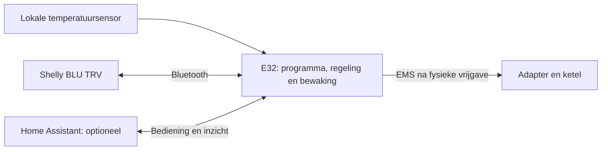

# Extra mogelijkheid: Shelly BLU TRV rechtstreeks op de E32

Onderzocht op 24 oktober 2026. **Technisch haalbaar volgens de protocoldocumentatie;
nog niet geïmplementeerd of op een echte kraan getest.** Dit is een uitbreiding
naast de bestaande HA-route. De actuele uitvoering staat uitsluitend op het
[werkbord](WORKBOARD.nl.md); dit document is het ontwerp voor uitbreiding X01.

## Wat is bevestigd?

De [gelinkte Standalone-productpagina](https://www.shelly.com/de/products/shelly-blu-trv-standalone)
noemt model SBTR-001AEU en Bluetooth. Shelly beschrijft in de
[TRV-ontwikkelaarsdocumentatie](https://shelly-api-docs.shelly.cloud/docs-ble/Devices/BLU_ZB/trv/)
rechtstreekse GATT-toegang: een gebonden BLE-client kan het temperatuurdoel
lezen/schrijven en de klepstand lezen/schrijven; klepschrijven vereist dat de
eigen automatische temperatuurregeling uit staat. Doel en gemeten temperatuur
komen ook in BTHome-advertenties voor. Alleen bakens ontvangen bestuurt de kraan niet.

Het [officiële wijzigingslog](https://shelly-api-docs.shelly.cloud/docs-ble/changelog_mg27/)
introduceert directe parameter-GATT in 1.5.0. De
[1.5.1-aankondiging](https://community.shelly.cloud/announcement/53-new-blu-trv-firmware-v151-released/)
noemt de Standalone-uitvoering afzonderlijk. Werkelijke hardwarevariant,
firmwareversie en aangeboden kenmerken moeten vóór gebruik worden vastgelegd;
geen blinde compatibiliteitsclaim voor iedere variant/versie.

**Conclusie:** de E32 kan technisch de rol van eigen Bluetooth-controller
vervullen. Een Shelly Gateway, cloud en HA hoeven dan niet in de lokale
regelketen te zitten. Dit is een ontwerpconclusie uit protocol en bestaande
E32-hardware/code, geen Shelly-certificering of geslaagde praktijkproef.

## Wat hebben we al, wat ontbreekt?

Onze E32-bron gebruikt al NimBLE-Arduino 2.5.1. De huidige
[BLE-lezer](../../src/BeaconTemperatureReader.h) scant temperatuurbakens;
de [decoder](../../src/control/BleTemperatureAdvertisement.h) ondersteunt bestaande
ATC/MJ_HT_V1-profielen, geen Shelly/BTHome-kraandriver. Pairing/bonding, een
GATT-client en de apparaatgebonden doel-/statusketen ontbreken.

In de moderne modus schakelt [HeatingController](../../src/HeatingController.h)
de oude scheduler/ketelschrijver juist uit. De huidige native sessie is afhankelijk
van een HA-lease. Een Bluetooth-kraan toevoegen maakt dat niet automatisch
autonoom. De bestaande lease langer zetten of de oude regeling tegelijk
activeren is daarom geen oplossing.

Bestaande projecten bekeken: [ESP32 Shelly BLE RPC](https://github.com/matthias-bs/esp32-shelly-ble-rpc)
als mogelijke transportreferentie, en een
[directe HA/BLE-implementatie](https://github.com/reinhard-brandstaedter/hass_shelly_blu_trv).
Die laatste vereist HA; de generieke RPC-library bewijst geen compatibiliteit
met onze TRV/firmware. Eerste voorkeur: de bestaande NimBLE-stack uitbreiden,
met de officiële kenmerken als basis. Geen extra library afhankelijk maken
zonder gerichte API-/licentie-/resourcecontrole.

## Gewenste architectuur

Onderstaande route is gepland; de huidige installatie blijft passief.

Twee expliciete bedrijfsmodi, met één eigenaar van de regeling:

| Modus | Wie bewaart het leidende programma en beslist? | Bij HA-uitval |
| --- | --- | --- |
| Bestaande HA-modus | Huidige SOURCE-/sessieketen | Bestaand begrensd uitvalgedrag behouden |
| Nieuwe lokale E32-modus | E32, met blijvend opgeslagen lokale configuratie | Lokale regeling kan doorgaan zolang eigen bronnen en veiligheidsvoorwaarden geldig zijn |

In lokale modus is HA een optionele bedienings-/weergaveclient. Geen tweede
schrijver naar dezelfde kraan en geen automatische omschakeling tussen twee
eigenaren bij een netwerkstoring. Eigendomsoverdracht trekt oude opdrachten in.
Bestaande HA-apparaten en functies blijven bestaan; HA-afhankelijke Zigbee-kranen
worden hierdoor niet ineens rechtstreeks door de E32 ondersteund.

## Ontwikkelvolgorde binnen X01

| Stap | Concrete uitbreiding | Benodigd bewijs |
| --- | --- | --- |
| X01-A | Eén Shelly op het bestaande BLE-beheer aansluiten: expliciet koppelen, identiteit/bond bewaren, alleen-lezen status en EN/NL-diagnose | Echte variant/firmware, herverbinden/herstart, advertentie versus GATT-herkomst, fout- en batterijstatus; geen regelkwalificatie uit alleen RSSI of een pakketnummer |
| X01-B | Bestaande actuatorprofielen uitbreiden met een directe BLE-adapter | Eén proefkraan zonder ketel: begrensde opdracht, oorspronkelijke deadline, passende GATT-respons, aparte actuele doel-/klep-/foutterugmelding, geen automatische herhaling na onzeker resultaat |
| X01-C | Lokale E32-eigenaar, kamerinrichting, weekprogramma en herstel aansluiten op dezelfde regelkern/supervisor | Expliciete modus, versie/readback, opslag/herstart, tijdkwaliteit, grenswaarden en bronuitval; HA uitzetten zonder automatische eigenaarswissel |
| X01-D | Begrensde integratie met ketelpad en bestaande functies | Alleen na bestaande TX-/stop-/flowvoorwaarden; HA/MQTT/WiFi/BLE/E32-uitval afzonderlijk beproeven; daarna langere stabiliteits- en schaalproef |

Eerst één kraan en het bestaande 1–2-kamerbudget. Grotere aantallen pas na gemeten
heap-, radiotijd-, responstijd- en batterijbudgetten; acht zones blijft een
productdoel. De bestaande M2-HA-route en overige roadmap verdwijnen niet. Deze
BLE-route krijgt eigen apparaat-/uitvoerbewijs en tekent de HA-keten niet af.

## Regeling, tijd en uitval

- Begin met een kamerdoel en de eigen regeling van de Shelly. De E32 coördineert
  ketelvraag; geen concurrerende dubbele PI op dezelfde klep. Procentuele
  klepsturing is een afzonderlijk profiel met eigen proef en uitschakeling van
  de interne temperatuurregelaar, niet de standaardmodus.
- Gebruik een geschikte lokale kamermeting waar nodig. Een temperatuur bij de
  radiator en een BLE-ontvangsttijd zijn geen automatische kwalificatie van een
  actuele representatieve kamermeting. Bronleeftijd en externe-sensoruitval blijven bewaakt.
- Een GATT-schrijfantwoord bewijst protocolacceptatie; klepterugmelding bewijst
  niet vanzelf waterdoorstroming. Hergebruik de bestaande afzonderlijke feiten
  voor afgiftepad, flow, DHW, grenzen en naloop.
- Programma, bonds en instellingen blijvend bewaren; geen flashwrite per scan
  of ontvangen bericht. Lokale tijd onafhankelijk van HA beoordelen. NTP kan
  zonder HA werken, maar de RTC staat nu uit: na stroomuitval zonder geldige
  tijd geen verzonnen weekprogramma. Een expliciete begrensde terugval is nodig.
- HA-Recorder, HA-automatiseringen/geofencing en een HA-weerdienst blijven HA
  nodig hebben. De verwarmingskern krijgt lokale bronnen/programma's en een
  zichtbare terugval wanneer externe gegevens ontbreken. Geen volledige
  HA-historie in E32-RAM beloven.
- Eén BLE-beheerder en begrensde verbindingen op de bestaande stack. Scannen,
  verbinden, WiFi, EMS en OTA mogen elkaar niet blokkeren. Setup stopt nu BLE;
  onderhoud/setup/update moet in lokale modus daarom expliciet veilig worden
  afgehandeld, met behoud van afgifte/naloop waar vereist.
- Bij E32-voedingsverlies kan de E32 niets meer sluiten of naar de ketel zenden.
  Gedrag van kraan, ketel en converter en de onafhankelijke stop blijven fysiek
  te kwalificeren. Direct Bluetooth omzeilt B09 niet.

R12 blijft gelden: gevalideerde leerparameters per ruimte blijvend bewaren in
de definitieve versie. Deze uitbreiding begint bij bron/actuator/eigendom;
zij start geen nieuwe F9/F10-stage vóór de bestaande M2-voorwaarden.

## English

**Planned additional capability, not installed support.** Shelly documents bonded
BLE GATT access to its BLU TRV. This makes a direct E32 controller technically
plausible; actual hardware/firmware, pairing and operation still need bench tests.

Keep the current HA mode and add an explicit local-E32 mode. Local schedules,
configuration, qualified sensors, control ownership and the existing supervisor
must work without an HA lease. HA remains optional for management in local mode;
it never becomes a concurrent writer. Existing HA-only devices and HA services
retain their dependencies.

Sequence: identify/read one device; qualify a bounded BLE actuator without a
boiler; connect local persistence/time/room control; then qualify boiler and
failure handling under existing physical gates. Reuse the installed NimBLE stack
and controller policies, with one bounded BLE owner. Test restart/bonds, stale
reports, wrong devices, radio loss, WiFi coexistence, battery/resource budgets,
power loss, safe stop and owner handover. A successful GATT write is not proof
of physical valve movement or water flow. No live scans, pairing, writes,
configuration changes or heating tests were performed for this assessment.
